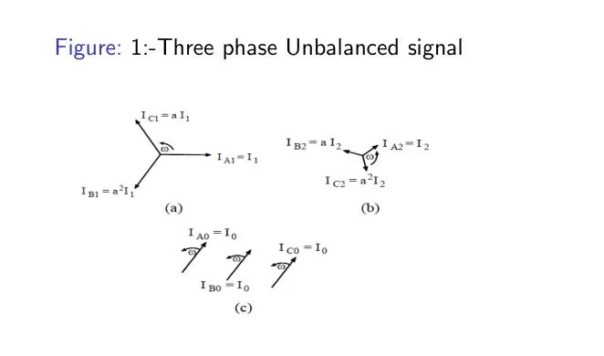
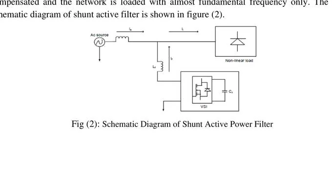
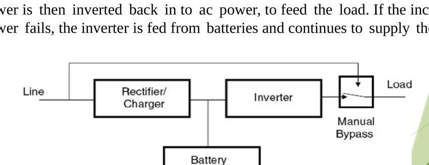
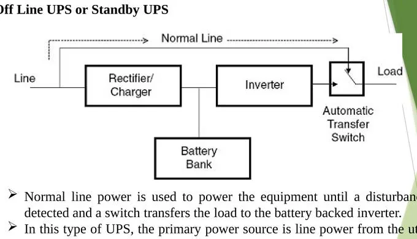
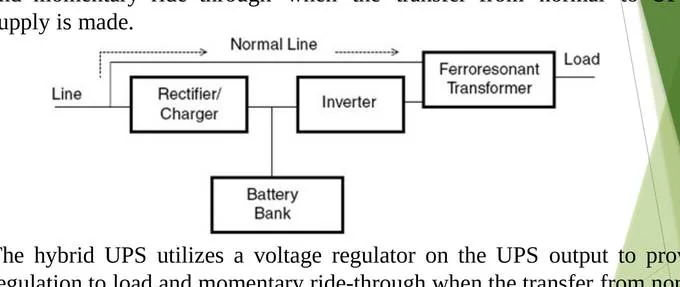
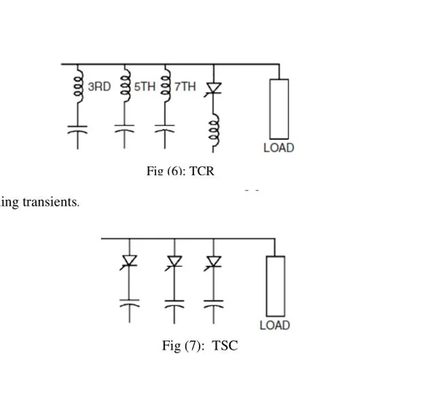
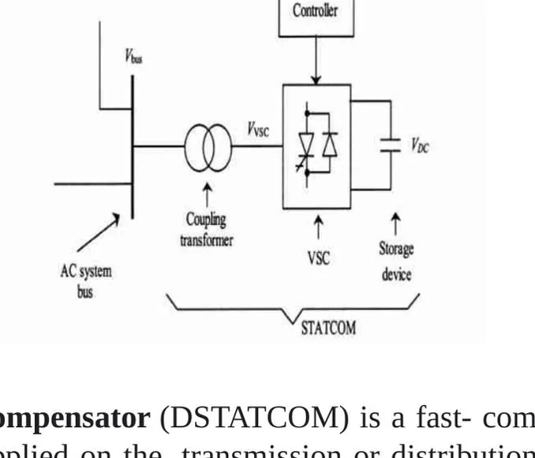
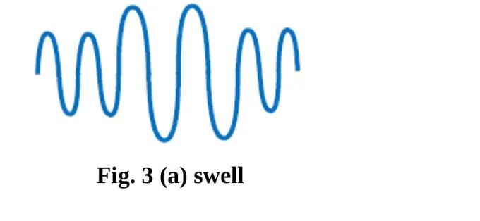
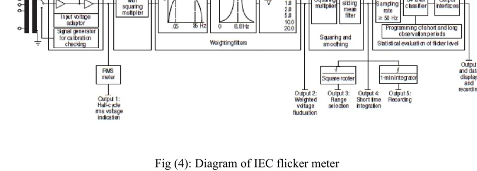
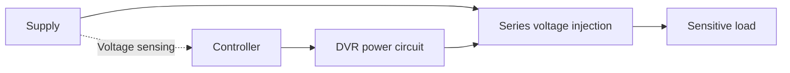

# EPQ Notes

# Electrical Power Quality — End-Sem Final Revision (21 November 2026)

**Purpose:** One exam-ready set of notes from our revision sessions, with clear explanations, formulas, simplified diagrams and solved PYQs. **Teacher's stated priority:** active/passive filters and numericals; balanced/unbalanced three-phase systems and symmetrical components; UPS, SVC and STATCOM; sag, swell and impulsive transients; power-quality monitoring, especially the flickermeter. Unit 5 is excluded. The November 2025 paper closely matches this scope.

**How to use tonight:** For each heading, learn *what it is*, *how it works*, *what diagram to draw*, and *what numerical/formula applies*. Attempt the worked questions again without looking at the answers. Detailed equipment designs, IEC filter transfer functions and long lists of monitor specifications are intentionally excluded.

---

## 1. Balanced, Unbalanced and Symmetrical Components

### Detailed explanation — balanced, unbalanced, and phase sequence

A **balanced three-phase system** has three voltage/current phasors of **equal magnitude**, with angular separation of **120°**. If the magnitudes differ or the phase angles no longer have the proper separation, the system is **unbalanced**.

A complicated unbalanced system can be resolved into **three balanced sets** called symmetrical components.

**Positive sequence (ABC):** Three equal phasors separated by 120°, in the normal A–B–C order. Taking phase A at 0°, draw B at −120° and C at +120°.

**Negative sequence (ACB):** The same phasor magnitudes and separation, but the reverse order. Taking A at 0°, draw B at +120° and C at −120°.

**Zero sequence:** All three phasors have equal magnitude and **the same angle**. Draw the arrows on top of one another.

**How to approach the numerical:** First check whether the question provides the actual three phase values or the sequence values. If actual phases are given, extract $V_0,V_1,V_2$ or $I_0,I_1,I_2$. If the components are given, reconstruct the actual phases. Use $a=1\angle120^\circ$, $a^2=1\angle-120^\circ$ and the formulas in the next subsection. You cannot add complex magnitudes or angles separately.

**Calculator method:** On your Casio fx-991ES PLUS, use CMPLX mode and degree setting. Enter each phasor in polar form, use the complex arithmetic functions, and convert the result to polar form. In the exam show the formula and substitution, not only the calculator's final number.

**What you should be able to draw:** The original phasor diagrams immediately below show all three component sets. Label A, B and C and their angles. The subsequent two worked PYQs cover both directions of transformation.

### What is a balanced three-phase system?

A balanced three-phase set has **equal RMS magnitudes** and **phase angles separated by exactly 120°**, in the expected phase order. Equal magnitudes alone do not guarantee balance. Unequal loading, faults or unequal impedances can make the voltage set unbalanced, causing negative-sequence currents and motor heating.

### Important things to know: phase sequence

- **Positive sequence (ABC):** Three equal phasors, 120° apart, in the normal A–B–C order.
- **Negative sequence (ACB):** Three equal phasors, 120° apart, in reverse A–C–B order.
- **Zero sequence:** Three equal phasors pointing in the *same* direction.
- A normally balanced, positive-sequence set contains only its positive-sequence component. An unbalanced set may have negative- and zero-sequence components.

**Phasor sketch to reproduce:** Choose phase A as 0°. For positive sequence, draw B at −120° and C at +120°; for negative sequence, swap B and C; for zero sequence, draw A, B and C coincident. Label all three.

### Formula sheet

Let $a=1\angle120^\circ$, $a^2=1\angle240^\circ=1\angle(-120^\circ)$ and $1+a+a^2=0$.

**Components → actual phase voltages:**

$
V_A=V_0+V_1+V_2,\qquad
V_B=V_0+a^2V_1+aV_2,\qquad
V_C=V_0+aV_1+a^2V_2.
$

**Actual phases → components:**

$
V_0=\frac{V_A+V_B+V_C}{3},\quad
V_1=\frac{V_A+aV_B+a^2V_C}{3},\quad
V_2=\frac{V_A+a^2V_B+aV_C}{3}.
$

For current problems, replace $V$ by $I$ throughout. **Memorise the order**: $V_1$ uses $a$ on phase B and $a^2$ on phase C; $V_2$ swaps them.

### Worked PYQ — 2020, Q1(b): reconstruct phase voltages

Given $V_0=0.6\angle90^\circ$, $V_1=1\angle30^\circ$, $V_2=0.8\angle(-30^\circ)$:

$
V_A=V_0+V_1+V_2=\boxed{1.7088\angle24.18^\circ}
$

$
V_B=V_0+a^2V_1+aV_2=\boxed{0.4000\angle90^\circ}
$

$
V_C=V_0+aV_1+a^2V_2=\boxed{1.7088\angle155.82^\circ}
$

**Method:** Substitute the phasors, perform complex additions (preferably in rectangular form), then give polar answers. Do not add magnitudes or angles separately.

### Worked PYQ — November 2025, Q3: find symmetrical currents

Given $I_A=100\angle30^\circ$, $I_B=50\angle300^\circ$, $I_C=30\angle180^\circ$ A:

$
I_0=(I_A+I_B+I_C)/3=\boxed{27.29\angle4.69^\circ\ \text{A}}
$

$
I_1=(I_A+aI_B+a^2I_C)/3=\boxed{57.98\angle43.29^\circ\ \text{A}}
$

$
I_2=(I_A+a^2I_B+aI_C)/3=\boxed{18.97\angle24.96^\circ\ \text{A}}
$

Intermediate rectangular results, useful for checking calculator entry: $I_0=27.2009+j2.2329$, $I_1=42.2009+j39.7607$, $I_2=17.2009+j8.0064$ A.

**Calculator:** Casio fx-991ES PLUS → CMPLX mode, DEG, use $\angle$ for polar entries. Verify the setting before using $120^\circ$. A final 10-mark answer should show the component formulas and substitution, not just the three values.

---

## 2. Harmonics, Voltage Distortion and Filters

### Detailed explanation — what actually happens in a filter

**What are harmonics?** In an ideal system, voltage and current are sinusoidal. Nonlinear loads, such as rectifiers, adjustable-speed drives and electronic power supplies, draw **distorted current** containing sinusoidal components whose frequencies are integer multiples of the fundamental. If the fundamental is 50 Hz, the 3rd, 5th and 7th components are 150, 250 and 350 Hz.

**Voltage distortion versus current distortion:** A nonlinear load appears approximately as a **source of harmonic currents** injected into the system. The supply network has some impedance. The harmonic currents flowing through that impedance produce harmonic voltage drops. Therefore, distorted current can cause **distorted voltage at the load**. That's the physical meaning of $V_h=I_hZ_h$.

**Passive shunt filter:** A passive filter uses components such as **resistors, inductors and capacitors**. The most important type for us is the **shunt single-tuned filter**. Its inductor and capacitor are **in series with each other**, but that whole L–C branch is connected **in parallel with the load**. At its tuned harmonic frequency, the inductor and capacitor reactances cancel, leaving **low impedance**. The unwanted harmonic current then finds it easier to flow into that branch instead of passing through the rest of the supply.

**Why is the notch in the graph useful?** In a graph of harmonic impedance against harmonic order, a **notch** means very low impedance at the selected harmonic. This helps suppress its effect. But a capacitor connected alone can interact with supply inductance and create a **parallel resonance peak** of very high impedance. Then even a moderate harmonic current may create a large harmonic voltage. A tuned filter can also create a smaller parallel resonance peak near its tuning frequency. That's why a practical filter is often tuned slightly **below** the target harmonic to allow for changes and tolerances.

**Series passive filter:** Do not confuse this with the shunt filter. A **parallel LC combination inserted in series with the load** can present high impedance to a chosen harmonic, **blocking** it. The shunt single-tuned filter provides an easy route to divert harmonic current; the series filter prevents it from passing.

**Shunt active filter:** Instead of depending on fixed L and C values, an active filter uses a **voltage-source converter/inverter** and control electronics. It injects compensating harmonic current in the **opposite direction** to the load's harmonic current. Imagine the load producing 5 A of fifth-harmonic current: the shunt APF produces approximately 5 A of opposing fifth-harmonic current, so the source current becomes much closer to a clean sine wave. It can also compensate reactive current.

**Series active filter:** A series APF is mainly concerned with **the voltage delivered to the load**. A converter and coupling transformer inject the missing or compensating voltage. For example, if the input is 190 V and the load needs 230 V, adding 40 V in phase restores 230 V. In a general AC calculation, these are phasors.

**Comparison for the exam:** Passive filters are relatively inexpensive and simple, but bulky, fixed in compensation and may cause resonance. Active filters are more expensive but respond dynamically to multiple harmonic components. Remember **shunt APF = current compensation** and **series APF = voltage compensation**.

**Diagrams:** Use the original lecture figures included alongside these topics. For the 2020 three-phase three-wire filter PYQ, draw the labelled three-phase tuned filter with its filter inductors and delta capacitor bank rather than an unlabeled generic box. Avoid memorising every high-pass design that was outside our announced scope.

### What are harmonics?

A harmonic is a sinusoidal component whose frequency is an integer multiple of the fundamental:

$
f_h=h f_1.
$

For a 50 Hz supply, the 3rd, 5th and 7th harmonics are 150, 250 and 350 Hz. **Nonlinear loads** such as rectifiers, drives and switched-mode supplies draw nonsinusoidal currents.

### Why does current distortion produce voltage distortion?

A nonlinear load acts approximately as a **harmonic-current source**. Harmonic current flowing through the supply-network impedance causes harmonic voltage drops:

$
\boxed{V_h=I_h Z_h}.
$

**Current distortion** originates mainly in nonlinear load current; **voltage distortion** arises when those currents pass through system impedance. Consequences include transformer heating/derating, malfunction of controls that sense voltage and distortion at neighbouring loads.

### Passive filters — shunt single-tuned filter

A passive filter uses **inductors, capacitors and sometimes resistors**. The standard shunt single-tuned filter is a **series L–C branch connected across the supply**, in parallel with the load.

At the tuned frequency the inductive and capacitive reactances cancel, making the branch **low impedance**. It diverts the selected harmonic current away from the upstream network.

$
\boxed{f_r=\frac{1}{2\pi\sqrt{LC}}}.
$

- **At the fundamental:** The filter's operating impedance and capacitive effect may also improve power factor.
- **At the target harmonic:** Low branch impedance diverts harmonic current.
- **Why slightly detune below the target (e.g. below the 5th)?** To allow for tolerances, drift and changes in network conditions.
- **Risk:** The filter and system impedance may create a **parallel-resonance peak** at another frequency, amplifying harmonic voltage. The filter is not universally low impedance at all frequencies.

**Graph you may need:** Horizontal axis = harmonic order; vertical axis = equivalent harmonic impedance. A capacitor-only system can show a very tall resonance peak. A tuned L–C filter produces a sharp **notch near the target harmonic**, with a possible smaller peak just below it.

**Three-phase, three-wire PYQ sketch (2020 Q2(b)):** Draw three line conductors A, B and C, show the passive filter as a shunt assembly, and label the **filter inductors** and **delta-connected capacitor bank**. For the particular delta-capacitor model used in the lecture figure, the notch order is $h_n=\sqrt{X_C/(3X_f)}$; the factor 3 arises from converting the delta capacitor bank to an equivalent star. Use this only for that circuit and definitions of $X_C$, $X_f$.

### Other passive arrangements

**Series passive filter:** A **parallel L–C resonant circuit placed in series with the line/load** can present high impedance at its tuned harmonic to block it. Do not confuse its topology with the shunt single-tuned filter.

**High-pass passive filter:** Gives unwanted higher-order harmonic currents a low-impedance route over a wider frequency band. Detailed first-/second-/third-order circuits are not needed for our announced scope.

**Limitations of passive filters:** Bulky; compensation is relatively fixed; performance depends on system impedance; possible resonance/overload.

### Active power filters

An active filter uses power electronics, normally a **voltage-source inverter/converter (VSI/VSC)**, to generate compensating electrical quantities dynamically.

**Shunt active filter — cancels harmonic current:**

The shunt APF injects harmonic current **opposite to the load's harmonic current**, so the source current becomes closer to sinusoidal. It can also compensate reactive current. Example: a 5 A fifth-harmonic load component is counteracted by approximately 5 A in opposite phase.

**Series active filter — corrects supply/load voltage:**

It injects a controlled voltage to compensate voltage harmonics, sags or swells:

$
\boxed{\mathbf V_{\rm load}=\mathbf V_{\rm supply}+\mathbf V_{\rm injected}}.
$

Example in the same phase: to maintain 230 V when the supply is 190 V, inject 40 V. In general these are **phasors**, so direction and phase matter.

| Passive filter | Active filter |
| --- | --- |
| Fixed R, L and C elements | Electronic converter and controller |
| Economical but bulkier | Flexible, dynamic, more expensive |
| Tuned to selected frequencies | Can compensate multiple changing harmonic components |
| May cause resonance | Does not rely on the same tuned passive resonance |
| Shunt tuned type diverts harmonic current | Shunt APF injects compensating current; series APF injects voltage |

**PYQ anchors:** 2020 Q2(b) asks for a tuned passive filter in a three-phase three-wire system; 2024 Q5(a) tests active filtering; November 2025 Q1(b) asks active versus passive filters with examples.

---

## 3. Harmonic Numericals, Distortion Factor and Power Factor

### Detailed explanation — why the RMS currents are different

This was one of the concepts that needed extra explanation during our revision, because **fundamental RMS**, **AC RMS** and **total RMS** are different quantities.

Suppose a current is given as $i(t)=8+15\cos(377t+30^\circ)+6\cos(754t+45^\circ)+2\cos(1131t+60^\circ)$. The numbers 15, 6 and 2 are the **peak amplitudes** of sinusoidal components, so their individual RMS currents are $15/\sqrt2$, $6/\sqrt2$ and $2/\sqrt2$. The constant term **8 A DC** has RMS value **8 A**; you must **not** divide DC by $\sqrt2$.

**Fundamental RMS current:** $15/\sqrt2$ in this example. This includes only the fundamental.

**Harmonic RMS current:** Combine just the 2nd and 3rd harmonic currents in root-sum-of-squares: $\sqrt{(6^2+2^2)/2}$. It does not include the fundamental or DC.

**Total AC RMS current:** Add the fundamental and higher harmonics by root-sum-of-squares: $\sqrt{(15^2+6^2+2^2)/2}$. It **does not include the DC term**.

**Overall RMS current:** Now include the DC contribution too: $\sqrt{8^2+(15^2+6^2+2^2)/2}$. This is the current to use in apparent power when finding **true power factor** for the supplied full waveform.

**What is THD?** Total Harmonic Distortion compares the **combined higher-harmonic RMS current** with the **fundamental RMS current**. DC is excluded. Here the common $\sqrt2$ factors cancel, giving $\sqrt{6^2+2^2}/15=42.16\%$. The phase angles of those harmonic components do not affect THD.

**What is distortion factor (DF)?** The conventional AC distortion factor is **fundamental RMS current divided by total AC RMS current**. So the result here is $15/\sqrt{15^2+6^2+2^2}=0.9214$. If you include DC in the denominator, you obtain a different ratio. That does **not** mean our AC DF was calculated incorrectly; it means the denominator now represents a different total RMS quantity.

**Real power versus apparent power:** Real power $P$ is measured in **watts**. Apparent power is $S=V_{\rm rms}I_{\rm rms}$ in **VA**. Power factor is $P/S$. Displacement power factor $\cos\phi_1$ is the cosine of the phase angle between the fundamental voltage and current, not the true PF when significant distortion exists.

In our 2020 problem, voltage contains only the fundamental. Harmonic currents and the DC current make **zero net contribution to average real power** when multiplied by the pure sine voltage over a complete cycle. So $P=(100\times15/2)\cos30^\circ=649.52$ W. But **true PF** uses the entire RMS current, including DC and harmonics, which gives about **0.6553**, not $\cos30^\circ=0.8660$.

**Power-factor correction:** Remember the power triangle: real power **P in kW**, reactive power **Q in kVAr**, apparent power **S in kVA**. A capacitor bank supplies capacitive reactive power, reducing the reactive power drawn from the source while real power remains approximately constant. In the 2024 problem, the initial apparent power was **120 kVA**, power factor was **0.65**, and the required new PF was **0.95**. First find $P=120(0.65)=78$ kW. Then compute $Q_c=P(\tan\phi_1-\tan\phi_2)=65.55$ kVAr. **kVAr means kilovolt-ampere reactive**, a unit of reactive power.

**Exam numerical method:** Given → identify peak/RMS quantities → formula → substitution → boxed result with units. The calculations and formulas below are retained in full so you can practise the same 2020, 2024 and 2025 questions again.

### Core formulas and the RMS distinction

If a current is $i(t)=I_{\rm DC}+\sum I_{h,\rm peak}\cos(h\omega t+\phi_h)$, each sinusoidal component has $I_{h,\rm rms}=I_{h,\rm peak}/\sqrt2$, while **DC RMS equals the DC magnitude**.

$
\boxed{\mathrm{THD}_I=\frac{\sqrt{\sum_{h\ge2}I_{h,\rm rms}^2}}{I_{1,\rm rms}}\times100\%}.
$

**THD excludes DC** and its numerator excludes the fundamental. Harmonic phase angles do not affect the result.

$
I_{\rm AC,rms}=\sqrt{I_{1,\rm rms}^2+\sum_{h\ge2}I_{h,\rm rms}^2}
$

$
I_{\rm total,rms}=\sqrt{I_{\rm DC}^2+I_{\rm AC,rms}^2}.
$

**Conventional AC current distortion factor:**

$
\boxed{DF=\frac{I_{1,\rm rms}}{I_{\rm AC,rms}}
=\frac{1}{\sqrt{1+(\mathrm{THD}_I/100)^2}}}.
$

Some material defines a ratio using **total** RMS (including DC); read the question's definition. These ratios differ when DC exists.

**Power definitions:** $S=V_{\rm rms}I_{\rm rms}$ (VA), $P$ is mean real power (W), $PF=P/S$, and for the *fundamental* $DPF=\cos\phi_1$. If voltage is a pure sinusoid, only the fundamental current contributes to average real power:

$
P=V_{1,\rm rms}I_{1,\rm rms}\cos\phi_1.
$

### Worked PYQ — 2020 Q4(a)

$
v(t)=100\cos377t
$

$
i(t)=8+15\cos(377t+30^\circ)+6\cos(754t+45^\circ)+2\cos(1131t+60^\circ).
$

Current components: DC = 8 A; fundamental RMS $=15/\sqrt2$ A; second-harmonic RMS $=6/\sqrt2$ A; third-harmonic RMS $=2/\sqrt2$ A.

**THD:**

$
\mathrm{THD}=\frac{\sqrt{6^2+2^2}}{15}\times100
=\boxed{42.16\%}.
$

**Real power absorbed:** The voltage contains only the fundamental, so the DC and harmonic currents contribute no average real power:

$
P=\frac{100\times15}{2}\cos30^\circ=\boxed{649.52\ \mathrm W}.
$

**Conventional distortion factor:**

$
DF=\frac{15/\sqrt2}{\sqrt{(15^2+6^2+2^2)/2}}
=\frac{15}{\sqrt{265}}=\boxed{0.9214}.
$

**True power factor including DC:**

$
I_{\rm total,rms}=\sqrt{8^2+\frac{15^2+6^2+2^2}{2}}
=\sqrt{196.5}=14.018\ \mathrm A.
$

$
PF_{\rm true}=\frac{649.52}{(100/\sqrt2)(14.018)}
=\boxed{0.6553}.
$

Compare: displacement PF $=\cos30^\circ=0.8660$; ratio of fundamental RMS to **total** RMS including DC $=(15/\sqrt2)/14.018=0.7567$. These are **not** the conventional AC distortion factor.

### Worked PYQ — November 2025 Q2(a): voltage THD

Given fundamental $V_1=120$ V and harmonics $V_3=6$ V, $V_5=4$ V, $V_7=1.5$ V, $V_9=5.5$ V (consistent RMS magnitudes):

$
\mathrm{THD}_V=
\frac{\sqrt{6^2+4^2+1.5^2+5.5^2}}{120}\times100
=\boxed{7.66\%}.
$

**Exam method:** Square only higher-harmonic magnitudes, add, take square root, divide by fundamental, multiply by 100.

### Power-factor correction — theory and 2024 PYQ

An inductive motor draws **real power** $P$ (kW) plus **reactive power** $Q$ (kVAr); the supply handles **apparent power** $S$ (kVA).

**Power triangle:**

The power triangle is defined by the adjacent formulas: horizontal real power P, vertical reactive power Q, and hypotenuse apparent power S.

$
\boxed{S^2=P^2+Q^2},\qquad PF=\cos\phi=P/S,\qquad Q=P\tan\phi.
$

A shunt capacitor supplies capacitive reactive power locally, reducing the inductive reactive power drawn from the source. Real power remains approximately constant.

$
\boxed{Q_c=P(\tan\phi_1-\tan\phi_2)},\quad
\phi_i=\cos^{-1}(PF_i).
$

**2024 PYQ:** Initial apparent power 120 kVA, PF improves from 0.65 lagging to 0.95.

$
P=120(0.65)=78\ \mathrm{kW}.
$

$
Q_c=78\left[\tan(\cos^{-1}0.65)-\tan(\cos^{-1}0.95)\right]
=\boxed{65.55\ \mathrm{kVAr}}.
$

Here **kVAr means kilovolt-ampere reactive**, a unit of reactive power. This standard correction calculation assumes the usual approximately sinusoidal power-triangle model.

---

## 4. UPS — Online, Offline and Hybrid

### Detailed explanation — follow the power supply path

**What is a UPS?** An Uninterruptible Power Supply maintains power to sensitive equipment when ordinary mains power fails or becomes unacceptable, usually using a battery for backup energy.

**Online UPS:** In normal operation, the load is **always supplied through the inverter**. Incoming AC power goes through the **rectifier/charger** to become DC. The DC feeds the inverter, which produces AC for the load, and the battery is kept charged. When mains power fails, the **battery supplies the existing inverter**, and the inverter continues feeding the load. We do **not** need a second inverter. This is why online UPS has essentially **zero battery-transfer delay**. The bypass line in the lecture figure is an alternate or maintenance route, not the normal power path.

**Offline/standby UPS:** Under normal conditions, **the mains directly supplies the load**. The charger keeps the battery charged, while the inverter normally stands by. If the mains becomes unavailable, the **automatic transfer switch** connects the load to the battery-backed inverter. The transfer requires a small amount of time, so there may be a brief interruption. This setup is simpler than online UPS but offers less continuous conditioning.

**Hybrid UPS:** A hybrid resembles standby UPS, but adds a **ferroresonant transformer** for output voltage regulation. The transformer also supplies **momentary ride-through**, helping the load continue receiving power during the brief transition from normal mains supply to battery-backed inverter supply. This is the main additional feature you correctly recalled when I asked you to identify it.

**What does momentary ride-through mean?** It means **maintaining power to the load for a very short period during a supply interruption or switching transition**. It does not mean a transformer can independently provide unlimited energy during a long outage.

**Three-way comparison:** Online = inverter always feeds the load and battery transfer is essentially instantaneous. Offline = mains normally feeds the load and switching introduces a short delay. Hybrid = standby-style operation with ferroresonant voltage regulation and momentary ride-through.

**For a 5-mark answer:** Draw the original UPS diagram, explain the normal power path, explain how it changes when mains fails, and mention its distinguishing advantage or limitation. The correct original slides are included below.

### What is UPS?

An **Uninterruptible Power Supply** keeps sensitive equipment supplied during mains disturbances or failure using backup energy, commonly batteries.

### Online UPS

**Diagram:**

**Normal:** AC → rectifier (AC to DC) → inverter (DC to AC) → load; battery is kept charged. **Power failure:** battery feeds the **same existing inverter**, so there is essentially **zero battery-transfer time**. A bypass can supply the load during maintenance, but is not the normal operating path.

### Offline / standby UPS

**Normal:** Mains directly powers the load and charges the battery; inverter stands by. **Failure:** Switch changes to the battery-powered inverter, causing a **small transfer delay**. Simpler and generally cheaper/more efficient, but provides less isolation from mains disturbances.

### Hybrid UPS

A hybrid resembles standby UPS but adds a **ferroresonant transformer/voltage regulator** at the output. It stabilises voltage and provides **momentary ride-through** during transfer (bridges a brief interruption).

| Online | Offline | Hybrid |
| --- | --- | --- |
| Inverter continuously feeds load | Mains normally feeds load | Mains normally feeds regulated output |
| Essentially zero battery-transfer time | Small transfer delay | Transformer assists the transition |
| Double conversion | Standby inverter | Ferroresonant regulation and ride-through |

**PYQ:** November 2025 Q5 tests UPS with DSTATCOM and SVC. Draw the relevant flow diagram, then explain normal and outage operation.

---

## 5. SVC, TCR, TSC and STATCOM

### Detailed explanation — understanding TCR and TSC in simple terms

An **SVC (Static VAR Compensator)** is a shunt-connected device that regulates voltage by supplying or absorbing reactive power. **When voltage decreases, it increases net capacitive compensation** to help raise it. When voltage rises, it can increase inductive reactive-power absorption to reduce it.

Forget the technical jargon for a moment. A **capacitor supplies reactive power**, while an **inductor (reactor) absorbs reactive power**. A **thyristor** is an electronic switch that controls conduction.

**TCR — Thyristor-Controlled Reactor.** Look at Figure 6 from your Unit-3 notes. It has capacitor/filter branches and a separate thyristor-controlled reactor. **Imagine the capacitors always supply 100 units of reactive power.** We don't always need the full 100 units, so the reactor absorbs some of it. If it absorbs 40 units, the net capacitive compensation is **60 units**. The thyristor changes how much current flows through the reactor; more current means greater inductive reactive-power absorption. Voltage too low? Reduce reactor absorption, leaving more capacitive support. Voltage too high? Increase reactor absorption. This offers **smooth or continuous control**.

The 3rd, 5th and 7th branches in Figure 6 are tuned capacitor–inductor harmonic filters. They can supply capacitive compensation at the fundamental and filter harmonics produced by thyristor phase-angle control.

**TSC — Thyristor-Switched Capacitor.** Look at Figure 7. Imagine three capacitor banks, each supplying **20 units**. To supply 20 units, switch **one bank ON**; for 40 units, switch **two ON**; for 60 units, switch **all three ON**. The controller switches whole capacitor banks rather than changing their output continuously. So TSC gives **stepwise compensation**, unlike smooth TCR control. Thyristors can switch at suitable points to minimise transients. When asked whether a falling voltage needs more banks ON or OFF, you correctly answered **“more on.”**

**TCR versus TSC:** TCR controls the **inductive absorption** of a reactor and can vary smoothly. TSC switches **capacitive supply** on or off in steps. Remember which component each controls and why.

**Which SVC diagram?** The Power Quality PPT slide labelled SVC showed a DC-to-AC converter — a **STATCOM-like diagram**, not the standard TCR/TSC arrangement. We deliberately replaced it with the **correct original Figure 6 and Figure 7 from Unit-3**. There is no need to memorise the enormous five-branch SVC assembly.

### STATCOM / DSTATCOM — what is actually happening?

A **STATCOM** has the same broad goal as SVC: control reactive power to regulate voltage. **DSTATCOM** is the distribution-system version, with the same fundamental operation. Unlike SVC, it uses a **Voltage-Source Converter (VSC/VSI)** connected through a **coupling transformer/reactance**, together with a **DC-link capacitor** and **controller**.

Think of the VSC as a device that **creates a controllable AC voltage**. Its voltage difference from the grid across the coupling reactance causes current flow. By controlling the converter's AC voltage, STATCOM controls reactive power.

**Case A — voltage drops.** Imagine supply falls to **200 V** from 230 V. The controller makes the converter voltage magnitude **higher than grid voltage** with the appropriate phase relationship. STATCOM then supplies **capacitive reactive power**, helping raise grid voltage.

**Case B — voltage rises.** Imagine voltage is **250 V**. The controller reduces converter voltage magnitude **below grid voltage**, causing **inductive reactive-power absorption** and helping lower the bus voltage.

The **DC-link capacitor** maintains the DC voltage needed by the converter; it is mainly an energy buffer, not a large battery. The controller maintains both **AC bus voltage** and **DC capacitor voltage**.

**SVC vs STATCOM:** SVC uses thyristor-controlled reactors and capacitors. STATCOM uses a voltage-source converter. STATCOM usually responds flexibly and gives useful reactive-current support at low voltage, within its current limit. Neither can replace stored-energy **UPS** operation during a long outage.

**2025 Q5, 10 marks:** Explain SVC, DSTATCOM and UPS separately with their original correct diagrams. SVC/STATCOM provide **reactive-voltage support**; UPS supplies **stored real energy** to keep a sensitive load running.

### What is an SVC?

A **Static VAR Compensator (SVC)** is a shunt-connected, thyristor-based compensator that adjusts net reactive power to regulate system voltage. **Low voltage → more net capacitive support; high voltage → more net inductive absorption.**

**Important correction from lecture slides:** The PPT slide labelled SVC showed a DC-to-AC converter, which is characteristic of **STATCOM**, not a conventional SVC. Use **Unit-3 Figures 6 (fixed capacitors + TCR) and 7 (TSC)** instead.

### TCR — Thyristor-Controlled Reactor

Fixed capacitors provide capacitive reactive power. A reactor (inductor) **absorbs** reactive power; the thyristor firing angle continuously changes reactor current and thus how much compensation is left.

**Memory example:** Capacitor supplies 100 units; reactor absorbs 40 → net 60 units capacitive. If voltage falls, decrease the reactor absorption to leave more capacitive support.

Phase control can create harmonics, so capacitor branches may be tuned as filters (3rd/5th/7th in the classroom diagram).

### TSC — Thyristor-Switched Capacitor

Refer to the original TCR/TSC circuits shown above; the TSC is the switched-capacitor circuit labelled Fig. 7.

Each thyristor switch turns a capacitor bank **ON or OFF**. More banks on → more capacitive reactive power supplied. Control is **stepwise**, unlike the continuously varied TCR. Proper switching minimises transients/harmonic generation.

| TCR | TSC |
| --- | --- |
| Controls reactor current | Switches capacitor banks |
| Absorbs inductive reactive power | Supplies capacitive reactive power |
| Smooth variation | Discrete steps |
| Phase control may create harmonics | Well-timed switching introduces little harmonic distortion |

### STATCOM / DSTATCOM

**STATCOM = Static Synchronous Compensator; DSTATCOM = distribution-system version.** It uses a **voltage-source converter (VSC/VSI)** and a **DC-link capacitor**, connected to the AC network via coupling reactance/transformer.

The converter generates a controllable AC voltage. A difference between converter and grid voltage across the coupling reactance determines the reactive current. With appropriate phase control:

- Converter voltage magnitude **higher than the grid** → supplies capacitive reactive power → helps raise a low bus voltage.
- Converter voltage magnitude **lower than the grid** → absorbs inductive reactive power → helps lower a high bus voltage.

The controller regulates **AC bus voltage** and **DC-link voltage**. The DC capacitor provides an energy buffer, not unlimited sustained real power.

| SVC | STATCOM |
| --- | --- |
| Controlled L/C branches, TCR/TSC | VSC with DC-link capacitor |
| Adjusts effective shunt susceptance | Controls converter voltage/current |
| Fast reactive compensation | Fast, often better low-voltage current support |
| Harmonics possible from TCR firing | Converter switching harmonics managed by control/filtering |

**Limit:** SVC/STATCOM can support voltage during some sags but cannot independently sustain a load through a long/deep supply outage without another real-energy source. Do not claim they replace a battery UPS.

**PYQ:** November 2025 Q5: explain sag mitigation with DSTATCOM, SVC and UPS. For each, draw the simple diagram, explain whether it controls reactive current or provides stored-energy support, and state the limitation.

---

## 6. Module 1 — Sag, Swell, Transients and Classification

### Detailed explanation — Module 1 as we revised it

**Transient:** A transient is a **sudden, short-lived disturbance in voltage or current**. Imagine a normal smooth sine wave. Suddenly lightning strikes or an electrical device switches; for a brief moment its waveform changes.

**Impulsive transient:** Think of it as **one sudden spike**, predominantly positive or negative, rising rapidly and disappearing shortly afterward. **Lightning** is the main example. The high peak can damage electronic equipment, stress insulation or corrupt data.

**Oscillatory transient:** Think of **several fast electrical vibrations that gradually die away**. Switching a capacitor bank can cause energy to move back and forth between inductance and capacitance. The resulting disturbance repeatedly changes polarity and its oscillations decrease in amplitude. Your answer about rapid bipolar ringing that decays over time was correct. **Impulsive = sharp one-direction spike; oscillatory = decaying alternating ringing.**

**Voltage sag:** A sag (dip) is a **temporary RMS voltage reduction to 0.1–0.9 pu**, lasting **0.5 cycle to one minute**. The supply is still present. Imagine a large motor starting: it draws **high starting current**; the network has some **impedance**; higher current causes a larger voltage drop across this impedance; therefore **less voltage reaches the load**. Causes include short-circuit faults, large-motor starting, heavy-load connection and transformer energisation. Effects include contactor drop-out, adjustable-speed drive trips, PLC malfunction and process interruption.

**Sag waveform:** Draw several normal cycles, several cycles of **lower amplitude**, and recovery to normal. If the voltage is nearly zero it suggests an interruption instead.

**Example we practised:** Voltage at **0.65 pu for 20 cycles** is a sag and means a **35% voltage reduction**. You correctly identified increased starting current and network impedance as the cause.

**Voltage swell:** A swell is a **temporary increase in RMS voltage to 1.1–1.8 pu**, lasting **0.5 cycle to one minute**. Think of it as the opposite of a sag. When a **large load disconnects**, less current is drawn, reducing the voltage drop across network impedance, so remaining loads may see a **higher voltage**. Capacitor switching and ground faults affecting unfaulted phases may also cause swell. Effects: insulation stress, overheating, data errors or equipment malfunction.

**Swell waveform:** Normal cycles → **larger amplitude** cycles → normal again. This is not a narrow transient spike.

**Example we practised:** Voltage at **1.3 pu for 15 cycles** is a swell and is **30% above normal**. Your causal explanation about lower current and reduced network voltage drop was correct.

**Magnitude–duration classification:** Two observations identify most RMS voltage events: **how much voltage remains and how long it lasts**. Remember **0.1, 0.9 and 1.1 pu** for magnitude and **0.5 cycle, 3 seconds and 1 minute** for duration. Below 0.1 pu corresponds to an interruption; 0.1–0.9 pu up to a minute is sag; over 1.1 pu up to a minute is swell; a low/high voltage condition lasting **more than one minute** is under-/over-voltage.

Interruption duration: **momentary** 0.5 cycle–3 seconds; **temporary** over 3 seconds–1 minute; **sustained** over one minute. Thus **0.75 pu for 3 minutes** is under-voltage, not sag, and **0.05 pu for 5 seconds** is a temporary interruption.

**For the exam:** Learn definitions, limits, two causes and effects, and reproduce the original sag, swell and transient waveform shapes shown below. Don't reread the unrelated midsem material.

### Sag (voltage dip)

A **voltage sag** is a reduction of RMS voltage to **0.1–0.9 pu** for **0.5 cycle to 1 minute**. Supply remains present.

**Why:** Motor starting, heavy load connection or short-circuit fault → higher line current → larger voltage drop across system impedance → lower voltage at the load. **Effects:** Contactor drop-out, ASD trips, PLC/control malfunction. **Mitigation:** DVR/series voltage injection, UPS for sensitive loads, suitable transfer or system fault improvement.

**Waveform:** Normal sine cycles → smaller-amplitude cycles for a defined interval → normal again. Not zero.

### Swell

A **voltage swell** is an increase in RMS voltage to **1.1–1.8 pu** (the upper bound depends on duration subclass) for **0.5 cycle to 1 minute**.

**Why:** Sudden disconnection of a large load reduces network current/voltage drop, or capacitor switching; a single-line-to-ground fault may raise voltage on the unfaulted phases. **Effects:** Insulation stress, overheating, control errors and component damage.

**Waveform:** Normal cycles → larger-amplitude cycles → normal.

### Impulsive vs oscillatory transients

A **transient** is a sudden short-lived departure from the steady-state waveform.

| Impulsive transient | Oscillatory transient |
| --- | --- |
| One predominant polarity, sharp spike | Polarity alternates rapidly, decaying ringing |
| Lightning is the main example | Capacitor-bank or line switching is typical |
| High peak stresses electronics/insulation | Rapid oscillations can stress equipment |
| Sketch a single narrow spike | Sketch several shrinking oscillations around the waveform |

**Simple exam sketch cues:**

### Magnitude–duration classification (memorise boundaries)

$
V_{\rm pu}=\frac{V_{\rm rms}}{V_{\rm nominal}}.
$

| Event | RMS voltage | Duration |
| --- | --- | --- |
| Sag | 0.1–0.9 pu | 0.5 cycle–1 min |
| Swell | 1.1–1.8 pu (duration-specific upper limits) | 0.5 cycle–1 min |
| Under-voltage | Below 0.9 pu, above interruption range | More than 1 min |
| Over-voltage | Above 1.1 pu | More than 1 min |
| Momentary interruption | Below 0.1 pu | 0.5 cycle–3 s |
| Temporary interruption | Below 0.1 pu | >3 s–1 min |
| Sustained interruption | Nearly zero | More than 1 min |

For a classification chart: magnitude on vertical axis; duration horizontal; mark **0.1, 0.9 and 1.1 pu**, plus **0.5 cycle, 3 s and 1 min**.

**Examples:** 0.65 pu for 20 cycles → **sag**; 35% voltage lost. 1.3 pu for 15 cycles → **swell**; 30% above normal. 0.75 pu for 3 min → **under-voltage**, not sag. 0.05 pu for 5 s → **temporary interruption**.

### Sag mitigation recap

- **DVR / active series compensator:** Injects missing voltage in series; $\mathbf V_{\rm load}=\mathbf V_{\rm source}+\mathbf V_{\rm injected}$.
- **Static/fast transfer switch:** Transfers to a healthy second source; requires that source.
- **Online/offline UPS:** Uses stored energy to continue supplying load.
- **SVC/STATCOM:** Reactive compensation supports bus voltage.
- **Ferroresonant constant-voltage transformer:** Conditions voltage using saturated core and resonant capacitor.

---

## 7. Power Quality Monitoring — Definition, Purpose and Architecture

### Detailed explanation — monitoring basics without memorising every paragraph

**Power quality monitoring is the process of gathering, analysing and interpreting voltage/current measurements to identify disturbances and understand electrical-system performance.**

Suppose a factory machine suddenly shuts down. A monitoring system can record supply voltage and reveal whether a **sag, swell or transient** happened at that moment. It converts raw measurements into useful information: **Measure → Collect → Analyse → Interpret**.

**Why is monitoring useful?** Industrial equipment is sensitive to voltage disturbances: a contactor might drop out, a drive could trip, or a controller might reset, leading to production losses. Monitoring helps **detect problems, identify causes, protect equipment and improve system performance**. You can explain these purposes in your own words.

**What are monitoring considerations?** Think of the decisions before installing a monitor: **Why** monitor (objective)? **What equipment** is needed? **When** should an event trigger recording (triggering threshold)? **Where** should data be stored? **How** will it be analysed? A **triggering threshold** is the preset limit at which an event is detected or recorded.

**Five objectives, low-priority memory aid:** **Performance, Problems, Service, Maintenance, Survey**. These correspond to understanding normal performance, investigating an existing problem, verifying promised service, predicting failures and surveying a facility's wiring/conditions. You understood these even though you didn't want to memorise all five by heart.

**Proactive vs reactive:** Proactive monitoring measures the normal system routinely so it is easier to recognise abnormalities. Reactive monitoring begins after a particular problem to investigate its cause.

**Major monitoring subsystems:** Instrument/sensor measurement → event detection and data acquisition → data storage → communications → analysis, interpretation and reports. The original monitoring-system figure is below. In the **2020 PYQ**, PQ monitoring differs from general data acquisition because it is designed to catch **electrical disturbances of varied frequencies and durations**, not merely log ordinary signals.

**Duration of monitoring:** There is **no fixed universal duration**; it depends on the objective and how often disturbances occur. Frequent recurring problems may suit **short-term monitoring**. Rare, unpredictable sags require **long-term or continuous monitoring** — exactly what you answered in our quick check.

**Online vs offline analysis:** Online means processing measurements promptly for timely warnings; offline means analysing stored records later. We intentionally deprioritised long descriptions, seven-point site surveys and equipment specifications so we could focus on instruments and flickermeter.

### What is PQ monitoring?

**Power-quality monitoring is continuous or periodic measurement, collection, analysis and interpretation of voltage/current data to identify power-quality disturbances and assess system performance.**

**Why industries care:** Voltage events can trip drives, reset PLCs, damage equipment, corrupt data and cause production stoppages far longer than the actual disturbance. Monitoring lets them diagnose causes, protect sensitive processes and verify improvements.

**Monitoring considerations (explain in your own words):** Why to monitor (objective), what to use (instrument), what triggers an event (threshold), where to store the data and how to analyse it. There is no need to memorise lengthy site-survey checklists.

**Monitoring objectives, backup list:** Characterise normal performance; investigate specific problems; verify service quality; support predictive maintenance; survey a facility. Proactive = routine characterisation; reactive = investigate after a problem.

### Major subsystems — 2020 PYQ Q3(a)

1. **Measurement** observes voltage and current through suitable sensors/instruments.
2. **Acquisition/triggering** samples the signal and identifies events that cross configured thresholds.
3. **Storage** keeps event magnitude, duration and optionally waveforms.
4. **Communications** moves records to a database or central monitoring system.
5. **Analysis/reporting** identifies the disturbance and helps determine remedies.

**How PQ monitoring differs from general data acquisition:** PQ monitoring is specialised for electrical disturbances of very different durations and frequencies; it includes disturbance/event detection, relevant waveforms, harmonic analysis and power-quality reporting, beyond simply logging ordinary signals.

### Duration of monitoring — November 2025 Q1(e), 2 marks

There is **no universal fixed duration**. It depends on purpose, disturbance frequency and whether monitoring covers representative operating conditions. Short-term monitoring may diagnose a frequent recurring problem; long-term or continuous monitoring suits rare unpredictable events, trends and permanent performance assessment.

**Online vs offline analysis — low priority:** Online = data processed promptly for timely alerts; offline = data stored and examined later for historical patterns. No further details needed.

---

## 8. PQ Measurement Instruments — 2025 Q4(a), 5 marks

### Detailed explanation — each instrument as we studied it

The **November 2025 Q4(a)** asks for the instruments used for power-quality monitoring, with brief descriptions. We studied each one for its **actual function**, not by memorising long technical specifications.

**1. Wiring and grounding testers.** Many power-quality problems arise from incorrect wiring and grounding. These instruments identify **open or faulty wires, neutral–ground problems, incorrect/reversed connections**, and excessive grounding impedance. Some three-phase devices also check phase rotation. For the exam, explain the purpose and give two such examples; don't memorise the entire list of test capabilities.

**2. Multimeters.** A multimeter measures **voltage, current and resistance**. In a three-phase installation, it can check phase-to-phase, phase-to-neutral, phase-to-ground and neutral-to-ground voltages, and phase and neutral currents. It helps identify abnormal voltages and circuit loading. We discussed **peak method, averaging method and true RMS method**: peak and averaging methods calibrated for sinusoids can be misleading for distorted waveforms, whereas a **true RMS meter** gives a more reliable effective RMS measurement within its ratings.

**3. Oscilloscopes.** An oscilloscope displays **voltage/current waveforms against time**. Engineers can actually see distortion, transient spikes, variations and waveform shape. Digital oscilloscopes can **store the waveforms** for later analysis. You need not memorise details about handheld versions or computer software.

**4. Disturbance analyzers.** A disturbance analyzer is specifically designed to **detect, record and analyse power-quality disturbances** such as sags, swells, transient overvoltages, interruptions and under-/over-voltage. It monitors electrical conditions and can begin recording when a preset **triggering threshold** is crossed. It records magnitude, duration and sometimes waveform information.

There are **two important types**. **Conventional analyzers** record summary information such as an event's magnitude and duration. **Graphics-based analyzers** capture the **actual voltage/current waveform**. A graphical recording is particularly useful for an **oscillatory transient** because it shows rapid bipolar ringing and decaying oscillations, which a conventional peak-and-duration summary may fail to describe. You explained this difference correctly in our question.

**5. Harmonic and spectrum analyzers.** A harmonic analyzer identifies the harmonic frequency components of voltage and current, computes **THD**, and may display a frequency spectrum or bar graph. Some instruments use **FFT**. We only need to recognise the three categories: **simple meters** (quick checks), **general-purpose spectrum analyzers** (many signal types), and **special-purpose power-system harmonic analyzers** (detailed electrical analysis). Skip detailed sampling requirements and K-factor calculations.

**6. Flickermeters.** A flickermeter measures **flicker severity** caused by voltage fluctuations, including the sensitivity of a lamp and the human eye–brain system. Its special five-block mechanism is treated fully in the next section.

**7. Combination disturbance and harmonic analyzers.** These combine the monitoring and recording of disturbances with **harmonic/THD analysis** in one instrument, often with graphical outputs and storage.

**8. Energy monitors.** These measure and log energy consumption and related power quantities for ongoing monitoring.

**Your mind-map recall was strong:** You independently named **wiring and grounding testers, multimeters, oscilloscopes, disturbance analyzers, harmonic analyzers and flickermeters**, with the correct functions. You even remembered conventional versus graphical disturbance analyzers and all five flickermeter blocks. For the written exam, expand each mind-map label into **one or two complete sentences**.

**For the separate five-mark disturbance-analyzer question**, write the definition, disturbances detected, threshold-based operation, the two types and their difference. The shape and polarity changes visible in a graphical trace are especially relevant when explaining oscillatory transients.

**The exam strategy:** Write six to eight names, each with one accurate function. Six carefully described instruments are better than copying unrelated technical specifications.

| Instrument | What to write |
| --- | --- |
| **Wiring and grounding tester** | Finds open/wrong neutral or ground connections, reversals and grounding faults/impedance issues. |
| **Multimeter** | Measures voltage, current, resistance; helps check phase–phase, phase–neutral, phase–ground, neutral–ground voltages and phase/neutral currents. |
| **Oscilloscope** | Displays voltage/current waveforms against time, revealing spikes and distortions; digital versions can store traces. |
| **Disturbance analyzer** | Detects and records sags, swells, over/under-voltage, transients and interruptions, often using thresholds. |
| **Harmonic or spectrum analyzer** | Measures harmonic component magnitudes/frequencies, frequency spectrum, THD and often PF. |
| **Flickermeter** | Measures severity of light flicker resulting from voltage fluctuations, taking human perception into account. |
| **Combination disturbance/harmonic analyzer** | Combines event monitoring and harmonic/THD analysis in one instrument. |
| **Energy monitor** | Records energy consumption and related electrical measurements. |

**Multimeter caveat:** Peak ÷ $\sqrt2$ and average-responding RMS-calibrated methods assume a sinusoid; **true RMS** measurement is preferred for distorted currents because it measures effective heating value within meter limits.

### Disturbance analyzer — November 2025 Q6(c), 5 marks

A disturbance analyzer continuously measures electrical quantities and records disturbances when preset **triggering thresholds** are crossed. It stores magnitude and duration and may record waveforms.

**Two types:**

- **Conventional:** Records summary details — sag/swell magnitude, duration, surge peak, interruption time.
- **Graphics-based:** Records the **actual waveform**, revealing an impulsive spike or the alternating, decaying ringing of an oscillatory transient. This is important because a peak and duration alone cannot show transient shape.

**For a 5-mark short note:** Definition, working in 3 steps (monitor → threshold/event → store/analyse), two types and one reason graphical recording is valuable.

### Harmonic analyzers — important but brief

They measure individual harmonics and THD, often using FFT/spectrum analysis; simple meters make quick checks, general-purpose spectrum analyzers analyse frequency content, special-purpose power-system analyzers are designed for detailed electrical harmonics. No need to memorise K-factor/TIF or sampling-rate specifications.

---

## 9. IEC Flickermeter — Five-Block Answer (2025 Q6(b))

### Detailed explanation — the five blocks, with enough material for 5 marks

A **flickermeter is an instrument used to measure the severity of voltage flicker** caused by fluctuations in supply voltage. When voltage fluctuates, lamp brightness can change noticeably. A flickermeter processes the voltage signal while considering the response of the **incandescent lamp and human eye–brain system**.

**Why does the human eye–brain response matter?** Different fluctuation frequencies cause different levels of perceived flicker even if their voltage magnitudes are the same. So we need to measure not merely the electrical fluctuation but **how noticeable the visible flicker is to a person**. This is exactly the point you made in your answer to the Block 3 question.

**Block 1 — Input Voltage Adapter.** Adjusts the incoming voltage to a suitable reference level. This allows flicker measurement to respond to **percentage voltage fluctuations**, rather than depending only on the absolute supply voltage.

**Block 2 — Squaring Demodulator.** Squares the voltage waveform to separate the low-frequency voltage fluctuation (modulating signal) from the normal power-frequency waveform (carrier). It also helps represent the response of an incandescent lamp to voltage changes.

**Block 3 — Weighting Filters.** Removes unwanted frequency components produced by demodulation. It weights the remaining fluctuation signal according to the lamp and **human eye–brain sensitivity**, because different frequencies produce different amounts of perceived flicker.

**Block 4 — Squaring and Smoothing.** Squares the weighted signal to model nonlinear flicker perception. A sliding-mean/smoothing filter produces an **instantaneous flicker-level indication**.

**Block 5 — Statistical Analysis.** Examines instantaneous flicker levels over time. Their statistical distribution is used to assess overall flicker severity.

**Easy memory sequence:** **Adapt → Extract → Weight → Smooth → Analyse**.

We originally wrote very short descriptions, but you pointed out they might be **too little for a five-mark answer**. So we expanded the definition and each block to **one or two meaningful sentences**. That is the version to prepare.

**Diagram choice:** The original IEC block figure is included below. You do **not** need to memorise all internal curves, calibration circuits, filter frequency settings, transfer functions and output connections. For the five-mark short note, a **simplified five-box diagram** with the full block names and explanations is an efficient answer. You accepted that a question explicitly demanding a *detailed* diagram could cost some diagram-specific marks, but that memorising the entire internal schematic was not worth the time for this exam.

### What is a flickermeter?

A **flickermeter** measures the severity of **voltage flicker** — perceived variations in lamp brightness caused by voltage fluctuations. Its weighting considers how an incandescent lamp and human eye–brain system respond to different fluctuation frequencies.

### Exam-ready diagram

### Working principle — two meaningful sentences per block

**Block 1 — Input voltage adapter.** Adjusts/scales the input to a suitable internal reference so the instrument can evaluate **percentage fluctuations**, rather than being controlled by the nominal carrier-voltage level. It also supports input conditioning.

**Block 2 — Squaring demodulator.** Squares the input waveform to extract the lower-frequency voltage fluctuation (modulating signal) from the normal power-frequency voltage. This imitates the way lamp brightness depends on voltage.

**Block 3 — Weighting filters.** Removes unwanted frequency terms from the demodulation stage and weights the remaining signal. The weighting reflects different sensitivities of the incandescent lamp and eye–brain system to different flicker frequencies.

**Block 4 — Squaring and smoothing.** Squares the weighted signal to model nonlinear flicker perception. A smoothing/sliding-mean filter produces an **instantaneous flicker-level indication**.

**Block 5 — Statistical analysis.** Analyses the instantaneous flicker-level values over time, using their statistical distribution. This provides an assessment of overall flicker severity.

**Memory sequence:** **Adapt → Extract → Weight → Smooth → Analyse.**

**Diagram decision:** For the 5-mark *short note*, the clearly labelled five-block diagram plus the functions above is an efficient answer. The lecture's complex IEC figure includes internal filters, calibration and multiple outputs; reproduce those only if explicitly required and you have spare time. If the examiner specifically demands a *detailed* IEC diagram, the simplified version may lose diagram-specific marks.

**Skip for our scope:** IEEE flicker curves, FFT-based flicker measurement comparison, transfer functions and detailed statistical equations.

---

## 10. Ferroresonance Transformer — 2025 Q4(b), 5 marks

### Detailed explanation — ferroresonance is not the same as a ferroresonant transformer

**Ferroresonance** is a nonlinear resonance involving **capacitance and an iron-core inductance**. Because the iron core can **saturate**, its magnetising behaviour changes with operating conditions. In an unintended electrical network, this effect may create dangerously high voltages, currents and irregular waveforms. Your midsem notes also described a series RLC analogy.

But **November 2025 Q4(b)** specifically asks for a **ferroresonance/ferroresonant transformer**, also known as a **Constant Voltage Transformer (CVT)**.

A **ferroresonant transformer** is a voltage-regulating transformer that deliberately uses **a saturated magnetic core** and **a resonant capacitor/winding arrangement** to maintain a nearly constant output voltage despite variations in input voltage.

**How it works:** (1) An iron core is designed to operate in the saturation region. (2) A capacitor interacts with a suitable transformer winding to form a resonant circuit. (3) The saturated core and resonance help stabilise the voltage reaching the load. (4) Sensitive equipment therefore receives a relatively stable voltage within the transformer's operating limits.

Think of it as a **passive voltage stabiliser**. It can also form the voltage-regulating part of a **hybrid UPS**, where its ability to maintain output briefly helps with **momentary ride-through** during switching.

**Important distinction:** Unwanted ferroresonance is **dangerous** because it can create excessive voltages or currents. A ferroresonant transformer deliberately uses **controlled saturated-core and capacitor resonance** for useful voltage regulation. Do not confuse these in the exam.

**Five-mark answer:** Definition → two main features (**saturated core and resonant capacitor**) → how the output remains nearly constant → one or two applications. You answered the two-feature recall question correctly. The original transformer diagram remains below; you don't need the complicated RLC derivation for this PYQ.

### What it is

A **ferroresonant / constant-voltage transformer (CVT)** is a passive voltage-conditioning transformer that uses a **deliberately saturated magnetic core** and a **resonant capacitor/winding arrangement** to keep output voltage nearly constant as input varies within its operating limits.

### Working

1. Transformer iron core is designed to operate in saturation, making its magnetic behaviour nonlinear.
2. A capacitor interacts with a designated winding to form a resonant arrangement.
3. The saturated-core and capacitor system stabilises the voltage delivered to the load.
4. It helps protect sensitive equipment from moderate supply variations and some sags, subject to its rating and operating range.

**Simplified conceptual diagram:**

**Distinction:** Unwanted **ferroresonance** in a power network can produce dangerous voltages and currents. A **ferroresonant transformer** deliberately uses a controlled version of the effect for regulation. No series-RLC derivation is needed for the 2025 short theory question.

---

## 11. Exact PYQ Targets and Last-Minute Checklist

### How to revise what we've studied

You've learned most of this material through explanations and recall, so the final step is **retrieving it without the notes**. Completing the syllabus isn't the same as reproducing formulas, diagrams and structured answers under exam conditions.

For a **five-mark theory question**: State what the concept or device is, explain its working in complete but concise statements, draw the correct labelled diagram when useful, and finish with applications or important limitations. For a **ten-mark comparison**: Explain each device separately and compare the mechanisms. For a **numerical**: Write **Given → Formula → Substitution → Boxed answer with unit**.

**Most important practice tonight:** The November 2025 symmetrical-component numerical; the 2020 harmonic THD/DF/true PF numerical; the 2024 capacitor kVAr correction; passive and active filter configurations; online/offline/hybrid UPS paths; TCR vs TSC; STATCOM; and the **five-block flickermeter**.

**What we deliberately skipped:** The complicated internal IEC flickermeter diagram, detailed frequency-weighting transfer function, exhaustive instrument specifications, site-survey lists, high-pass filter topology design and the misleading SVC presentation slide. These are not worth displacing the explicitly announced material during final exam preparation.

### November 2025 end-sem paper — direct mapping

| Question | What you should reproduce |
| --- | --- |
| Q1(a) PQ monitoring and industrial concern (2) | Section 7 definition + why failures matter |
| Q1(b) active vs passive filters (2) | Section 2 comparison + shunt examples |
| Q1(c) sources of sags and interruptions (2) | Faults/motor starting for sag; faults, protective switching or supply failure for interruption |
| Q1(d) motor starting methods (2) | **Low-priority backup:** direct-on-line, star–delta, autotransformer, soft starter, VFD |
| Q1(e) duration of monitoring (2) | Section 7: depends on objective and event frequency |
| Q2(a) harmonic THD numerical (5) | Section 3: **7.66%** |
| Q2(b) increased voltage and its causes (5) | Section 6: swell vs over-voltage; load disconnection/capacitors/fault |
| Q3 unbalance and symmetrical components (10) | Section 1: **27.29∠4.69°, 57.98∠43.29°, 18.97∠24.96° A** |
| Q4(a) PQ instruments (5) | Section 8: six names + what each measures |
| Q4(b) ferroresonance transformer (5) | Section 10: saturated core + resonant capacitor |
| Q5 DSTATCOM, SVC and UPS (10) | Sections 4–5: diagrams, operation and comparisons |
| Q6(a) transient overvoltage (5) | Section 6: impulsive/oscillatory, causes, effects, sketch |
| Q6(b) flickermeter (5) | Section 9: five-block answer |
| Q6(c) disturbance analyzer (5) | Section 8: conventional vs graphics-based |

**Earlier repeated PYQs:** 2020 Q1(b) sequence reconstruction; 2020 Q2(b) tuned passive filter (3-phase 3-wire); 2020 Q3(a) PQ monitoring subsystems versus ordinary data acquisition; 2020 Q4(a) DC + harmonic current calculation; 2024 Q2(a) 120 kVA power-factor correction; 2024 Q5(a) active filter theory; 2024 instrument list. These are covered above.

### Exam answer templates

- **5-mark theory:** Definition (1–2 sentences) → working in short numbered points → relevant **simple labelled diagram** → important effect/advantage/limitation.
- **10-mark comparison:** Define both devices → separate correct circuits → operation under normal and disturbed conditions → a comparison table.
- **Numerical:** Given → formula → substitution → calculation → **boxed result with units**. For polar problems show your $a$ operator and component equations.

### Final self-test — answer without notes

- [ ] Distinguish positive, negative and zero sequences; write all six component formulas.
- [ ] Solve the **2025 Q3** current-component numerical once on your calculator.
- [ ] Draw and explain shunt tuned passive filter, shunt APF and series APF.
- [ ] Explain why nonlinear current distorts voltage and why an impedance notch suppresses harmonics.
- [ ] Compute THD for **2025 Q2(a)** and THD, DF, true PF for **2020 Q4(a)**.
- [ ] Derive $Q_c=P(\tan\phi_1-\tan\phi_2)$ and get **65.55 kVAr**.
- [ ] Draw online, offline and hybrid UPS power paths.
- [ ] Explain TCR vs TSC and SVC vs STATCOM without confusing their diagrams.
- [ ] State sag/swell voltage and duration limits, and draw transient sketches.
- [ ] Name six monitoring instruments with one function each.
- [ ] Write the **five IEC flickermeter blocks in order** and explain each in two sentences.
- [ ] Give a 5-mark disturbance-analyzer answer and explain the CVT's saturated-core/capacitor principle.

**Priority if time is short:** 2025 Q3 numerical → 2020 harmonic/DF numerical → filter and compensator diagrams → flickermeter → instruments → UPS → Module 1 quick classification. No need to reread the unrelated parts of the old midsem document.

---

# Electrical Power Quality — Midsem Notes

Study **Priority 0 first**, followed by the reliability numerical and the remaining **Priority 1** theory. Then prepare the repeated **Priority 2** applications and remedy table. **Priority 3** is kept short for the older-paper questions.

## Priority 0 — Topics explicitly emphasized by Sir

### 1. Introduction to power quality

An electrical supply must do more than deliver energy: it must allow the connected equipment to work correctly. A short voltage disturbance may reset a controller or trip a drive, stopping a production process even though the supply returns almost immediately. **Power quality (PQ)** therefore concerns both the electrical supply and the response of the equipment using it.

Modern systems contain many power-electronic devices, such as adjustable-speed drives, computer power supplies, UPS systems and renewable-energy converters. A **nonlinear load** draws current that does not follow the applied voltage proportionally. Thus, even a sinusoidal voltage can produce distorted current containing harmonics.

Solid-state equipment creates a two-sided problem: it can introduce distortion into the system and can itself be sensitive to disturbances. Microprocessors, computers, digitally controlled machines and industrial controls particularly need suitable voltage and continuity of supply.

PQ matters throughout transmission, distribution and utilization. Faults and switching in the network can disturb consumer voltage, while a customer’s nonlinear or rapidly varying load can affect other consumers through the common supply. The practical consequences include equipment malfunction, heating, data loss, production loss and reduced equipment life.

### 2. Power quality, voltage quality, current quality and PCC

**Power quality is the interaction of electrical power with equipment that determines whether the power is fit for the consumer’s devices.** It can also be described through deviations of voltage or current from the normal sinusoidal waveform. Together, these descriptions connect the electrical disturbance with its practical consequence.

| Term | Meaning |
| --- | --- |
| **Voltage quality** | How closely the supplied voltage follows the required waveform and operating conditions. It describes the quality of the utility’s delivered electrical product. |
| **Current quality** | How closely the current follows an ideal sinusoidal waveform. Nonlinear loads can draw poor-quality current even from a good-quality voltage supply. |
| **Continuity of supply** | The ability to provide satisfactory service nearly continuously, with few interruptions over time. |
| **Point of Common Coupling (PCC)** | The common connection point in the supply network shared by multiple consumer loads. Disturbances from one load can propagate through this point to others. |

Voltage quality and continuity are related but different. A supply can remain connected throughout a voltage sag, yet its voltage may be unsuitable for a sensitive load. Conversely, an interruption is a direct failure of continuity.

For voltage-event definitions, **RMS voltage** represents the effective AC voltage. **Per-unit voltage (pu)** expresses this relative to nominal voltage:

$$
V_{\mathrm{pu}}=\frac{V_{\mathrm{RMS}}}{V_{\mathrm{nominal}}}.
$$

Both voltages use the same units. Thus, 1 pu is nominal voltage and 0.7 pu means **70% voltage remaining**, equivalent to a 30% reduction.

### 3. Impulsive and oscillatory transients

A **transient** is a sudden, non-power-frequency change in the steady-state voltage or current. It is a brief disturbance superimposed on the normal waveform, commonly associated with lightning or switching.

An **impulsive transient** has one predominant polarity: a sharp positive or negative excursion with a very fast rise and short duration. Lightning is the main example. Other causes include inductive-load switching, utility fault clearing, electrostatic discharge and poor grounding. The high peak can damage electronic components or corrupt stored data.

An **oscillatory transient** alternates in polarity about the undisturbed waveform. System inductance and capacitance exchange stored energy after a switching event, producing a rapidly oscillating disturbance that decays as energy is dissipated. Capacitor-bank, line and inductive-load switching are common causes. Its frequency is associated with the circuit’s natural response, rather than necessarily being a multiple of the supply frequency.

Oscillatory transients can also damage equipment, corrupt data and reduce equipment life. The essential difference is the **shape and polarity of the transient component**.

| Impulsive transient | Oscillatory transient |
| --- | --- |
| Predominantly unidirectional. | Alternates in positive and negative directions. |
| A sharp spike with rapid rise and decay. | A burst of ringing with a decaying envelope. |
| Lightning is a representative cause. | Capacitor or line switching is a representative cause. |

**Waveforms:** Draw voltage against time with a normal sine wave as reference. For an impulse, add one narrow, tall spike and label its peak and short duration. For an oscillatory transient, add several rapid oscillations around the normal waveform with decreasing amplitude. The impulse may be negative as well as positive.

### 4. Voltage sag

A **voltage sag**, or voltage dip, is a temporary reduction in RMS voltage to **0.1–0.9 pu**, lasting **0.5 cycle to 1 minute**. The supply remains present, but its voltage falls below the normal operating level.

A sag commonly starts when the current drawn from the network suddenly increases. Because the supply network has impedance, the increased current produces a greater voltage drop before the load:

$$
\text{Fault or large starting current}
\rightarrow \text{greater network voltage drop}
\rightarrow \text{lower load voltage}.
$$

Typical causes are short-circuit faults, large-motor starting, sudden connection of a heavy load and transformer energization. During a line-to-ground fault, the sag may continue until protective equipment clears the fault. Even a refrigerator or air-conditioner starting can cause a local sag.

Contactors may drop out, adjustable-speed drives (ASDs) may trip, and programmable logic controllers (PLCs) or process controls may malfunction. The resulting production loss can last much longer than the electrical disturbance.

**Waveform:** Draw normal sinusoidal voltage, several cycles of smaller amplitude, and recovery to normal. Label the remaining RMS voltage and sag duration. Keep the sine wave visible during the sag; a nearly flat zero-voltage interval represents an interruption.

### 5. Under-voltage and its difference from sag

**Under-voltage** is a reduction of the power-frequency AC voltage below **90% of nominal for more than 1 minute**. It is a sustained low-voltage condition; “brownout” is an older term.

Heavy loading and inadequate voltage regulation can maintain a large network voltage drop. Under-voltage may also follow load switching, faults or capacitor de-energization. The classification depends on how long the reduced voltage persists, rather than on the cause alone.

Motors may heat and incur increased losses, while nonlinear loads such as computer power supplies may fail to operate. A persistent condition calls attention to the supply, loading or equipment configuration.

| Voltage sag | Under-voltage |
| --- | --- |
| 0.1–0.9 pu remaining voltage. | Below 0.9 pu, excluding the near-zero interruption condition. |
| 0.5 cycle to 1 minute. | More than 1 minute. |
| Commonly a fault or starting-current event. | A sustained loading or regulation problem. |

For an under-voltage sketch, extend the reduced-amplitude portion beyond the one-minute boundary.

### 6. Voltage swell

A **voltage swell** is a temporary increase in RMS voltage to **1.1–1.8 pu**, lasting **0.5 cycle to 1 minute**. The upper magnitude depends on the duration subclass.

A sudden reduction in load reduces the voltage drop in the supply network and can raise the load voltage. Large-load disconnection and capacitor switching are therefore common causes. A single-line-to-ground fault can also cause a temporary voltage rise on the unfaulted phases. A high-impedance neutral is another possible cause.

The increased voltage stresses insulation, semiconductors and power-supply components. It may cause data errors, control problems, overheating or equipment shutdown. Repeated exposure can gradually degrade insulation and contacts.

| Swell subclass | RMS magnitude | Duration |
| --- | --- | --- |
| Instantaneous | 1.1–1.8 pu | 0.5–30 cycles |
| Momentary | 1.1–1.4 pu | 30 cycles–3 s |
| Temporary | 1.1–1.2 pu | 3 s–1 min |

**Waveform:** Draw several cycles of increased sinusoidal amplitude between normal-voltage portions. Label the elevated RMS voltage and event duration. A swell lasts across cycles; it is not a narrow transient spike.

### 7. Over-voltage and its difference from swell

**Over-voltage** is a power-frequency AC voltage above **110% of nominal for more than 1 minute**. It is a sustained high-voltage condition.

Incorrect transformer tap settings can maintain excessive voltage. A setting that compensates for heavy-load voltage drop may produce over-voltage after much of the load is disconnected. Capacitor energization can also raise the voltage.

The consequences include insulation and component stress, overheating, nuisance breaker operation and appliance damage.

| Voltage swell | Over-voltage |
| --- | --- |
| A short increase above 1.1 pu. | A sustained increase above 1.1 pu. |
| 0.5 cycle to 1 minute. | More than 1 minute. |
| Often associated with switching or an unfaulted phase during a fault. | Often associated with tap settings, light loading or sustained regulation problems. |

The waveform shape is similar, but the elevated-amplitude region of an over-voltage lasts beyond one minute.

### 8. Voltage fluctuation and flicker

**Voltage fluctuation** is a systematic or random variation of the voltage envelope caused by changing load demand. The envelope describes how the amplitude of the underlying AC waveform changes with time.

Typical voltage fluctuations are small variations of approximately **95–105% of nominal**, usually at an envelope frequency **below 25 Hz**. This is the rate of amplitude variation; it does not mean that a 50 Hz supply has become a 25 Hz supply.

Rapid changes in real and reactive power produce changing current and hence changing network voltage drop. **Arc furnaces** are a major example. Arc welders, frequent motor starts, cyclic motor drives and large speed changes can produce similar effects.

**Flicker is the visible variation in lamp brightness caused by voltage fluctuation.** Fluctuation is the electrical phenomenon; flicker is its lighting effect. It can cause irritation and discomfort. Fluctuating supply voltage can also cause data loss, system halts and protection malfunction.

**Waveform:** Draw a sine wave whose amplitude repeatedly grows and shrinks. Label the changing envelope and its repetition period. Unlike a single sag, the amplitude variation is repeated or irregular over time.

### 9. Short and long interruptions

An **interruption** is a failure of supply continuity in which the voltage becomes nearly zero. On the magnitude-duration chart, the interruption region is **below 0.1 pu**. Complete loss of voltage may affect one or more phase conductors.

A **short interruption** lasts up to the one-minute boundary. A temporary fault may make an automatic recloser open the circuit and restore it after a short interval. Lightning-related faults and insulation flashover are examples. PLCs, ASDs and data-storage systems can stop or malfunction during the loss of supply.

A **sustained or long interruption** lasts **more than 1 minute**. Causes include system faults, human error and malfunction of protective equipment. Equipment and production remain stopped until supply is restored.

**Waveform:** Show normal sinusoidal voltage, a nearly zero interval, and restoration. Label the interruption duration. For a long interruption, use a time-axis break if needed to show the extended outage clearly.

> **Caution:** For the exam, use the magnitude–duration classification below: short interruptions last up to 1 minute, while sustained interruptions last more than 1 minute.
> 

### 10. Notching

**Notching** is a periodic voltage disturbance that produces small cuts or missing portions in the waveform during successive half-cycles. It is classified as waveform distortion because it repeats during normal operation of the disturbing equipment.

It is associated with power-electronic converters, variable-speed drives, dimmers and arc welders. These repeated disturbances can cause data-transmission errors, system halts and damage to capacitive components.

In a converter, transfer of current from one conducting device or phase to another is called **commutation**. This process can create voltage notches. An input reactor can reduce the resulting line notching.

**Waveform:** Draw narrow inward cuts at repeated positions on the positive and negative half-cycles of a sine wave. Label a notch. A notch is a brief cut within a cycle; a sag reduces the RMS voltage across a longer interval.

### 11. Magnitude–duration classification

Two observations identify most RMS voltage events: **how much voltage remains** and **how long the event lasts**. Magnitude distinguishes low voltage, high voltage and interruption; duration separates short events from sustained conditions.

| Event | Magnitude or defining shape | Duration / chart position |
| --- | --- | --- |
| Transient | Sharp impulse or oscillatory departure from the normal waveform. | Placed to the left of 0.5 cycle. |
| Sag | 0.1–0.9 pu RMS. | 0.5 cycle to 1 min. |
| Swell | Above 1.1 pu; overall range 1.1–1.8 pu. | 0.5 cycle to 1 min. |
| Under-voltage | Below 0.9 pu, above the interruption region. | More than 1 min. |
| Over-voltage | Above 1.1 pu. | More than 1 min. |
| Very brief interruption | Near zero, below 0.1 pu. | Leftmost chart region, before 0.5 cycle. |
| Momentary interruption | Below 0.1 pu. | 0.5 cycle to 3 s. |
| Temporary interruption | Below 0.1 pu. | Above 3 s to 1 min. |
| Sustained interruption | Nearly zero. | More than 1 min. |

The chart’s leftmost near-zero region is labelled simply **“Interruption.”** Its normal operating band lies between approximately **0.9 and 1.1 pu**. The chart is a simplified event map; transient shape must still be distinguished from a power-frequency RMS change.

**To reproduce the chart:** Put event magnitude on the vertical axis and duration on the horizontal axis. Mark horizontal boundaries at 10%, 90% and 110%, and vertical boundaries at 0.5 cycle, 3 s and 1 min. Place sag below the normal band, swell above it, under-/over-voltage beyond one minute, and the interruption classes along the bottom. Put transient/notch regions before 0.5 cycle.

### 12. Noise

**Electrical noise** is unwanted voltage or current superimposed on the power waveform or carried by neutral and signal conductors. It has broadband content below **200 kHz**, excluding disturbances better classified as harmonics or transients.

Power-electronic controls, switching power supplies, rectifiers, arcing equipment, arc welders and radio transmitters can introduce noise. Poor grounding increases susceptibility to interference.

Noise can produce data errors, display distortion, communication problems and equipment malfunction. Filters, isolation transformers, line conditioners and proper grounding help control it.

For a sketch, add small irregular disturbances to an otherwise sinusoidal waveform. Their irregular appearance distinguishes noise from a repeating harmonic-distorted waveform.

### 13. Power-system harmonics

A **harmonic** is a sinusoidal component whose frequency is an integer multiple of the fundamental supply frequency:

$$
f_h=h f_1.
$$

Here, (f_1) is the fundamental frequency in hertz and (h) is the harmonic order. For a 50 Hz supply, the third harmonic is 150 Hz and the fifth is 250 Hz. The fundamental is the first-order component; distortion calculations use the higher orders.

A periodic distorted waveform can be represented as the sum of its fundamental and harmonic components. The individual components are sinusoidal, but their sum need not be. This explains why a waveform with flattened peaks, narrow current pulses or chopped portions contains harmonics.

Nonlinear loads are the main source of harmonic current. Computer supplies and SMPS can draw concentrated current pulses; power converters and AC voltage controllers produce current waveforms determined by their switching. Saturating transformers and arc furnaces are other important sources.

Harmonics cause additional losses and heating, capacitor overloading, noise and vibration. They can also interfere with communications and produce protection or metering errors. Harmonic distortion is a continuing waveform feature, whereas a transient is a brief response to a disturbance.

**Waveforms:** Draw one fundamental cycle and, on the same time scale, three cycles of a smaller third-harmonic component. Then indicate that adding them produces a distorted resultant. For typical nonlinear-load current, sketch repeated narrow pulses near the voltage peaks rather than a sinusoidal current. Converter current shapes vary with rectifier type and smoothing; one example is not universal.

### 14. Total Harmonic Distortion (THD)

**THD measures the combined RMS magnitude of the higher harmonics relative to the fundamental.** It expresses how much harmonic content accompanies the required fundamental waveform and indicates its additional heating potential.

$$
\mathrm{THD}(\%)=
\frac{\sqrt{\displaystyle\sum_{h=2}^{h_{\max}}M_h^2}}{M_1}\times100.
$$

Here, (M_1) is the RMS fundamental magnitude and (M_h) is the RMS magnitude of harmonic order (h). Use voltage magnitudes for voltage THD and current magnitudes for current THD. All magnitudes must use the same units; THD itself is a ratio or percentage.

To calculate it, square the given higher-harmonic magnitudes, add them, take the square root, and divide by the fundamental. Multiply by 100 for percent. **Do not include the fundamental in the numerator.**

A current THD of 5% means that the combined harmonic RMS current is 5% of the fundamental current. Zero THD means no higher harmonics are present. For fixed harmonic amperes, reducing the fundamental current increases THD because the denominator becomes smaller.

### 15. IEEE 519 — required points

**IEEE 519 concerns keeping harmonic distortion within acceptable limits.** Its relevance is that nonlinear loads introduce harmonic currents and a distortion criterion is needed when discussing acceptable power quality.

For the expected class answer, state that **current THD should be less than 5% to be acceptable** and that the THD level depends on the current magnitudes. The THD ratio above explains why the relative distortion changes when either the harmonic components or the fundamental current changes.

> **Caution:** Treat the 5% value as the simplified criterion required for this midsem answer. Detailed IEEE 519 limits depend on their application conditions and are outside the present scope.
> 

### 16. Voltage unbalance

A **balanced three-phase supply** has three line-to-neutral voltages of equal magnitude separated by **120°**. Both conditions are necessary.

**Voltage unbalance** occurs when the three voltage magnitudes are unequal, their phase separations differ from 120°, or both. Equal magnitudes alone do not prove that the supply is balanced.

Uneven single-phase loading and unequal supply impedances produce different voltage drops in the three phases. Faults, incomplete line transposition, blown capacitor fuses and single-phasing can also disturb the phase set. The resulting unbalance degrades equipment performance and can cause motor heating, increased losses and reduced life.

**Phasor diagram:** Draw three equal arrows from a common origin, 120° apart, labelled (V_A,V_B,V_C). Beside this, draw an unbalanced set with unequal lengths and/or unequal angular separations. Sequence components in Priority 1 provide a systematic way to describe this unbalance.

### 17. Ferroresonance

**Ferroresonance is a nonlinear resonance involving capacitance and an iron-core inductance.** The inductance is nonlinear because the magnetic core can saturate, so its magnetizing behaviour changes with operating condition.

A relevant condition occurs when a transformer’s **magnetizing impedance** is effectively in series with system capacitance. A disturbance such as switch opening can establish or excite this condition. The interaction may produce very high voltages and currents, harmonic magnification and irregular waveforms.

The series-RLC circuit helps explain the danger. Draw an AC source (E), a resistance (R), the iron-core inductive element and a capacitor in one series loop. Label the current (I), inductive reactance (X_L), capacitive-reactance magnitude (|X_C|), and voltage across the inductance.

For the series circuit,

$$
Z=R+j(X_L-|X_C|),
\qquad I=\frac{E}{Z},
\qquad V_L=jX_LI.
$$

Here, (Z) is impedance in ohms, (E) and (V_L) are voltage phasors in volts, (I) is current in amperes, and (j) represents a 90° phase rotation.

At the ideal series-resonance condition,

$$
X_L=|X_C|,
$$

the reactive terms cancel, so (Z=R) and (I=E/R). If resistance is small, the current can become very large and create large voltages across the individual reactive elements.

This series-circuit interpretation explains the resonance condition, but the iron-core inductance is nonlinear. Ferroresonance can therefore show irregular behaviour beyond that of an ordinary fixed-inductance RLC circuit.

A **ferroresonant or constant-voltage transformer** deliberately uses a controlled saturated-core and capacitor arrangement for voltage conditioning. Distinguish that useful device, covered under sag mitigation, from unwanted ferroresonance in the power network.

## Priority 1 — Reliability and core theory

### 18. Reliability of supply

In this course, **reliability** concerns continuity of utility service, particularly the sustained interruptions during which customers are without power. Reliability indices describe how often interruptions occur, how much service time is lost and what fraction of service remains available.

An outage affecting 1,000 customers has a larger system impact than an equally long outage affecting one customer. The calculations therefore count **customer interruptions** and **customer-interruption duration**, rather than merely counting outage events.

### 19. Reliability indices: meaning, formulas and units

For a study period, let (N_T) be the total number of customers served, (N_i) the customers interrupted in outage (i), and (U_i) the duration of that outage. Define:

$$
C=\sum_i N_i,
\qquad D=\sum_i N_iU_i.
$$

Here, (C) counts customer interruptions, including repeat interruptions of the same customer. If durations are in minutes, (D) is in **customer-minutes**. Let (N_A) be the number of **distinct customers** interrupted at least once, and (H) the number of hours in the study period.

| Index | Meaning | Formula | Units and interpretation |
| --- | --- | --- | --- |
| **SAIFI — System Average Interruption Frequency Index** | Average interruption frequency across all served customers. | (C/N_T) | Interruptions/customer for the study period. Lower means fewer interruptions on average. |
| **SAIDI — System Average Interruption Duration Index** | Average total outage time across all served customers. | (D/N_T) | Minutes/customer for the study period if (U_i) is in minutes. Lower means less service time lost. |
| **CAIFI — Customer Average Interruption Frequency Index** | Average interruption frequency among customers interrupted at least once. | (C/N_A) | Interruptions/affected customer for the study period. Repeat interruptions raise the value. |
| **CAIDI — Customer Average Interruption Duration Index** | Average duration per customer interruption. | (D/C=/) | Minutes/interruption if durations are in minutes. It describes average restoration duration experienced per interruption. |
| **ASAI — Average System Availability Index** | Fraction of demanded customer service that was available. | (1-D_{}/(N_TH)) | Dimensionless; multiply by 100 for percent. Closer to 1 means greater availability. |

SAIFI and SAIDI average over **everyone served**, including customers who experienced no outage. CAIFI focuses on **distinct affected customers**, while CAIDI averages over **customer interruptions**. Thus, CAIDI is not the total accumulated outage time per distinct affected customer.

ASAI compares available customer-hours with demanded customer-hours. The demand is **(N_T H)**, not just (H). Use (H=24) for a one-day problem and (H=8760) for a full non-leap year; do not automatically use an annual denominator for a daily table.

The denominator of CAIFI must count distinct affected customers. SAIFI is an average interruption count per served customer, not an outage probability.

### 20. Reliability table numerical

The class example studies **one day**, with (N_T=50{,}000) customers and five outages. This is the same style of table used in the 2025 midsem.

| Outage | Customers interrupted, (N_i) | Duration, (U_i) (min) | (N_iU_i) (customer-min) |
| --- | --- | --- | --- |
| 1 | 10 | 90 | 900 |
| 2 | 1,000 | 20 | 20,000 |
| 3 | 2 | 175 | 350 |
| 4 | 1 | 120 | 120 |
| 5 | 1 | 38 | 38 |
| **Total** | **1,014** | — | **21,408** |

Use this procedure for a new table:

1. Identify total customers and the study period.
2. Multiply customers by duration for each outage, then sum the products.
3. Separately sum customer interruptions. The number of table rows is not this total.
4. Calculate SAIFI, SAIDI and CAIDI with the same duration units.
5. Convert customer-minutes to customer-hours for ASAI and use the correct period length.
6. For CAIFI, identify distinct affected customers or state the necessary assumption.

For the class data,

$$
C=1014,
\qquad D=21{,}408\text{ customer-min}
=356.8\text{ customer-h}.
$$

$$
\mathrm{SAIFI}=\frac{1014}{50{,}000}
=0.02028\text{ interruptions/customer for the day}.
$$

$$
\mathrm{SAIDI}=\frac{21{,}408}{50{,}000}
=0.42816\text{ min/customer for the day}.
$$

$$
\mathrm{CAIDI}=\frac{21{,}408}{1014}
\approx21.11\text{ min/interruption}.
$$

$$
\mathrm{ASAI}=1-\frac{356.8}{50{,}000\times24}
=0.9997027\approx99.9703\%.
$$

The table does not identify whether the same customers appear in multiple outages. Therefore, **CAIFI cannot be determined uniquely from the counts alone**. If all five groups are distinct, (N_A=1014), and (=1014/1014=1). If some customers experience repeat outages, use the actual distinct-customer count instead.

> **Caution:** The class example prints SAIDI as **0.0428 min** and CAIFI as (5/1014). Direct arithmetic gives SAIDI as **0.42816 min**, while CAIFI cannot be found unless the number of distinct affected customers is known. In the exam, write the formula and any assumption clearly.
> 

A useful check is (=), allowing for rounding. Also check that ASAI lies between 0 and 1.

### 21. Symmetrical or sequence components

An unbalanced three-phase set is difficult to describe using one magnitude and one phase angle. **Symmetrical components** express it as the sum of three simpler sets: positive, negative and zero sequence.

| Component | Phasor relationship | Meaning |
| --- | --- | --- |
| **Positive sequence** | Three equal magnitudes, 120° apart, in normal A–B–C order. | The normal balanced-system component. |
| **Negative sequence** | Three equal magnitudes, 120° apart, in reverse A–C–B order. | A component associated with unbalance and motor heating. |
| **Zero sequence** | Three equal magnitudes, all in phase. | A common in-phase component of the three phase quantities. |

Let (a=1^). Multiplication by (a) rotates a phasor by 120°, and (a2=1). The identities (a^3=1) and (1+a+a^2=0) help simplify the relations.

If (V_0,V_1,V_2) are the phase-A zero-, positive- and negative-sequence voltage components, the original voltages are:

$$
\begin{aligned}
V_A&=V_0+V_1+V_2,\\
V_B&=V_0+a^2V_1+aV_2,\\
V_C&=V_0+aV_1+a^2V_2.
\end{aligned}
$$

Conversely, from the phase voltages:

$$
\begin{aligned}
V_0&=\frac{V_A+V_B+V_C}{3},\\
V_1&=\frac{V_A+aV_B+a^2V_C}{3},\\
V_2&=\frac{V_A+a^2V_B+aV_C}{3}.
\end{aligned}
$$

All these quantities are **phasors**, so both magnitude and angle matter. Voltages are in volts; the same relations apply to currents in amperes by replacing (V) with (I).

For a balanced supply in normal phase order, only positive sequence remains. An unbalanced set can contain negative and/or zero sequence. This is why sequence components help describe voltage unbalance more fully than a comparison of magnitudes alone.

For a basic calculation, write the given phasors in rectangular form, apply the required rotations and additions, divide by three, and convert the result to magnitude-angle form if requested. When reconstructing phase quantities, reverse the process using the first set of equations. A check is that adding the three phase voltages gives (3V_0).

**Diagrams:** Draw equal arrows 120° apart for positive sequence and label A–B–C. Reverse B and C for negative sequence. For zero sequence, draw three coincident or parallel arrows pointing in the same direction and label all three phases.

### 22. Causes and effects of voltage unbalance

Unequal single-phase loads draw different phase currents. With network impedance present, this creates unequal voltage drops and an unbalanced supply at the load. Unequal line or transformer impedances can produce the same result even when load distribution is otherwise reasonable.

**Incomplete transposition** means the phase conductors have not exchanged physical positions sufficiently along the line, so their electrical conditions may remain unequal. Faults, lightning-related disturbances, open phases and blown capacitor fuses can introduce further asymmetry.

Unbalance produces negative- and/or zero-sequence components. Negative sequence is particularly important because it causes motor heating. The practical effects are increased losses, degraded performance, equipment derating and shorter operating life.

Redistributing single-phase loads more evenly across the phases reduces load-related unbalance. Faulty connections, open phases and unequal impedances should also be corrected at their source.

### 23. Classification of power-quality problems

PQ problems can be classified in several ways. Each classification answers a different question about the same disturbance.

| Basis | Groups and examples |
| --- | --- |
| **Behaviour with time** | Brief events, including transients and short-duration RMS variations; continuing or steady-state conditions, including harmonic distortion and unbalance. |
| **Affected electrical quantity** | Voltage problems such as sag, swell, fluctuation and distortion; current problems such as harmonic, unbalanced, reactive and excessive-neutral currents; frequency variation. |
| **Origin or location** | Supply-side problems such as faults and network switching; load-side problems such as nonlinear current and arc-furnace fluctuations. |

In a waveform-definition answer, distinguish an **impulsive or oscillatory transient** from a **short-duration RMS variation** such as a sag or swell.

These classifications overlap. An arc furnace can be a load-side source of current variation that produces voltage fluctuation at the common supply. It is therefore useful to name both the originating cause and the electrical quantity affected.

### 24. Main causes of PQ problems

Natural and network-related causes include lightning, storms, weather damage, faults and equipment failure. Lightning may produce a transient directly or lead to an insulation fault, followed by sag or interruption.

Operational causes include switching transformers, capacitor banks, feeders and heavy loads. Switching can change stored energy abruptly and excite a transient; connection or disconnection of a large load can also alter the power-frequency voltage.

Load-related causes include saturating transformers and machines, solid-state controllers, ASDs, UPS inputs, arc furnaces, SMPS and other power converters. Nonlinear loads produce harmonic currents, while rapidly varying loads produce voltage fluctuations. A device’s effect depends on its input behaviour and the supply conditions.

### 25. Main effects of PQ problems

The immediate operational effects include equipment malfunction, control resets, loss of data and interruption of production. In automated or continuous processes, a brief event may spoil material or require a lengthy restart, so lost production time can greatly exceed disturbance duration.

Electrical effects include heating, increased losses, capacitor overloading, insulation stress, vibration and premature equipment failure. Harmonics and unbalance can reduce useful equipment capacity even when the supply remains available.

Protection, metering and communications can also be affected. Relays may operate incorrectly, meters may give erroneous readings, and interference may corrupt control or communication signals. For a broad question, connect each effect to a representative disturbance rather than giving an unexplained list.

### 26. Short- and long-duration voltage variations

**Short-duration variations** include sag, swell and short interruption. **Long-duration variations** include under-voltage, over-voltage and sustained interruption. The main dividing boundary in the course material is **one minute**.

A motor-start sag is an example of a short low-voltage event. A low feeder voltage maintained under heavy loading is under-voltage. A recloser opening briefly produces a short interruption; an outage requiring extended fault clearance produces a sustained interruption.

Use the magnitude-duration table in Section 11 for the ranges. A strong comparison states the remaining voltage, duration and one cause or example for each class.

### 27. Waveform distortion

**Waveform distortion** is a steady-state departure from the ideal power-frequency sine wave. Its five main forms are **DC offset, harmonics, interharmonics, notching and noise**. Harmonics, notching and noise were introduced in Priority 0; DC offset and interharmonics complete the classification.

**DC offset** is a DC component present in an AC voltage or current. It shifts the waveform’s average away from zero. Converter asymmetry, half-wave rectification and geomagnetic disturbances can introduce it. A DC component can bias a transformer’s magnetic core toward saturation, leading to heating and reduced life. It can also accelerate corrosion of grounding connectors.

**Interharmonics** are components whose frequencies are not integer multiples of the fundamental. Their sources include static frequency converters, cycloconverters, induction furnaces and arcing devices.

| Harmonics | Interharmonics |
| --- | --- |
| Integer multiples of the fundamental frequency. | Non-integer multiples of the fundamental frequency. |
| At 50 Hz fundamental, 150 Hz is the third harmonic. | At 50 Hz fundamental, 175 Hz is an interharmonic example. |

For a DC-offset sketch, draw a sine wave displaced above or below the zero axis and label its nonzero average. For the other forms, use the harmonic, notch and noise waveform features already described.

### 28. Power-frequency variation

**Power-frequency variation** is a deviation of the supply frequency from its nominal value. It concerns the repetition rate of the underlying AC waveform, rather than the presence of additional harmonic frequencies.

Frequency is linked to generator speed and the balance between generation and load. A disturbance to that balance, loss of generator synchronism, faults in an isolated system or islanding can produce frequency variation. **Islanding** means a portion of the network becomes electrically separated and operates as an isolated supply system.

Frequency deviations affect loads and transformers and can produce mechanical stress in generator and turbine shafts. In a waveform sketch, show changing spacing between successive cycles: closer cycles mean higher frequency and wider spacing means lower frequency.

## Priority 2 — Repeated applications and reason–remedy questions

### 29. Voltage-sag mitigation

Sag mitigation aims to keep sensitive equipment operating when the incoming voltage falls. **Ride-through** means continuing operation through the disturbance without a trip or process stoppage.

The main approaches are to condition the voltage, inject the missing voltage in series, supply energy from storage, or transfer the load to a healthy source. The useful choice depends on sag magnitude and duration, load sensitivity, and whether an independent alternative supply exists.

#### Active series compensation and the DVR

An **active series compensator** inserts a controlled voltage in series with the supply. It adds voltage during a sag and can oppose excess voltage during a swell. Fast switching brings the series electronics into operation when the disturbance is detected.

A **Dynamic Voltage Restorer (DVR)** applies this series-compensation principle to protect a sensitive load. Its controller detects the voltage event and commands the power circuit to inject a compensating voltage. The intended relationship is:

$$
\mathbf V_{\mathrm{load}}
=\mathbf V_{\mathrm{supply}}+\mathbf V_{\mathrm{injected}}.
$$

The quantities are voltage phasors in volts or a common per-unit base. The injected voltage must have the appropriate magnitude and phase so that the load voltage remains close to its required value. This relation expresses the operating principle; detailed converter control is unnecessary here.

For the exam diagram, the defining feature is **series injection between the source and load**, with voltage sensing, controller and power circuit labelled. A DVR is useful where the incoming voltage sags but the load needs a nearly normal voltage. Its compensation has equipment and energy limits; series injection alone does not imply unlimited support through a complete outage.

#### Static transfer switch

A **static transfer switch** uses solid-state switching to move a critical load from its normal supply to an independent healthy supply. It is installed near the load and operates on a **break-before-make** basis: the disturbed source is disconnected before the alternative source is connected.

Its advantage is rapid restoration from an available second source. It does not create energy or correct the original source voltage, so it needs a healthy redundant supply. For a diagram, show two independent AC sources feeding separate switch paths that join at one critical load; indicate that only one path supplies the load at a time.

#### Fast transfer switch

The same general strategy can be implemented using a fast transfer scheme that detects loss or deterioration of the normal source and transfers the load to a standby feeder.

Fast-transfer systems may coordinate high-speed circuit breakers. In sequential transfer, the main-feeder breaker opens before the standby-feeder breaker closes. Thus, “fast” describes the transfer performance, while “static” identifies solid-state switching technology. Both require a suitable alternative supply.

#### UPS and stored-energy support

An **Uninterruptible Power Supply (UPS)** maintains power to the load using an inverter and stored energy, normally batteries, when the incoming supply is inadequate. This is useful for critical electronic equipment requiring support through sags and interruptions.

In an **online UPS**, the normal path is AC supply → rectifier/DC stage → inverter → load. The battery supports the DC stage when the supply fails, so the load continues to receive inverter output.

In an **offline or standby UPS**, the load normally receives utility power. After a disturbance is detected, it transfers to the battery-fed inverter. A hybrid arrangement adds voltage regulation and momentary ride-through. The important distinction is whether the inverter supplies the load continuously or after transfer.

Stored energy can bridge the missing input power, but its available quantity limits support duration. A UPS is therefore especially useful where brief supply loss must not reset a computer, controller or other sensitive device.

#### Constant-voltage or ferroresonant transformer

A **constant-voltage transformer (CVT)** uses a saturated-core transformer and resonant capacitor arrangement to keep its output approximately constant as its input varies.

It is useful for a load needing voltage stabilization through input variations within the device’s operating range. Unlike source transfer, it conditions the existing supply. Unlike unwanted network ferroresonance, its magnetic and capacitive behaviour is deliberately used to obtain a regulated output.

For a basic diagram, show the transformer between supply and load, with the resonant capacitor associated with the regulating winding. Label input voltage, approximately constant output voltage and capacitor.

| Method | What protects the load? | Main requirement or useful situation |
| --- | --- | --- |
| Active series compensator / DVR | Controlled voltage added in series. | Sensitive load exposed to voltage sags; adequate compensation capability. |
| Static transfer switch | Rapid selection of a healthy AC source. | Independent redundant supply near the critical load. |
| Fast transfer scheme | Rapid coordinated transfer to a standby feeder. | Suitable standby feeder and fast switching arrangement. |
| UPS / stored energy | Energy supplied while input power is inadequate. | Loads needing continuity through sags or interruptions. |
| CVT / ferroresonant transformer | Approximately constant output from a regulating magnetic-capacitor arrangement. | Voltage conditioning within the device’s operating range. |

### 30. Cause–effect–remedy table

Use this table to organize broad disturbance questions. The earlier explanations supply the mechanisms and waveform details; here, one clear cause and a suitable remedy can be selected quickly for each phenomenon.

| Disturbance and definition | Main causes | Main effects | One or two remedies |
| --- | --- | --- | --- |
| **Impulsive transient:** brief one-polarity spike. | Lightning; inductive switching or fault clearing. | Component damage; data corruption. | Surge arresters/suppressors; suitable isolation or filtering. |
| **Oscillatory transient:** decaying bidirectional ringing. | Capacitor, line or load switching exciting inductance and capacitance. | Equipment stress; data errors; reduced life. | Surge suppression; pre-insertion resistance/inductance to limit switching transients. |
| **Sag:** 0.1–0.9 pu for 0.5 cycle–1 min. | Faults; motor starting; sudden heavy load. | Drive trips; contactor dropout; process stoppage. | DVR/series compensation; UPS or healthy-source transfer. |
| **Swell:** temporary RMS rise above 1.1 pu. | Large-load disconnection; capacitor switching; unfaulted phases during a fault. | Insulation and power-supply stress; control errors. | Series compensation that subtracts excess voltage; suitably fast voltage regulation. |
| **Interruption:** voltage nearly zero. | Fault-related protective opening; equipment failure; human error. | Complete equipment stoppage; data and production loss. | UPS/stored-energy support; transfer to an independent healthy source. |
| **Under-voltage:** below 0.9 pu for more than 1 min, outside the interruption region. | Heavy loading; excessive network drop; capacitor de-energization. | Motor heating and losses; electronic-supply failure. | Appropriate voltage regulation/tap adjustment; reduce excessive feeder voltage drop. |
| **Over-voltage:** above 1.1 pu for more than 1 min. | Incorrect taps; light loading after voltage boosting; capacitor energization. | Overheating; insulation stress; appliance damage. | Correct voltage-regulator/tap settings; coordinate capacitor switching with load. |
| **Voltage fluctuation:** repeated or random envelope variation. | Arc furnaces/welders; cyclic loads; frequent motor starts. | Lamp flicker; control or data problems. | Strengthen the supply; limit starting current or compensate rapidly varying reactive demand. |
| **Voltage unbalance:** unequal phase magnitudes and/or non-120° separation. | Uneven single-phase loads; unequal impedances; faults or open phases. | Motor heating; increased losses; shorter equipment life. | Redistribute single-phase loads; correct open phases or unequal connections. |
| **Harmonics:** integer-multiple frequency components. | Nonlinear converters, SMPS, ASDs, furnaces and saturating devices. | Heating; capacitor overloading; protection/metering errors. | Suitable passive, active or hybrid harmonic filtering at principle level. |
| **Notching:** repeated narrow cuts in the voltage waveform. | Power-electronic converter operation/commutation. | Data errors; system halts; capacitive-component stress. | Use a converter input line reactor to reduce notching. |
| **Noise:** unwanted broadband signal superimposed on power or signal conductors. | Switching electronics; arcing; radio interference. | Data and communication errors; equipment malfunction. | Filters; isolation transformer or line conditioner. |

A remedy must suit the event’s duration. Mechanical tap-changing regulators respond to slowly changing conditions, so they are useful for sustained voltage regulation but offer little benefit for a sag lasting only a few cycles.

### 31. Equipment sensitivity to voltage sags

Equipment does not respond to every sag in the same way. Its response depends on load type, control settings and application. Sensitive equipment can be divided into three broad categories.

**Equipment sensitive mainly to magnitude** operates incorrectly when voltage crosses a critical level; duration is secondary in this classification. Examples are **undervoltage relays, process controls, motor-drive controls and automated or semiconductor-manufacturing machines**. These are the examples to give when a short question asks for equipment sensitive “only” to sag magnitude.

**Equipment sensitive to both magnitude and duration** includes electronic power supplies. A low input may be tolerable briefly, but if the voltage remains too low for too long, the supply output falls and the equipment resets or trips.

**Equipment sensitive to other sag characteristics** may respond to phase shift, three-phase unbalance, the point on the waveform at which the sag starts or ends, and superimposed oscillations. Two events with the same RMS magnitude and duration can therefore produce different responses.

These are broad response categories, not a claim that every model of an example device has identical sensitivity. For a waveform-related answer, define **point-on-wave** as the position in the AC cycle at disturbance initiation or recovery.

### 32. Industrial harmonic sources

For a question asking for four sources, a strong set is **transformers, arc furnaces, power converters and adjustable-speed drives**. SMPS, rotating electrical machines, cycloconverters and AC voltage controllers are also valid examples.

The sources generate distortion through different mechanisms. Transformer magnetizing current becomes nonlinear as the core approaches saturation. Arcing loads have nonlinear and varying electrical behaviour. Converters and controllers conduct or switch during selected parts of a cycle, producing current that is not sinusoidal.

ASDs and SMPS often contain rectifier inputs, explaining why they belong to the harmonic-source list. For a short explanation question, name the device and connect it to magnetic saturation, arcing or switched/rectified current.

### 33. Voltage sag and rectifier-fed loads / ASDs

A typical ASD or rectifier-fed electronic load can malfunction when its internal DC voltage falls too low during a sag.

A typical AC drive has the path **AC supply → rectifier → DC link → inverter → motor**. The DC-link capacitor smooths the rectified voltage and stores energy. The input diodes conduct when the available rectified supply voltage exceeds the capacitor voltage; between charging intervals, the capacitor supplies energy to the inverter and motor.

During a sag, the reduced input may prevent the rectifier from recharging the capacitor for part of the event. The capacitor then continues supplying the load and its voltage falls. A shallow or brief sag may be ridden through; a deeper or longer sag can lower the DC voltage below the equipment’s usable level. Rectifier-fed electronic supplies behave similarly.

For an ASD, a sufficiently low DC-link voltage can reach an **undervoltage trip threshold**, stopping the drive even though the motor itself has not lost all speed. This links sag magnitude and duration to process interruption.

For a basic sketch, draw the four drive blocks and label the DC-link capacitor. Beneath them, show the AC voltage sag and the DC-link voltage falling during the event, with a horizontal undervoltage threshold. A threshold crossing explains the trip.

Keep the two directions of influence clear: **large motor starting current can cause a supply sag**, while **a supply sag can trip a rectifier-fed drive**. They are related but different questions.

## Priority 3 — Concise older-paper topics

### 34. IEC classification of electromagnetic disturbances

At short-answer depth, IEC electromagnetic disturbances can be grouped by frequency range and by whether they travel through conductors or arrive as fields. Electrostatic discharge is treated separately.

| Group | Representative phenomena |
| --- | --- |
| **Conducted, low frequency** | Harmonics, supply-voltage and frequency changes, DC components in AC networks. |
| **Radiated, low frequency** | Electric and magnetic fields. |
| **Conducted, high frequency** | Continuous high-frequency signals and transient disturbances carried by conductors. |
| **Radiated, high frequency** | Continuous, modulated or pulsed electromagnetic fields. |
| **Electrostatic discharge (ESD)** | A sudden discharge of accumulated electric charge. |

The key distinction is **conducted versus radiated coupling**, combined with low- versus high-frequency behaviour. Give the groups and examples without expanding into immunity-test procedures.

### 35. Sag with harmonics

A **sag with harmonics** combines reduced RMS voltage with a distorted waveform. During the sag, the voltage has lower magnitude and also contains harmonic components, so it is not a clean smaller sine wave.

**Waveform:** Draw normal voltage, followed by a reduced-amplitude region with visibly distorted cycles, followed by recovery. Label the sag duration, reduced RMS level and harmonic distortion. The reduced region must show both features: lower RMS magnitude and departure from a clean sine wave.

### 36. Fluorescent versus incandescent lamps: PQ view

An ordinary incandescent lamp is approximately a resistive load in steady operation, so its current approximately follows the sinusoidal voltage. A fluorescent lamp requires a ballast, and its current waveform and PQ effects depend on the ballast type.

| Aspect | Incandescent lamp | Fluorescent lamp |
| --- | --- | --- |
| Electrical behaviour | Approximately resistive filament load; no ballast. | Discharge lamp operated with a magnetic or electronic ballast. |
| Current and harmonics | Approximately sinusoidal current under sinusoidal voltage; little harmonic generation in the simple steady-state model. | Current can be distorted; harmonic content depends on ballast design. |
| Flicker | Voltage fluctuation appears as variation in brightness. | Magnetic-ballast operation can show low-frequency light variation; high-frequency electronic ballasts reduce it. |
| Main PQ concern | Sensitivity to supply-voltage fluctuation. | Nonlinear input current and ballast-dependent distortion, as well as response to supply disturbances. |

Do not assume every electronic ballast produces the same distortion; ballast design strongly affects harmonic current and power factor.

### 37. Sensitive process or machine

A **sensitive process** can stop or produce unacceptable output when one essential component malfunctions during a PQ event. The supply may recover quickly, yet control reset, material loss and restart requirements can extend the production interruption.

For example, a sag can upset a controller or drive in an automated process. The important principle is to match the supply reaching the equipment to its operating tolerance, using appropriate conditioning or ride-through where required.

**Block diagram:** Draw **electrical supply → sensitive controller/drive → machine or process**. Add a disturbance arrow at the supply and label the consequence at the process as “trip, lost output or restart.”

> **Caution:** The older PYQ wording “sensitivity process machine” is unclear. Use this as a conceptual sensitivity diagram rather than treating it as the name of a standard machine.
> 

### 38. Further ASD response during a sag

At greater load, stored DC-link energy is used more quickly; lighter loading can improve the time for which an electronic supply maintains its output.

Some drives can continue with reduced torque or a temporary zero-torque ride-through strategy. The response therefore depends on the drive’s energy storage, loading and control strategy as well as the sag magnitude and duration.

For the midsem explanation, connect **sag → reduced DC-link support → drive limitation or trip → process effect**. The basic block diagram and sensitivity to magnitude, duration and loading are sufficient here.