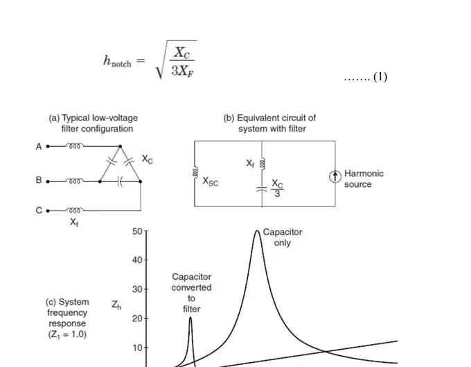
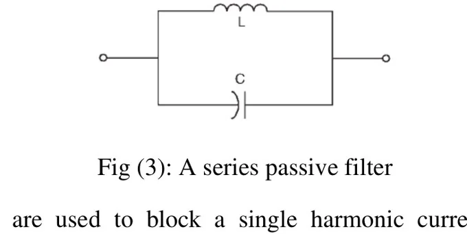
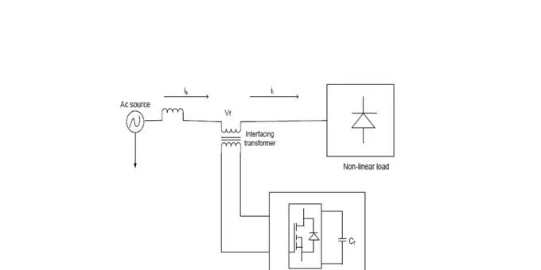
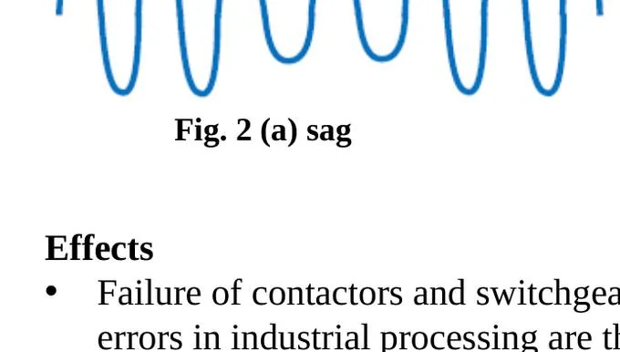
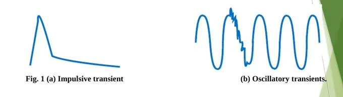
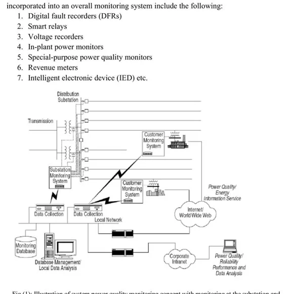
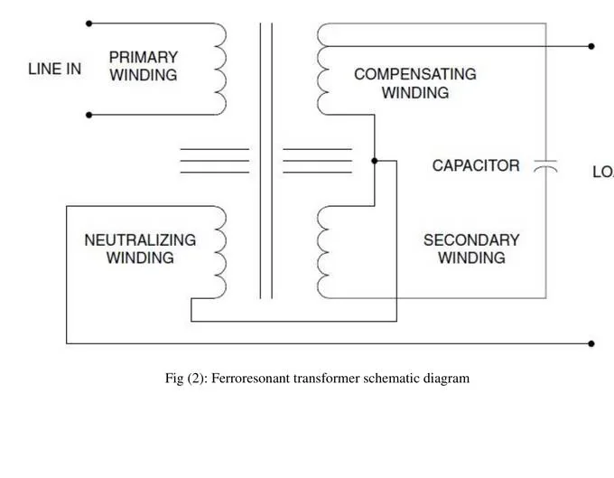
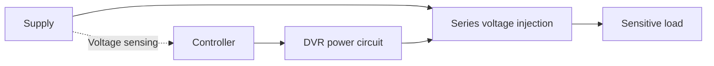

# EPQ Notes

# Electrical Power Quality — End-Sem Final Revision (21 November 2026)

**Purpose:** One exam-ready set of notes from our revision sessions, with clear explanations, formulas, simplified diagrams and solved PYQs. **Teacher's stated priority:** active/passive filters and numericals; balanced/unbalanced three-phase systems and symmetrical components; UPS, SVC and STATCOM; sag, swell and impulsive transients; power-quality monitoring, especially the flickermeter. Unit 5 is excluded. The November 2025 paper closely matches this scope.

**How to use tonight:** For each heading, learn *what it is*, *how it works*, *what diagram to draw*, and *what numerical/formula applies*. Attempt the worked questions again without looking at the answers. Detailed equipment designs, IEC filter transfer functions and long lists of monitor specifications are intentionally excluded.

---

## 1. Balanced, Unbalanced and Symmetrical Components

### 1. What is a balanced three-phase system?

A **balanced three-phase system** has three phase voltages or currents that:

1. Have **equal magnitudes**.
2. Have a **phase difference of exactly 120°** between successive phases.
3. Follow a specified **phase sequence**.

If these conditions are not satisfied, the system is **unbalanced**.

**Simple example**

For a balanced positive-sequence voltage set:

$$
V_A=100\angle0^\circ,\qquad
V_B=100\angle-120^\circ,\qquad
V_C=100\angle120^\circ.
$$

All three have the same magnitude, and their angles are separated by 120°.

But if one phase is 80 V while the others are 100 V, the system is unbalanced.

### 2. What is phase sequence?

Phase sequence describes **the order in which the three alternating phase quantities reach corresponding points in their cycles**.

The three sequence sets are the basis of symmetrical-component analysis.

**Positive sequence (ABC)**

Three equal phasors separated by 120°, following the normal **A → B → C** order.

With phase A at 0°:

$$
V_{A1}=V_1,\qquad V_{B1}=a^2V_1,\qquad V_{C1}=aV_1.
$$

**Negative sequence (ACB)**

Three equal phasors separated by 120°, but in the **reverse order**.

$$
V_{A2}=V_2,\qquad V_{B2}=aV_2,\qquad V_{C2}=a^2V_2.
$$

**Zero sequence**

All three phasors have **equal magnitudes and the same phase angle**. In a phasor diagram, all three arrows point in the **same direction**.

$$
V_{A0}=V_{B0}=V_{C0}=V_0.
$$

**Original lecture phasor diagrams:**

**How to draw them in the exam**

Take phase A as 0°:
- Positive sequence: B at −120°, C at +120°.
- Negative sequence: B at +120°, C at −120°.
- Zero sequence: all three lie on top of one another.

You don't need artistic phasor diagrams. Just make the directions, labels and 120° separation clear.

### 3. What are symmetrical components?

An unbalanced three-phase set is difficult to analyse directly. Symmetrical-component analysis lets us express it as the **sum of three balanced component sets**:

1. Positive sequence.
2. Negative sequence.
3. Zero sequence.

Each actual phase is obtained by **adding the corresponding component phasors**.

Define:

$$
a=1\angle120^\circ,\qquad a^2=1\angle(-120^\circ),\qquad 1+a+a^2=0.
$$

### 4. Given symmetrical components — find actual phase voltages

Use the **reconstruction formulas**:

$$
\boxed{V_A=V_0+V_1+V_2}
$$

$$
\boxed{V_B=V_0+a^2V_1+aV_2}
$$

$$
\boxed{V_C=V_0+aV_1+a^2V_2}
$$

**2020 PYQ Q1(b)**

Given:

$$
V_0=0.6\angle90^\circ,\qquad V_1=1\angle30^\circ,\qquad V_2=0.8\angle(-30^\circ).
$$

**Step 1:** Find $V_A$ by directly adding the three component phasors.

$$
V_A=0.6\angle90^\circ+1\angle30^\circ+0.8\angle(-30^\circ)
=\boxed{1.7088\angle24.18^\circ}.
$$

**Step 2:** Apply the rotation factors to the positive- and negative-sequence terms for phase B.

$$
V_B=V_0+a^2V_1+aV_2
=\boxed{0.4000\angle90^\circ}.
$$

**Step 3:** Apply the opposite rotation factors for phase C.

$$
V_C=V_0+aV_1+a^2V_2
=\boxed{1.7088\angle155.82^\circ}.
$$

**Important:** These are **phasor sums**. Do not add magnitudes or angles separately.

### 5. Given phase voltages/currents — find the symmetrical components

Use the **extraction formulas**:

$$
\boxed{V_0=\frac{V_A+V_B+V_C}{3}}
$$

$$
\boxed{V_1=\frac{V_A+aV_B+a^2V_C}{3}}
$$

$$
\boxed{V_2=\frac{V_A+a^2V_B+aV_C}{3}}
$$

The same formulas apply to currents: simply replace $V$ with $I$.

**November 2025 PYQ Q3**

Given:

$$
I_A=100\angle30^\circ,\qquad
I_B=50\angle300^\circ,\qquad
I_C=30\angle180^\circ.
$$

**Zero-sequence component:**

$$
I_0=\frac{I_A+I_B+I_C}{3}
=\frac{81.6025+j6.6987}{3}
=\boxed{27.29\angle4.69^\circ\ \mathrm A}.
$$

**Positive-sequence component:**

$$
I_1=\frac{I_A+aI_B+a^2I_C}{3}
=\boxed{57.98\angle43.29^\circ\ \mathrm A}.
$$

**Negative-sequence component:**

$$
I_2=\frac{I_A+a^2I_B+aI_C}{3}
=\boxed{18.97\angle24.96^\circ\ \mathrm A}.
$$

**How to solve it using your calculator**

On the **Casio fx-991ES PLUS**, select **CMPLX** mode and set angle units to **degrees**. Enter polar phasors with the angle operator, multiply by $a=1\angle120^\circ$ or $a^2=1\angle-120^\circ$ as required, add the complex terms, then divide by three.

**The one thing you must not mix up:** For $I_1$ the order is $I_A+aI_B+a^2I_C$. For $I_2$ the rotation factors are reversed.

### 6. What should you be ready to write?

For theory: definition of balanced/unbalanced systems, three sequence sets, and their phasor diagrams.

For numericals: both sets of formulas, the correct rotation factors and one complete phasor calculation using your calculator.

**PYQ focus:** 2020 Q1(b) and November 2025 Q3, which is a **10-mark question**.

## 2. Harmonics, Voltage Distortion and Filters

### 1. What are harmonics?

In an ideal electrical system, voltage and current have a sinusoidal waveform.

But many modern loads, such as rectifiers, adjustable-speed drives and electronic equipment, are **nonlinear loads**. They draw distorted current containing additional frequency components called **harmonics**.

A harmonic has a frequency that is an integer multiple of the fundamental frequency.

$
f_h=h f_1
$

If the fundamental frequency is **50 Hz**:

| Component | Frequency |
| --- | --- |
| Fundamental | 50 Hz |
| 3rd harmonic | 150 Hz |
| 5th harmonic | 250 Hz |
| 7th harmonic | 350 Hz |

These harmonics can cause overheating, increased losses and malfunctioning equipment.

**Our objective is to reduce these unwanted harmonics.**

That's where harmonic filters come in.

### 2. What are harmonic filters?

A harmonic filter is a device or circuit used to reduce harmonic distortion in electrical systems.

Your notes classify filters into three types:

- **Passive filters:** Use inductors (L), capacitors (C) and sometimes resistors (R) to control harmonic currents.
- **Active filters:** Use power electronics to generate compensating currents or voltages.
- **Hybrid filters:** Combine passive and active filtering.

**Simple example**

Suppose a device produces unwanted **250 Hz** harmonic current along with the normal **50 Hz** current.

A properly designed **shunt passive filter** provides a low-impedance path for the 250 Hz harmonic, diverting much of that unwanted current away from the supply.

The normal 50 Hz component continues supplying the load.

That's the basic idea behind the topic!

### 3. Voltage distortion versus current distortion

A nonlinear load produces **harmonic current**. It appears approximately like a harmonic-current source connected in shunt with the power system.

But how can that distort the **voltage**?

The wires, transformer and power system have some impedance. When distorted harmonic current flows through that impedance, it produces a harmonic voltage drop.

$
\boxed{V_h=I_h Z_h}
$

So a load can create harmonic currents and, because of the network impedance, produce harmonic voltage distortion at the load.

**Remember:** Current distortion mainly originates in nonlinear loads. Voltage distortion occurs when those currents flow through system impedance.

This can make sensitive controls malfunction and cause heating or derating of electrical equipment.

### 4. Passive filter — the shunt single-tuned filter

**What is it?**

A passive filter is constructed using passive circuit components, mainly inductors, capacitors and sometimes resistors.

The most important one for our exam is the **shunt single-tuned (notch) filter**.

**How is it connected?**

The inductor **L** and capacitor **C** are connected **in series with each other**. But that complete L–C branch is connected **in parallel (shunt)** with the power line and the load.

**Simple diagram to understand the connection**

~~~text
Supply ───────────┬──────── Load
                  |
                  L
                  |
                  C
                  |
             Return path
~~~

**Actual circuit from UNIT-4 (and its harmonic-impedance response):**

**What exactly happens?**

Inductive and capacitive reactances depend on frequency. At one particular frequency, they become equal in magnitude and cancel each other.

This is called **resonance**.

$
\boxed{f_r=\frac{1}{2\pi\sqrt{LC}}}
$

At the tuned frequency, the series L–C branch has **very low impedance**.

Imagine that the load is generating a fifth-harmonic current at **250 Hz**. If the filter is tuned near that harmonic, the harmonic current finds a much easier path through the shunt filter than through the rest of the supply network. Thus, the filter **diverts harmonic current away from the source**.

The normal fundamental-frequency supply continues feeding the load. The filter may also provide capacitive reactive-power support and improve the power factor.

**Why do we see a notch in the impedance graph?**

The graph has **harmonic order** on the horizontal axis and **equivalent harmonic impedance** on the vertical axis.

At the tuned harmonic, the equivalent impedance drops sharply. That dip is called the **notch**. A low impedance means the unwanted current can be diverted into the filter.

However, if you connect a capacitor bank without considering the supply inductance, the network can develop a **parallel-resonance peak** — very high impedance at a particular harmonic. Since $V_h=I_hZ_h$, a high impedance can produce a large harmonic voltage.

Even a tuned filter may create a smaller resonance peak just below the notch. This is why filters are often tuned **slightly below the intended harmonic**, allowing for changes in system conditions and component tolerances.

**Important:** A notch is useful because it represents **low impedance** at the harmonic to be suppressed. A peak can be dangerous because it represents **high impedance**.

**The three-phase three-wire PYQ**

In the lecture figure, the shunt filter uses series inductors and a delta-connected capacitor bank. For that particular circuit, the tuned harmonic order is:

$
\boxed{h_{\text{notch}}=\sqrt{\frac{X_C}{3X_f}}}
$

The factor of three comes from the delta-to-star equivalent for the capacitor bank. Use that formula only when the question uses the same circuit and reactance definitions.

**2020 Q2(b):** Explain and draw a tuned passive filter for a three-phase three-wire system. Use the actual diagram above and label the phases, inductors and capacitors.

### 5. Series passive filter

Don't confuse this arrangement with the shunt filter.

A **series passive filter** can use an **L–C parallel resonant combination**, and the entire assembly is inserted **in series with the load**.

At its resonant harmonic frequency, this parallel L–C combination offers high impedance, **blocking the unwanted harmonic**.

**The distinction:**

- **Shunt single-tuned filter:** A series L–C branch is in parallel with the load. It provides a low-impedance route to **divert** harmonic current.
- **Series passive filter:** A parallel L–C assembly is in series with the load. It provides high impedance to **block** the selected harmonic.

Series filters are less common because they carry load current and may cause voltage drop or overload issues. Do not spend time memorising every first-, second- or third-order high-pass design.

### 6. Active power filters

**What is an active filter?**

Unlike passive filters, active filters use **power electronics**, such as a Voltage-Source Inverter (VSI), to generate compensating currents or voltages.

They can respond dynamically when harmonic distortion or load conditions change.

There are two important types.

#### Shunt active power filter — compensates current

It is connected **in parallel with the load**.

The filter measures the unwanted harmonic current and injects **compensating current of opposite phase**.

**Simple example**

Suppose a nonlinear load produces **5 A of fifth-harmonic current**.

The shunt active filter injects approximately **5 A of fifth-harmonic current in the opposite direction**.

The two harmonic contributions cancel at the supply connection, so the source current becomes much closer to a clean sine wave.

It can also compensate reactive current.

**Quick connection diagram**

~~~text
Supply ───────────┬──────── Nonlinear load
                  |
               Coupling L
                  |
             VSI / DC link
~~~

#### Series active power filter — compensates voltage

It is connected **in series with the supply line**, commonly through a coupling/injection transformer.

The inverter injects a controlled voltage to make the **load voltage** closer to the required waveform.

$
\boxed{\mathbf V_{\text{load}}=\mathbf V_{\text{supply}}+\mathbf V_{\text{injected}}}
$

**Simple example**

Suppose the load needs **230 V**, but because of a voltage sag the supply falls to **190 V**.

In a simple in-phase illustration, the series APF injects **40 V**:

$
190+40=230\ \text{V}.
$

In a general AC system these voltages are **phasors**, so their relative phase is important.

### 7. Passive versus active filters

| Passive filters | Active filters |
| --- | --- |
| Use L, C and sometimes R. | Use power electronics and control. |
| Relatively simple and economical. | More complex and expensive. |
| Usually designed for selected harmonic frequencies. | Can compensate multiple changing harmonic components. |
| Bulky; possible resonance problems. | Dynamic compensation; avoids the same passive tuned-resonance limitation. |
| Shunt tuned filters divert harmonic currents. | Shunt APFs inject harmonic current; series APFs inject voltage. |

**What should you remember for the exam?**

You must be able to explain **how the shunt L–C filter works**, identify the **notch in the impedance graph**, distinguish **series from shunt passive filters**, and explain **series and shunt active filters** with their correct diagrams.

**Related PYQs:** 2020 Q2(b), 2024 Q5(a), and 2025 Q1(b).

## 3. Harmonic Numericals, Distortion Factor and Power Factor

### 1. Before solving numericals, understand the different RMS currents

This was one of the concepts we spent extra time on because the words **fundamental RMS**, **AC RMS** and **total RMS** mean different things.

Suppose current is given as:

$$
i(t)=8+15\cos(377t+30^\circ)+6\cos(754t+45^\circ)+2\cos(1131t+60^\circ).
$$

The current has a **DC component** of 8 A and three sinusoidal components.

The coefficients **15, 6 and 2 are peak current amplitudes**. For any sinusoidal component:

$$
I_{\text{rms}}=\frac{I_{\text{peak}}}{\sqrt 2}.
$$

The RMS of the **DC term** is simply **8 A**. We do not divide it by $\sqrt2$.

Now distinguish the four currents:

1. **Fundamental RMS:** The RMS of the fundamental-frequency component only, $I_1=15/\sqrt2$.
2. **Combined harmonic RMS:** The root-sum-square of the higher harmonics, $\sqrt{(6^2+2^2)/2}$.
3. **Total AC RMS:** Fundamental and higher harmonics combined, $\sqrt{(15^2+6^2+2^2)/2}$.
4. **Overall total RMS:** AC components plus DC, $\sqrt{8^2+(15^2+6^2+2^2)/2}$.

**Why does this difference matter?**

Because different formulas use **different denominators**. THD compares harmonics with the fundamental. Conventional current distortion factor compares the fundamental with total **AC** current. True power factor uses the RMS of the **complete current waveform**, including any DC component.

### 2. Total harmonic distortion (THD)

**What is THD?**

THD tells us how much unwanted harmonic content is present **relative to the fundamental**.

$$
\boxed{\mathrm{THD}_I=\frac{\sqrt{I_{2,\mathrm{rms}}^2+I_{3,\mathrm{rms}}^2+\cdots}}{I_{1,\mathrm{rms}}}\times100\%.}
$$

**Important:** Do not include the fundamental in the numerator. Do not include DC in THD. The phase angles of separate harmonics do not alter the RMS sum.

**Worked 2020 PYQ Q4(a) — Part 1**

Given:

$$
v(t)=100\cos377t
$$

$$
i(t)=8+15\cos(377t+30^\circ)+6\cos(754t+45^\circ)+2\cos(1131t+60^\circ).
$$

The fundamental peak is 15 A; higher harmonics have peaks 6 A and 2 A.

$$
\mathrm{THD}=\frac{\sqrt{6^2+2^2}}{15}\times100
=\boxed{42.16\%}.
$$

Notice that the $\sqrt2$ factors cancel because the numerator and denominator are all sinusoidal RMS components.

### 3. Distortion factor (DF)

**What is distortion factor?**

Distortion factor measures **what fraction of the AC RMS current belongs to the fundamental**.

$$
\boxed{DF=\frac{I_{1,\mathrm{rms}}}{I_{\mathrm{AC,rms}}}}
$$

It is also related to THD by:

$$
\boxed{DF=\frac{1}{\sqrt{1+(\mathrm{THD}/100)^2}}}.
$$

**Worked 2020 PYQ Q4(a) — Part 2**

$$
DF=\frac{15/\sqrt2}{\sqrt{(15^2+6^2+2^2)/2}}
=\frac{15}{\sqrt{265}}
=\boxed{0.9214}.
$$

**One question we discussed:** Why is the RMS current used for distortion factor different from the RMS current used in true power factor?

Because DF normally compares the fundamental with **total AC RMS**, while true PF involves **overall RMS current**, including the DC component of this particular signal. If a question explicitly defines DF differently, use that definition.

### 4. Real power, apparent power and true power factor

**Real power ($P$):** Average power consumed or converted into useful work; unit **W**.

**Apparent power ($S$):** $V_{\mathrm{rms}}I_{\mathrm{rms}}$; unit **VA**.

**Power factor:** $PF=P/S$.

**Displacement power factor:** $\cos\phi_1$, the phase-angle effect between fundamental voltage and fundamental current.

When voltage is a **pure fundamental sinusoid**, the DC component and higher harmonic currents produce **zero average real power** over a full period. Only the fundamental current contributes.

**Worked 2020 PYQ Q4(a) — Parts 3 and 4**

$$
P=\frac{100\times15}{2}\cos30^\circ
=\boxed{649.52\ \mathrm W}.
$$

The full RMS current is:

$$
I_{\mathrm{total,rms}}=\sqrt{8^2+\frac{15^2+6^2+2^2}{2}}
=\sqrt{196.5}=\boxed{14.018\ \mathrm A}.
$$

Voltage RMS is $100/\sqrt2$ V, so:

$$
PF_{\mathrm{true}}=\frac{649.52}{(100/\sqrt2)(14.018)}
=\boxed{0.6553}.
$$

Compare these values:

| Quantity | Result |
| --- | ---: |
| THD | **42.16%** |
| AC distortion factor | **0.9214** |
| Displacement PF, $\cos30^\circ$ | **0.8660** |
| True PF including DC | **0.6553** |

All four values answer **different questions**. Don't substitute one for another.

### 5. November 2025 Q2(a) — Voltage THD

Given fundamental voltage $V_1=120$ V and harmonics $V_3=6$ V, $V_5=4$ V, $V_7=1.5$ V, and $V_9=5.5$ V:

$$
\mathrm{THD}_V
=\frac{\sqrt{6^2+4^2+1.5^2+5.5^2}}{120}\times100
=\boxed{7.66\%}.
$$

**What to do:** Square the harmonic magnitudes, add, take the square root, divide by the fundamental and multiply by 100.

### 6. Power-factor correction — 2024 PYQ Q2(a)

Let's first understand the theory.

Power in a conventional sinusoidal AC circuit has three related quantities:

- **Real power $P$** in **kW**.
- **Reactive power $Q$** in **kVAr**.
- **Apparent power $S$** in **kVA**.

$$
\boxed{S^2=P^2+Q^2}
$$

$$
\boxed{PF=\cos\phi=\frac{P}{S}},\qquad Q=P\tan\phi.
$$

**What is kVAr?**

It stands for **kilovolt-ampere reactive**, the unit of reactive power. Real power does useful work; reactive power is exchanged with magnetic and electric fields, particularly in inductive and capacitive equipment. A capacitor bank can supply capacitive reactive power to reduce the net reactive power drawn from the supply.

**How do we correct a lagging power factor?**

A shunt capacitor supplies reactive power near the inductive load. The load's **real power stays approximately the same**, but the upstream system supplies less reactive power, improving PF.

$$
\boxed{Q_c=P(\tan\phi_1-\tan\phi_2)}
$$

**2024 PYQ:** A 120 kVA load with PF 0.65 is to be improved to 0.95.

**Step 1 — Find real power**

$$
P=S(PF_1)=120\times0.65=\boxed{78\ \mathrm{kW}}.
$$

You answered **78**, which was correct.

**Step 2 — Find capacitor compensation**

$$
Q_c=78[\tan(\cos^{-1}0.65)-\tan(\cos^{-1}0.95)]
=\boxed{65.55\ \mathrm{kVAr}}.
$$

You calculated **65.56**, also correct to rounding.

**Remember:** For this standard correction problem, the capacitor supplies the reactive-power difference. It does not create additional real power.

## 4. Uninterruptible Power Supply (UPS)

### 1. What is a UPS?

A **UPS (Uninterruptible Power Supply)** is a device that maintains continuous electrical power to connected equipment when the normal utility power becomes unavailable.

It usually uses batteries as an alternative energy source.

We studied three types:

- **Online UPS**
- **Offline or standby UPS**
- **Hybrid UPS**

The simplest way to understand the difference is to ask:

**What feeds the load during normal operation, and what changes when mains power fails?**

### 2. Online UPS

In an online UPS, **the load is always fed through the UPS**.

The incoming AC power is **rectified into DC**, which charges the battery and feeds an **inverter**. The inverter converts DC back to AC and supplies the load.

**Original online UPS diagram:**

**How it works**

**During normal operation:**
1. AC mains supply enters the rectifier/charger.
2. The rectifier converts the AC into DC.
3. The DC supplies the inverter, which powers the load.
4. The battery remains charged.

**When mains power fails:**
1. The battery supplies DC to the **same inverter**.
2. The inverter continues supplying AC power to the load.
3. The load does not have to be transferred to a new inverter.

This is why an online UPS has **essentially no battery-transfer delay**.

**Important question we discussed:** Does a second inverter start working when power fails?

**No — it is the existing inverter.** The load was already receiving power from that inverter. Only the **DC energy source** changes.

The **bypass** shown in the lecture diagram is an alternate path used for maintenance or certain operating conditions. It is not the normal route in an online double-conversion UPS.

### 3. Offline UPS or Standby UPS

An offline UPS works differently.

**During normal operation, the utility line directly supplies the load.**

The battery is being charged, while the inverter is normally on standby.

**Original offline UPS diagram:**

**How it works**

**During normal operation:**
- Mains directly feeds the connected equipment.
- The rectifier/charger charges the battery.
- The inverter is not normally supplying power to the load.

**When a disturbance or mains failure occurs:**
- The automatic transfer switch changes the supply path.
- The battery-backed inverter begins supplying the load.

Since a **switch must transfer the load**, there is usually a **small transfer delay**.

**Remember the comparison**

Online UPS: The inverter always powers the load.

Offline UPS: Mains powers the load until a disturbance is detected, after which the switch transfers it to the battery-backed inverter.

### 4. Hybrid UPS

A hybrid UPS is similar to a standby UPS, but it uses a **ferroresonant transformer** for output-voltage regulation and **momentary ride-through** during the transfer.

**Original hybrid UPS diagram:**

**What is the ferroresonant transformer doing here?**

It helps maintain a regulated output voltage when the input fluctuates.

It also helps the equipment ride through the brief interval while the supply switches from normal power to battery-backed inverter power.

**What is momentary ride-through?**

It simply means **continuing to supply power for a short interval during a disturbance or transfer**, so the load does not immediately lose power.

When I asked you about the important additional component of the hybrid UPS, your answer was correct:

**“A ferroresonant transformer for voltage regulation and ride-through during switching.”**

### 5. Comparison for the exam

| Online UPS | Offline UPS | Hybrid UPS |
| --- | --- | --- |
| Load always supplied by inverter. | Load normally supplied directly from mains. | Similar to standby, with voltage regulator. |
| Essentially zero battery-transfer time. | Small transfer delay due to switching. | Ferroresonant transformer helps with regulation and brief ride-through. |
| Double conversion under normal operation. | Inverter on standby normally. | Output includes ferroresonant conditioning. |

**What to do for 5 marks:** Draw the appropriate original diagram and explain **normal operation** and **mains-failure operation**. Avoid simply memorising three definitions without knowing where power flows.

**Relevant PYQ:** 2025 Q5 asks about UPS alongside SVC and DSTATCOM as voltage-sag mitigation techniques.

## 5. SVC, TCR, TSC and STATCOM

### 1. First, what is an SVC?

A **Static VAR Compensator (SVC)** is a **shunt-connected power-electronic compensation system** that adjusts reactive power to help regulate voltage.

The basic idea is:

- **Voltage falls:** We need more **capacitive reactive-power support** to help raise the voltage.
- **Voltage rises:** We may need more **inductive reactive-power absorption** to help lower it.

The word **VAR** refers to *volt-ampere reactive*, the unit of reactive power.

**Important correction from our revision:** One PPT slide titled SVC showed a converter and DC storage, which resembles **STATCOM**, not the conventional TCR/TSC SVC. Do not use that erroneous diagram to explain the conventional SVC.

Your **Unit-3.pdf** has the correct TCR and TSC circuits.

### 2. What is a TCR?

**TCR means Thyristor-Controlled Reactor**.

Let's simplify the terminology first.

A **reactor is simply an inductor**. An inductor absorbs inductive reactive power.

A **thyristor** is an electronic switch. In a TCR, thyristors control **how much current flows through the reactor**.

The fixed capacitor/filter banks provide capacitive reactive power. The reactor **absorbs some of that reactive power**, letting the system control the net compensation.

**Simple example**

Suppose the fixed capacitors supply **100 units** of capacitive reactive power.

If the TCR reactor absorbs **40 units**, the system receives:

$$
100-40=60\ \text{units of net capacitive compensation}.
$$

If voltage drops and the system needs more support, the controller **reduces the reactor's absorption**.

The capacitors still supply 100 units, but less is cancelled by the reactor, so **more capacitive compensation remains**.

If the system voltage is too high, the controller can increase reactor absorption.

That is the basic idea of a TCR.

**Why is it called controlled?**

Because changing the thyristor firing angle controls the reactor current. This provides **smooth or continuously variable control** of its inductive reactive-power absorption.

The capacitors in the original figure may also form harmonic-filter branches. TCR firing control can generate harmonics, which explains the importance of the 3rd, 5th and 7th tuned filters shown in your notes.

### 3. What is a TSC?

**TSC means Thyristor-Switched Capacitor.**

This one is even simpler.

There are **several capacitor banks**, each connected through thyristor switches.

The capacitors provide **capacitive reactive power**, and the controller chooses how many banks should be connected.

**Simple example**

Imagine three banks, each supplying **20 units**:

- Need 20 units? Turn **one** bank on.
- Need 40 units? Turn **two** banks on.
- Need 60 units? Turn **all three** on.

A TSC does not vary one bank smoothly; it **switches capacitor banks ON and OFF**. Its control is **stepwise**.

When we practised this, I asked what the controller should do if more capacitive reactive power is needed.

You answered **“more on.”** Correct: it should turn **more capacitor banks ON**.

Properly timed switching minimises switching transients and avoids the continuous phase-angle chopping used in a TCR.

**Actual TCR and TSC diagrams from Unit-3:**

### 4. Difference between TCR and TSC

| TCR | TSC |
| --- | --- |
| Controls a **reactor**. | Switches **capacitor banks**. |
| Changes **inductive reactive-power absorption**. | Changes **capacitive reactive-power supply**. |
| Smooth variation using firing angle. | Stepwise variation using ON/OFF switching. |
| Phase control can create harmonics. | Appropriate switching minimises transients. |

**The one thing to understand:** In a typical SVC, the thyristor-controlled reactor and switched/fixed capacitor banks work together to adjust **net reactive power** and regulate bus voltage.

### 5. What is a STATCOM?

A **STATCOM (Static Synchronous Compensator)** is also used to regulate voltage by supplying or absorbing reactive power.

But instead of controlling capacitor and reactor branches like an SVC, it uses a **Voltage-Source Converter (VSC)**.

**DSTATCOM** means a distribution-level STATCOM. The basic working principle is the same.

**Original DSTATCOM diagram:**

### 6. How does STATCOM work?

The main parts in the diagram are:

- **Voltage-Source Converter (VSC/VSI)**.
- **DC-link capacitor**.
- **Coupling transformer or reactor**.
- **Controller**.

The VSC generates a **controllable AC voltage**.

The AC voltage produced by the converter is connected to the grid through the coupling reactance. The **difference between the two AC voltages** causes reactive current to flow.

**Case A — system voltage is too low**

Imagine the bus voltage falls from 230 V to **200 V**.

The STATCOM controller makes its converter produce an appropriately phased AC voltage of **greater magnitude than the grid voltage**.

Reactive current is supplied into the system. The STATCOM provides **capacitive reactive power**, helping support the bus voltage.

**Case B — system voltage is too high**

Imagine voltage rises to **250 V**.

The STATCOM controller lowers its converter AC voltage magnitude **below the grid voltage**.

The compensator now absorbs **inductive reactive power**, helping reduce the bus voltage.

**What does the capacitor do?**

The DC-link capacitor supports the DC voltage needed for the converter to operate. It acts as an energy buffer.

It is **not the same as a large battery** that can independently supply the load through a long outage.

**Two control objectives**

1. Regulate the **AC voltage** at the bus connected to DSTATCOM.
2. Control the **DC-link capacitor voltage** inside DSTATCOM.

### 7. SVC versus STATCOM

| SVC | STATCOM |
| --- | --- |
| Uses thyristor-controlled reactor/capacitor branches. | Uses a voltage-source converter and DC-link capacitor. |
| Controls net reactive compensation by changing effective reactance/susceptance. | Controls converter AC voltage and reactive current. |
| TCR can create harmonics. | Power-electronic switching requires appropriate filtering/control. |
| Voltage support becomes more limited as voltage falls. | Generally provides stronger low-voltage reactive-current support within its limits. |

**Important for the 2025 10-mark question**

SVC and STATCOM help mitigate a **voltage sag by reactive-power support**.

A **UPS** is different: it can supply **stored real energy** from a battery to keep a sensitive load operating during a supply failure.

Don't write that an SVC or STATCOM automatically replaces a UPS.

**What to prepare:** Definition, correct labelled diagrams, working principle and a clear comparison. We deliberately avoided memorising the very large multi-branch SVC slide.

## 6. Module 1 — Sag, Swell, Transients and Classification

### Detailed explanation — Module 1 as we revised it

**Transient:** A transient is a **sudden, short-lived disturbance in voltage or current**. Imagine a normal smooth sine wave. Suddenly lightning strikes or an electrical device switches; for a brief moment its waveform changes.

**Impulsive transient:** Think of it as **one sudden spike**, predominantly positive or negative, rising rapidly and disappearing shortly afterward. **Lightning** is the main example. The high peak can damage electronic equipment, stress insulation or corrupt data.

**Oscillatory transient:** Think of **several fast electrical vibrations that gradually die away**. Switching a capacitor bank can cause energy to move back and forth between inductance and capacitance. The resulting disturbance repeatedly changes polarity and its oscillations decrease in amplitude. Your answer about rapid bipolar ringing that decays over time was correct. **Impulsive = sharp one-direction spike; oscillatory = decaying alternating ringing.**

**Voltage sag:** A sag (dip) is a **temporary RMS voltage reduction to 0.1–0.9 pu**, lasting **0.5 cycle to one minute**. The supply is still present. Imagine a large motor starting: it draws **high starting current**; the network has some **impedance**; higher current causes a larger voltage drop across this impedance; therefore **less voltage reaches the load**. Causes include short-circuit faults, large-motor starting, heavy-load connection and transformer energisation. Effects include contactor drop-out, adjustable-speed drive trips, PLC malfunction and process interruption.

**Sag waveform:** Draw several normal cycles, several cycles of **lower amplitude**, and recovery to normal. If the voltage is nearly zero it suggests an interruption instead.

**Example we practised:** Voltage at **0.65 pu for 20 cycles** is a sag and means a **35% voltage reduction**. You correctly identified increased starting current and network impedance as the cause.

**Voltage swell:** A swell is a **temporary increase in RMS voltage to 1.1–1.8 pu**, lasting **0.5 cycle to one minute**. Think of it as the opposite of a sag. When a **large load disconnects**, less current is drawn, reducing the voltage drop across network impedance, so remaining loads may see a **higher voltage**. Capacitor switching and ground faults affecting unfaulted phases may also cause swell. Effects: insulation stress, overheating, data errors or equipment malfunction.

**Swell waveform:** Normal cycles → **larger amplitude** cycles → normal again. This is not a narrow transient spike.

**Example we practised:** Voltage at **1.3 pu for 15 cycles** is a swell and is **30% above normal**. Your causal explanation about lower current and reduced network voltage drop was correct.

**Magnitude–duration classification:** Two observations identify most RMS voltage events: **how much voltage remains and how long it lasts**. Remember **0.1, 0.9 and 1.1 pu** for magnitude and **0.5 cycle, 3 seconds and 1 minute** for duration. Below 0.1 pu corresponds to an interruption; 0.1–0.9 pu up to a minute is sag; over 1.1 pu up to a minute is swell; a low/high voltage condition lasting **more than one minute** is under-/over-voltage.

Interruption duration: **momentary** 0.5 cycle–3 seconds; **temporary** over 3 seconds–1 minute; **sustained** over one minute. Thus **0.75 pu for 3 minutes** is under-voltage, not sag, and **0.05 pu for 5 seconds** is a temporary interruption.

**For the exam:** Learn definitions, limits, two causes and effects, and reproduce the original sag, swell and transient waveform shapes shown below. Don't reread the unrelated midsem material.

### Sag (voltage dip)

A **voltage sag** is a reduction of RMS voltage to **0.1–0.9 pu** for **0.5 cycle to 1 minute**. Supply remains present.

**Why:** Motor starting, heavy load connection or short-circuit fault → higher line current → larger voltage drop across system impedance → lower voltage at the load. **Effects:** Contactor drop-out, ASD trips, PLC/control malfunction. **Mitigation:** DVR/series voltage injection, UPS for sensitive loads, suitable transfer or system fault improvement.

**Waveform:** Normal sine cycles → smaller-amplitude cycles for a defined interval → normal again. Not zero.

### Swell

A **voltage swell** is an increase in RMS voltage to **1.1–1.8 pu** (the upper bound depends on duration subclass) for **0.5 cycle to 1 minute**.

**Why:** Sudden disconnection of a large load reduces network current/voltage drop, or capacitor switching; a single-line-to-ground fault may raise voltage on the unfaulted phases. **Effects:** Insulation stress, overheating, control errors and component damage.

**Waveform:** Normal cycles → larger-amplitude cycles → normal.

### Impulsive vs oscillatory transients

A **transient** is a sudden short-lived departure from the steady-state waveform.

| Impulsive transient | Oscillatory transient |
| --- | --- |
| One predominant polarity, sharp spike | Polarity alternates rapidly, decaying ringing |
| Lightning is the main example | Capacitor-bank or line switching is typical |
| High peak stresses electronics/insulation | Rapid oscillations can stress equipment |
| Sketch a single narrow spike | Sketch several shrinking oscillations around the waveform |

**Simple exam sketch cues:**

### Magnitude–duration classification (memorise boundaries)

$
V_{\rm pu}=\frac{V_{\rm rms}}{V_{\rm nominal}}.
$

| Event | RMS voltage | Duration |
| --- | --- | --- |
| Sag | 0.1–0.9 pu | 0.5 cycle–1 min |
| Swell | 1.1–1.8 pu (duration-specific upper limits) | 0.5 cycle–1 min |
| Under-voltage | Below 0.9 pu, above interruption range | More than 1 min |
| Over-voltage | Above 1.1 pu | More than 1 min |
| Momentary interruption | Below 0.1 pu | 0.5 cycle–3 s |
| Temporary interruption | Below 0.1 pu | >3 s–1 min |
| Sustained interruption | Nearly zero | More than 1 min |

For a classification chart: magnitude on vertical axis; duration horizontal; mark **0.1, 0.9 and 1.1 pu**, plus **0.5 cycle, 3 s and 1 min**.

**Examples:** 0.65 pu for 20 cycles → **sag**; 35% voltage lost. 1.3 pu for 15 cycles → **swell**; 30% above normal. 0.75 pu for 3 min → **under-voltage**, not sag. 0.05 pu for 5 s → **temporary interruption**.

### Sag mitigation recap

- **DVR / active series compensator:** Injects missing voltage in series; $\mathbf V_{\rm load}=\mathbf V_{\rm source}+\mathbf V_{\rm injected}$.
- **Static/fast transfer switch:** Transfers to a healthy second source; requires that source.
- **Online/offline UPS:** Uses stored energy to continue supplying load.
- **SVC/STATCOM:** Reactive compensation supports bus voltage.
- **Ferroresonant constant-voltage transformer:** Conditions voltage using saturated core and resonant capacitor.

---

## 7. Power Quality Monitoring — Definition, Purpose and Architecture

### 1. What is power quality monitoring?

Power quality monitoring is the process of **gathering, analysing and interpreting raw voltage and current measurement data into useful information**.

The idea is simple: if an industrial drive trips, we want to know **what happened to the electrical supply at that moment**.

A monitoring system records voltage and current, detects abnormal events and helps us determine whether there was a sag, swell, harmonic distortion, transient or interruption.

**Why are industries increasingly concerned about power quality?**

Modern industrial processes use many sensitive devices, such as adjustable-speed drives, PLCs and control electronics. Even a brief voltage disturbance may reset or trip them.

The electrical disturbance may last only a fraction of a second, but the resulting **production shutdown, equipment malfunction and data loss** can last much longer.

Monitoring helps identify the causes, improve performance and prevent repeated losses.

### 2. Monitoring considerations — what should we actually think about?

When we set up monitoring, several practical questions matter.

- **What is our objective?** Are we studying normal system performance or investigating a specific fault?
- **What instrument should we use?** We choose it according to the disturbance we want to measure.
- **What triggering threshold should we set?** This determines when the instrument records an event.
- **How will data be collected and stored?**
- **How will the recorded information be analysed and interpreted?**

**What is a triggering threshold?**

A triggering threshold is a **predefined limit** that causes the monitoring system to detect or record an event.

**Simple example:** If the monitor is configured to recognise a sag when voltage falls below **0.9 pu**, crossing that threshold triggers recording.

You don't need to memorise the long paragraphs on the first page. Once you understand these ideas, you can explain them in your own words.

### 3. Five objectives of monitoring — remember the ideas, not paragraphs

You understood the five objectives but were concerned you wouldn't recall them later. We reduced them to **five keywords**:

| Keyword | What it helps you recall |
| --- | --- |
| **Performance** | Understand how the system normally behaves. |
| **Problems** | Find the cause of a specific disturbance. |
| **Service** | Verify the quality promised to customers. |
| **Maintenance** | Predict equipment failures. |
| **Survey** | Inspect the electrical conditions at a facility. |

Think of it as five questions:

**How is the system performing? What's wrong? Are customers getting good service? Is something about to fail? Is the facility properly installed?**

You can reconstruct explanations from these ideas without memorising the long paragraphs.

**Proactive monitoring:** Monitoring regularly to identify problems before they become serious.

**Reactive monitoring:** Monitoring after a problem occurs to investigate its cause.

We deliberately skipped memorising the seven initial site-survey points. For the exam, it's enough to understand why we choose a measurement objective and monitoring location carefully.

### 4. Permanent PQ monitoring systems

A permanent monitoring system can use different types of instruments at substations and selected customer locations. Their measurements are collected, communicated, stored and analysed.

**Original monitoring-system diagram from UNIT-6:**

Understand the basic flow:

~~~text
  Monitoring instruments
 (substations / customers)
            |
     Data collection
            |
   Communication / network
            |
      Data storage
            |
    Analysis and reports
~~~

You do **not** need to memorise the complex networking details in the lecture figure.

**Major monitoring subsystems — 2020 PYQ:** Measurement sensors/instruments, data acquisition and triggering, data storage, communications, analysis and interpretation, and reporting. A general data-acquisition system collects signals; a PQ monitoring system is specifically designed to detect and characterise **electrical disturbances over very different time and frequency ranges**.

### 5. Duration of power quality monitoring — 2025 Q1(e), 2 marks

**What does it mean?**

The duration of monitoring is the **length of time for which voltage and current are measured and recorded** to detect power-quality disturbances.

**There is no single fixed duration.** It depends on the monitoring objective and how frequently disturbances occur.

| Situation | Monitoring duration |
| --- | --- |
| Investigating a frequently occurring problem | Short-term monitoring |
| Detecting rare or unpredictable disturbances | Longer monitoring period |
| Assessing overall system performance | Continuous or long-term monitoring |

**Exam-ready answer**

The duration of power quality monitoring depends on the objective, frequency of disturbances and operating conditions of the electrical system. Short-term monitoring is suitable for identifying specific recurring problems, whereas long-term or continuous monitoring is required for unpredictable disturbances, system performance assessment and predictive maintenance. The monitoring period should be sufficient to capture representative operating conditions.

**Quick check we practised:** If a factory experiences an unpredictable voltage sag once every few weeks, should monitoring be short or long term?

You answered **long term**, which was correct.

### 6. Online versus offline analysis — lower priority

| Offline analysis | Online analysis |
| --- | --- |
| Data is analysed later using separate software. | Data is analysed as it is captured. |
| Useful for historical trends and detailed reports. | Useful for real-time alerts and quick corrective action. |

That's all you need for now. Don't memorise the detailed software features, databases, file formats or statistical indices.

### What to prioritise

For the examination, focus on the definition and importance of monitoring, the major monitoring-system components, duration of monitoring and the six measurement instruments in the next section.

**Related questions:** 2020 monitoring-system subsystems; 2025 Q1(a), Q1(e) and Q4(a).

## 8. Power Quality Measurement Instruments

This is the important equipment section we've been looking for. Unlike the earlier monitoring pages, this one directly relates to the **2025 Q4(a): “What are the instruments used for Power Quality Monitoring? Briefly Describe.” — 5 marks**.

We don't need to memorise every long description. For each instrument, learn **what it is**, **what it measures**, and **one or two useful functions**.

### 1. Wiring and Grounding Testers — Important for Q4(a)

**What does it do?**

A wiring and grounding tester detects problems in electrical wiring and grounding that may cause power-quality disturbances.

Examples include:
- Open or incorrectly connected neutral and ground wires.
- Reversed live and neutral connections.
- Excessive grounding impedance.
- Incorrect phase rotation in three-phase systems.

**What to remember for the exam**

> Wiring and grounding testers detect faulty connections, grounding problems and wiring errors in electrical installations.

That's sufficient for a short instrument-description question. Don't memorise the entire page of test specifications.

### 2. Multimeters — Important for Q4(a)

**What does a multimeter do?**

A multimeter measures electrical quantities such as **voltage and current** to help identify power-quality problems.

According to your notes, it can measure:
- Phase-to-ground, phase-to-neutral and phase-to-phase voltages.
- Neutral-to-ground voltage.
- Phase and neutral currents.

**Applications:** Detecting overvoltage, undervoltage, circuit overloading and phase imbalance.

**One important concept: Three RMS measurement methods**

| Method | How it works | Limitation |
| --- | --- | --- |
| Peak method | Measures peak value and divides by $\sqrt 2$. | Assumes a sinusoidal waveform. |
| Averaging method | Measures the average rectified value and converts it to RMS. | Calibrated for sinusoidal waveforms. |
| True RMS method | Calculates the actual effective RMS value. | Works with distorted waveforms too, within the meter's specifications. |

**Why does this matter?**

Suppose a nonlinear load draws current containing harmonics. The waveform is no longer a pure sine wave. Therefore, simply dividing its peak by $\sqrt2$ may give an incorrect RMS reading.

A **true RMS multimeter** provides a more reliable measurement of distorted current.

**What to remember for the exam:** A multimeter measures voltage and current, checks phase voltages and currents, and true RMS meters are preferred for distorted signals.

### 3. Oscilloscopes — Important for the Exam

**What is an oscilloscope?**

An oscilloscope is an instrument that displays **voltage and current waveforms in real time**, helping engineers observe power-quality disturbances.

**Important things to know**

1. **Waveform observation:** Displays voltage and current against time, allowing us to see distortions, transients and other abnormalities.
2. **Measurement:** Helps determine voltage and current magnitudes and identify significant variations.
3. **Data storage:** Digital oscilloscopes can save waveforms for later analysis.
4. **Advanced analysis:** Some digital oscilloscopes can perform energy calculations and spectrum analysis.

**What to write for a 5-mark instrument-list question**

> An oscilloscope displays real-time voltage and current waveforms to identify power quality disturbances. Digital oscilloscopes can also store waveforms and perform further analysis, such as spectrum analysis.

That is sufficient when describing it as one of several instruments.

### 4. Disturbance Analyzers — Very Important

This deserves more attention because **2025 Q6(c)** explicitly asks for a **short note on disturbance analyzers — 5 marks**.

**What is a disturbance analyzer?**

A disturbance analyzer is an instrument used to **detect, measure and record power-quality disturbances over time**.

It can record:
- Voltage sags and swells.
- Transient overvoltages.
- Undervoltage and overvoltage.
- Supply interruptions.

**How does it work?**

Remember the triggering threshold we studied earlier?

A disturbance analyzer uses the same principle:

1. Continuously monitors voltage or current.
2. Detects when a disturbance crosses a predefined threshold.
3. Records the disturbance's magnitude, duration and other relevant information.
4. Stores the data for later analysis.

For example, if voltage drops below a configured threshold, the analyzer records the sag event.

**Two types of disturbance analyzers**

| Conventional analyzer | Graphics-based analyzer |
| --- | --- |
| Records summary information. | Records the actual waveform. |
| Shows magnitude and duration of disturbances. | Shows magnitude, duration and waveform shape. |
| Useful for basic monitoring. | Useful for detailed investigation. |
| Cannot fully describe complex transient waveforms. | Can capture oscillatory transients more effectively. |

**Simple example**

A conventional analyzer might report that a transient reached **800 V** and lasted **2 milliseconds**.

A graphics-based analyzer can also show whether the transient was a sharp spike or a series of decaying oscillations.

That's why **waveform capture matters**.

**Why is a graphics-based disturbance analyzer better for oscillatory transients?**

Because it captures the actual waveform, allowing us to examine its shape, rapid oscillations, changing polarity and gradual decay. Conventional analyzers mainly give summary information such as magnitude and duration.

**Exam-ready answer**

A disturbance analyzer detects and records electrical disturbances such as sags, swells, transients and interruptions. It uses triggering thresholds and stores information for later analysis.

There are two types:
- **Conventional:** Records event summaries, including magnitude and duration.
- **Graphics-based:** Records the actual waveform, allowing detailed analysis of complex disturbances.

For a short note, prioritise the definition, working principle, two types and their differences. You do **not** need to reproduce the instrument's screenshot.

### 5. Spectrum and Harmonic Analyzers

This section looked huge in your notes, but we only need the core functions.

**What is a harmonic analyzer?**

A harmonic analyzer measures the **harmonic components present in voltage and current waveforms**. It helps determine how distorted an electrical waveform is.

**Important things to know**

1. **Measures individual harmonics:** For example, the 3rd, 5th and 7th harmonic components.
2. **Calculates THD:** Determines total harmonic distortion as a percentage of the fundamental.
3. **Displays a frequency spectrum:** Shows harmonic magnitudes at different frequencies, often as a bar graph.
4. **Measures power factor:** Useful for assessing electrical system performance.

Some analyzers use the **Fast Fourier Transform (FFT)** to separate a distorted waveform into its frequency components.

You've already studied THD and harmonics, so none of these concepts is new.

**Three types — Just recognise the names**

| Type | Main purpose |
| --- | --- |
| Simple meters | Quick harmonic measurements at a site. |
| General-purpose spectrum analyzers | Frequency analysis of various signals. |
| Special-purpose power-system harmonic analyzers | Detailed harmonic measurements designed for power networks. |

No need to memorise the sampling specifications, K-factor or telephone influence factor for this exam.

### 6. Combination Disturbance and Harmonic Analyzers

This one is even simpler.

A combination analyzer performs **both disturbance monitoring and harmonic analysis using a single instrument**.

It can detect sags, swells and transients; measure harmonics and THD; store results; and transfer data for further analysis.

Think of it as a **disturbance analyzer + harmonic analyzer in one device**.

### 7. Flickermeters

A **flickermeter measures the severity of voltage flicker** caused by voltage fluctuations.

What makes it special is that it accounts for how humans perceive changes in lamp brightness. Its IEC five-block diagram and full explanation are in **Section 9**.

### 8. Energy Monitors

Energy monitors record electrical-energy consumption and related electrical measurements. They are another category of equipment used in ongoing power-quality monitoring.

### Final recall — what you already answered correctly

You recalled **six instruments** without looking at your notes:
- Wiring and grounding testers.
- Multimeter.
- Oscilloscope.
- Disturbance analyzer.
- Harmonic analyzer.
- Flickermeter.

You also remembered conventional versus graphics-based analyzers, the three harmonic-analyzer categories, and all five flickermeter blocks.

**For 2025 Q4(a), write any six instruments with one or two meaningful sentences about each.** That's a stronger answer than a bare list of names.

## 9. IEC Flickermeter — 5-Mark Answer

This is an important topic because **Flickermeter appeared in the 2025 paper (Q6b)** and your teacher explicitly mentioned it.

It looks huge, but we can reduce these pages to **one diagram, five functions and a short definition**, without making the explanation too brief for 5 marks.

### 1. What is a flickermeter?

A **flickermeter is an instrument used to measure the severity of voltage flicker** caused by fluctuations in supply voltage. It processes the voltage signal while considering the response of an incandescent lamp and the human eye–brain system.

Remember:

- Voltage fluctuations cause variations in lamp brightness.
- Flicker is the visible effect of those fluctuations.
- A flickermeter processes the voltage signal to estimate how noticeable and severe the flicker is.

### 2. IEC Flickermeter — Five-block diagram

This is the most important part of your notes.

**Easy diagram you can reproduce in the exam:**

~~~text
        Input voltage
             |
  [1. Input Voltage Adapter]
             |
  [2. Squaring Demodulator]
             |
  [3. Weighting Filters]
             |
  [4. Squaring and Smoothing]
             |
  [5. Statistical Analysis]
             |
       Flicker severity
~~~

**Original detailed IEC diagram from UNIT-6, Figure 4:**

You **do not need to memorise and reproduce this entire complicated diagram** for the usual five-mark short note. The diagram with the correct five blocks, arrows and meaningful explanations is a reasonable exam strategy. If the question explicitly asks for the detailed diagram, the simplified answer may lose diagram-specific marks.

### 3. How does it work?

Imagine a lamp whose brightness keeps increasing and decreasing.

The flickermeter takes the electrical voltage and processes it in stages.

**Block 1 — Input Voltage Adapter**

Adjusts the input voltage to a suitable reference level. This allows flicker measurements to depend on percentage voltage fluctuations rather than the actual supply voltage magnitude.

**Block 2 — Squaring Demodulator**

Squares the input voltage signal to separate the voltage fluctuations from the main AC waveform. It helps simulate the response of an incandescent lamp to voltage variations.

**Block 3 — Weighting Filters**

Removes unwanted frequency components produced during demodulation. It then weights the remaining fluctuation signal according to the sensitivity of the lamp and human eye–brain system, since different fluctuation frequencies produce different levels of perceived flicker.

**Why do we care about the eye and brain?** Different frequencies of voltage fluctuation affect human perception differently. For example, two voltage fluctuations of equal magnitude but different frequencies may produce different levels of visible flicker.

The filters account for the sensitivity of the **lamp–eye–brain system**, helping the flickermeter estimate how noticeable the flicker is to humans.

**Block 4 — Squaring and Smoothing**

The signal is squared to simulate the nonlinear response of human flicker perception. A sliding mean filter smooths the signal to represent the short-term response, producing an instantaneous flicker level.

**Block 5 — Statistical Analysis**

The instantaneous flicker levels are analysed statistically over time. Their distribution is used to assess the overall severity of voltage flicker.

### 4. What do you need to memorise?

**Adapt → Extract → Weight → Smooth → Analyse**

These five verbs correspond to the five stages.

You do **not** need to memorise:
- Internal circuit details and individual filter-response graphs.
- Filter frequencies and gain settings.
- Calibration circuits and supplementary outputs.
- The weighting-filter transfer function.
- The detailed histogram mathematics.
- The IEEE 141/519 flicker curves, RMS strip-chart and FFT method descriptions.

### 5. Is this enough for five marks?

**Yes, this is an appropriately developed 5-mark answer.** It includes the definition, a labelled five-block diagram and an explanation of every block.

You don't need the complicated transfer function, detailed filter characteristics or statistical calculations.

**2025 PYQ Q6(b):** Write a short note on flickermeter. Use the definition, diagram and explanations above.

## 10. Ferroresonance Transformer — 2025 Q4(b), 5 marks

**This section is more complicated than what you need for the 2025 exam question.**

Notice that the paper asks:

**Q4(b): Explain briefly about Ferroresonance Transformer — 5 marks.**

Your midsem notes mainly explain *ferroresonance as an electrical phenomenon*. We need to focus on the **ferroresonant transformer**, also called a **Constant Voltage Transformer (CVT)**.

### 1. First, understand ferroresonance

Ferroresonance occurs when **capacitance interacts with an iron-core inductance whose magnetic behaviour changes due to saturation**.

Under certain conditions, this interaction can produce unusually high voltages and currents.

The important idea is that an iron core does not behave like an ordinary fixed inductor once it becomes saturated.

You can skip the RLC impedance derivation and resonance equations in your screenshot for now.

### 2. What is a ferroresonant transformer?

A **ferroresonant transformer is a voltage-regulating transformer that uses magnetic core saturation and a resonant capacitor to maintain an approximately constant output voltage despite variations in input voltage.**

### How does it work?

1. The transformer uses an iron core designed to operate in magnetic saturation.
2. A capacitor forms a resonant circuit with a winding of the transformer.
3. The saturated core and resonant arrangement help stabilise the output voltage when the input fluctuates.
4. Therefore, the load receives a relatively constant voltage within the transformer's operating range.

Think of it as a **passive voltage stabiliser**, meaning it regulates voltage without requiring an electronically controlled inverter.

### 3. Original lecture diagram

You should understand how the **saturated core** and **resonant capacitor** interact. The original figure is useful to recognise the arrangement; you don't need the entire series-RLC derivation.

### 4. Applications

- Voltage regulation for sensitive electrical equipment.
- Reduction of the effects of moderate voltage fluctuations and sags.
- Power conditioning for control and electronic equipment.

### What to write for 5 marks

Use the definition, explain the role of **core saturation and the resonant capacitor**, describe how the output stays approximately constant, and mention two applications.

One important distinction:

**Unwanted ferroresonance** can produce dangerous overvoltages, whereas a **ferroresonant transformer** deliberately uses controlled ferroresonant behaviour for voltage regulation.

That's the essential theory for this question.

**Quick check we practised:** What are the two main features that allow the transformer to maintain a nearly constant output voltage?

Your answer was correct: **a saturated core, and a resonant capacitor that interacts with the core windings to regulate the output voltage.**

## 11. Exact PYQ Targets and Last-Minute Checklist

### How to revise what we've studied

You've learned most of this material through explanations and recall, so the final step is **retrieving it without the notes**. Completing the syllabus isn't the same as reproducing formulas, diagrams and structured answers under exam conditions.

For a **five-mark theory question**: State what the concept or device is, explain its working in complete but concise statements, draw the correct labelled diagram when useful, and finish with applications or important limitations. For a **ten-mark comparison**: Explain each device separately and compare the mechanisms. For a **numerical**: Write **Given → Formula → Substitution → Boxed answer with unit**.

**Most important practice tonight:** The November 2025 symmetrical-component numerical; the 2020 harmonic THD/DF/true PF numerical; the 2024 capacitor kVAr correction; passive and active filter configurations; online/offline/hybrid UPS paths; TCR vs TSC; STATCOM; and the **five-block flickermeter**.

**What we deliberately skipped:** The complicated internal IEC flickermeter diagram, detailed frequency-weighting transfer function, exhaustive instrument specifications, site-survey lists, high-pass filter topology design and the misleading SVC presentation slide. These are not worth displacing the explicitly announced material during final exam preparation.

### November 2025 end-sem paper — direct mapping

| Question | What you should reproduce |
| --- | --- |
| Q1(a) PQ monitoring and industrial concern (2) | Section 7 definition + why failures matter |
| Q1(b) active vs passive filters (2) | Section 2 comparison + shunt examples |
| Q1(c) sources of sags and interruptions (2) | Faults/motor starting for sag; faults, protective switching or supply failure for interruption |
| Q1(d) motor starting methods (2) | **Low-priority backup:** direct-on-line, star–delta, autotransformer, soft starter, VFD |
| Q1(e) duration of monitoring (2) | Section 7: depends on objective and event frequency |
| Q2(a) harmonic THD numerical (5) | Section 3: **7.66%** |
| Q2(b) increased voltage and its causes (5) | Section 6: swell vs over-voltage; load disconnection/capacitors/fault |
| Q3 unbalance and symmetrical components (10) | Section 1: **27.29∠4.69°, 57.98∠43.29°, 18.97∠24.96° A** |
| Q4(a) PQ instruments (5) | Section 8: six names + what each measures |
| Q4(b) ferroresonance transformer (5) | Section 10: saturated core + resonant capacitor |
| Q5 DSTATCOM, SVC and UPS (10) | Sections 4–5: diagrams, operation and comparisons |
| Q6(a) transient overvoltage (5) | Section 6: impulsive/oscillatory, causes, effects, sketch |
| Q6(b) flickermeter (5) | Section 9: five-block answer |
| Q6(c) disturbance analyzer (5) | Section 8: conventional vs graphics-based |

**Earlier repeated PYQs:** 2020 Q1(b) sequence reconstruction; 2020 Q2(b) tuned passive filter (3-phase 3-wire); 2020 Q3(a) PQ monitoring subsystems versus ordinary data acquisition; 2020 Q4(a) DC + harmonic current calculation; 2024 Q2(a) 120 kVA power-factor correction; 2024 Q5(a) active filter theory; 2024 instrument list. These are covered above.

### Exam answer templates

- **5-mark theory:** Definition (1–2 sentences) → working in short numbered points → relevant **simple labelled diagram** → important effect/advantage/limitation.
- **10-mark comparison:** Define both devices → separate correct circuits → operation under normal and disturbed conditions → a comparison table.
- **Numerical:** Given → formula → substitution → calculation → **boxed result with units**. For polar problems show your $a$ operator and component equations.

### Final self-test — answer without notes

- [ ] Distinguish positive, negative and zero sequences; write all six component formulas.
- [ ] Solve the **2025 Q3** current-component numerical once on your calculator.
- [ ] Draw and explain shunt tuned passive filter, shunt APF and series APF.
- [ ] Explain why nonlinear current distorts voltage and why an impedance notch suppresses harmonics.
- [ ] Compute THD for **2025 Q2(a)** and THD, DF, true PF for **2020 Q4(a)**.
- [ ] Derive $Q_c=P(\tan\phi_1-\tan\phi_2)$ and get **65.55 kVAr**.
- [ ] Draw online, offline and hybrid UPS power paths.
- [ ] Explain TCR vs TSC and SVC vs STATCOM without confusing their diagrams.
- [ ] State sag/swell voltage and duration limits, and draw transient sketches.
- [ ] Name six monitoring instruments with one function each.
- [ ] Write the **five IEC flickermeter blocks in order** and explain each in two sentences.
- [ ] Give a 5-mark disturbance-analyzer answer and explain the CVT's saturated-core/capacitor principle.

**Priority if time is short:** 2025 Q3 numerical → 2020 harmonic/DF numerical → filter and compensator diagrams → flickermeter → instruments → UPS → Module 1 quick classification. No need to reread the unrelated parts of the old midsem document.

---

# Electrical Power Quality — Midsem Notes

Study **Priority 0 first**, followed by the reliability numerical and the remaining **Priority 1** theory. Then prepare the repeated **Priority 2** applications and remedy table. **Priority 3** is kept short for the older-paper questions.

## Priority 0 — Topics explicitly emphasized by Sir

### 1. Introduction to power quality

An electrical supply must do more than deliver energy: it must allow the connected equipment to work correctly. A short voltage disturbance may reset a controller or trip a drive, stopping a production process even though the supply returns almost immediately. **Power quality (PQ)** therefore concerns both the electrical supply and the response of the equipment using it.

Modern systems contain many power-electronic devices, such as adjustable-speed drives, computer power supplies, UPS systems and renewable-energy converters. A **nonlinear load** draws current that does not follow the applied voltage proportionally. Thus, even a sinusoidal voltage can produce distorted current containing harmonics.

Solid-state equipment creates a two-sided problem: it can introduce distortion into the system and can itself be sensitive to disturbances. Microprocessors, computers, digitally controlled machines and industrial controls particularly need suitable voltage and continuity of supply.

PQ matters throughout transmission, distribution and utilization. Faults and switching in the network can disturb consumer voltage, while a customer’s nonlinear or rapidly varying load can affect other consumers through the common supply. The practical consequences include equipment malfunction, heating, data loss, production loss and reduced equipment life.

### 2. Power quality, voltage quality, current quality and PCC

**Power quality is the interaction of electrical power with equipment that determines whether the power is fit for the consumer’s devices.** It can also be described through deviations of voltage or current from the normal sinusoidal waveform. Together, these descriptions connect the electrical disturbance with its practical consequence.

| Term | Meaning |
| --- | --- |
| **Voltage quality** | How closely the supplied voltage follows the required waveform and operating conditions. It describes the quality of the utility’s delivered electrical product. |
| **Current quality** | How closely the current follows an ideal sinusoidal waveform. Nonlinear loads can draw poor-quality current even from a good-quality voltage supply. |
| **Continuity of supply** | The ability to provide satisfactory service nearly continuously, with few interruptions over time. |
| **Point of Common Coupling (PCC)** | The common connection point in the supply network shared by multiple consumer loads. Disturbances from one load can propagate through this point to others. |

Voltage quality and continuity are related but different. A supply can remain connected throughout a voltage sag, yet its voltage may be unsuitable for a sensitive load. Conversely, an interruption is a direct failure of continuity.

For voltage-event definitions, **RMS voltage** represents the effective AC voltage. **Per-unit voltage (pu)** expresses this relative to nominal voltage:

$$
V_{\mathrm{pu}}=\frac{V_{\mathrm{RMS}}}{V_{\mathrm{nominal}}}.
$$

Both voltages use the same units. Thus, 1 pu is nominal voltage and 0.7 pu means **70% voltage remaining**, equivalent to a 30% reduction.

### 3. Impulsive and oscillatory transients

A **transient** is a sudden, non-power-frequency change in the steady-state voltage or current. It is a brief disturbance superimposed on the normal waveform, commonly associated with lightning or switching.

An **impulsive transient** has one predominant polarity: a sharp positive or negative excursion with a very fast rise and short duration. Lightning is the main example. Other causes include inductive-load switching, utility fault clearing, electrostatic discharge and poor grounding. The high peak can damage electronic components or corrupt stored data.

An **oscillatory transient** alternates in polarity about the undisturbed waveform. System inductance and capacitance exchange stored energy after a switching event, producing a rapidly oscillating disturbance that decays as energy is dissipated. Capacitor-bank, line and inductive-load switching are common causes. Its frequency is associated with the circuit’s natural response, rather than necessarily being a multiple of the supply frequency.

Oscillatory transients can also damage equipment, corrupt data and reduce equipment life. The essential difference is the **shape and polarity of the transient component**.

| Impulsive transient | Oscillatory transient |
| --- | --- |
| Predominantly unidirectional. | Alternates in positive and negative directions. |
| A sharp spike with rapid rise and decay. | A burst of ringing with a decaying envelope. |
| Lightning is a representative cause. | Capacitor or line switching is a representative cause. |

**Waveforms:** Draw voltage against time with a normal sine wave as reference. For an impulse, add one narrow, tall spike and label its peak and short duration. For an oscillatory transient, add several rapid oscillations around the normal waveform with decreasing amplitude. The impulse may be negative as well as positive.

### 4. Voltage sag

A **voltage sag**, or voltage dip, is a temporary reduction in RMS voltage to **0.1–0.9 pu**, lasting **0.5 cycle to 1 minute**. The supply remains present, but its voltage falls below the normal operating level.

A sag commonly starts when the current drawn from the network suddenly increases. Because the supply network has impedance, the increased current produces a greater voltage drop before the load:

$$
\text{Fault or large starting current}
\rightarrow \text{greater network voltage drop}
\rightarrow \text{lower load voltage}.
$$

Typical causes are short-circuit faults, large-motor starting, sudden connection of a heavy load and transformer energization. During a line-to-ground fault, the sag may continue until protective equipment clears the fault. Even a refrigerator or air-conditioner starting can cause a local sag.

Contactors may drop out, adjustable-speed drives (ASDs) may trip, and programmable logic controllers (PLCs) or process controls may malfunction. The resulting production loss can last much longer than the electrical disturbance.

**Waveform:** Draw normal sinusoidal voltage, several cycles of smaller amplitude, and recovery to normal. Label the remaining RMS voltage and sag duration. Keep the sine wave visible during the sag; a nearly flat zero-voltage interval represents an interruption.

### 5. Under-voltage and its difference from sag

**Under-voltage** is a reduction of the power-frequency AC voltage below **90% of nominal for more than 1 minute**. It is a sustained low-voltage condition; “brownout” is an older term.

Heavy loading and inadequate voltage regulation can maintain a large network voltage drop. Under-voltage may also follow load switching, faults or capacitor de-energization. The classification depends on how long the reduced voltage persists, rather than on the cause alone.

Motors may heat and incur increased losses, while nonlinear loads such as computer power supplies may fail to operate. A persistent condition calls attention to the supply, loading or equipment configuration.

| Voltage sag | Under-voltage |
| --- | --- |
| 0.1–0.9 pu remaining voltage. | Below 0.9 pu, excluding the near-zero interruption condition. |
| 0.5 cycle to 1 minute. | More than 1 minute. |
| Commonly a fault or starting-current event. | A sustained loading or regulation problem. |

For an under-voltage sketch, extend the reduced-amplitude portion beyond the one-minute boundary.

### 6. Voltage swell

A **voltage swell** is a temporary increase in RMS voltage to **1.1–1.8 pu**, lasting **0.5 cycle to 1 minute**. The upper magnitude depends on the duration subclass.

A sudden reduction in load reduces the voltage drop in the supply network and can raise the load voltage. Large-load disconnection and capacitor switching are therefore common causes. A single-line-to-ground fault can also cause a temporary voltage rise on the unfaulted phases. A high-impedance neutral is another possible cause.

The increased voltage stresses insulation, semiconductors and power-supply components. It may cause data errors, control problems, overheating or equipment shutdown. Repeated exposure can gradually degrade insulation and contacts.

| Swell subclass | RMS magnitude | Duration |
| --- | --- | --- |
| Instantaneous | 1.1–1.8 pu | 0.5–30 cycles |
| Momentary | 1.1–1.4 pu | 30 cycles–3 s |
| Temporary | 1.1–1.2 pu | 3 s–1 min |

**Waveform:** Draw several cycles of increased sinusoidal amplitude between normal-voltage portions. Label the elevated RMS voltage and event duration. A swell lasts across cycles; it is not a narrow transient spike.

### 7. Over-voltage and its difference from swell

**Over-voltage** is a power-frequency AC voltage above **110% of nominal for more than 1 minute**. It is a sustained high-voltage condition.

Incorrect transformer tap settings can maintain excessive voltage. A setting that compensates for heavy-load voltage drop may produce over-voltage after much of the load is disconnected. Capacitor energization can also raise the voltage.

The consequences include insulation and component stress, overheating, nuisance breaker operation and appliance damage.

| Voltage swell | Over-voltage |
| --- | --- |
| A short increase above 1.1 pu. | A sustained increase above 1.1 pu. |
| 0.5 cycle to 1 minute. | More than 1 minute. |
| Often associated with switching or an unfaulted phase during a fault. | Often associated with tap settings, light loading or sustained regulation problems. |

The waveform shape is similar, but the elevated-amplitude region of an over-voltage lasts beyond one minute.

### 8. Voltage fluctuation and flicker

**Voltage fluctuation** is a systematic or random variation of the voltage envelope caused by changing load demand. The envelope describes how the amplitude of the underlying AC waveform changes with time.

Typical voltage fluctuations are small variations of approximately **95–105% of nominal**, usually at an envelope frequency **below 25 Hz**. This is the rate of amplitude variation; it does not mean that a 50 Hz supply has become a 25 Hz supply.

Rapid changes in real and reactive power produce changing current and hence changing network voltage drop. **Arc furnaces** are a major example. Arc welders, frequent motor starts, cyclic motor drives and large speed changes can produce similar effects.

**Flicker is the visible variation in lamp brightness caused by voltage fluctuation.** Fluctuation is the electrical phenomenon; flicker is its lighting effect. It can cause irritation and discomfort. Fluctuating supply voltage can also cause data loss, system halts and protection malfunction.

**Waveform:** Draw a sine wave whose amplitude repeatedly grows and shrinks. Label the changing envelope and its repetition period. Unlike a single sag, the amplitude variation is repeated or irregular over time.

### 9. Short and long interruptions

An **interruption** is a failure of supply continuity in which the voltage becomes nearly zero. On the magnitude-duration chart, the interruption region is **below 0.1 pu**. Complete loss of voltage may affect one or more phase conductors.

A **short interruption** lasts up to the one-minute boundary. A temporary fault may make an automatic recloser open the circuit and restore it after a short interval. Lightning-related faults and insulation flashover are examples. PLCs, ASDs and data-storage systems can stop or malfunction during the loss of supply.

A **sustained or long interruption** lasts **more than 1 minute**. Causes include system faults, human error and malfunction of protective equipment. Equipment and production remain stopped until supply is restored.

**Waveform:** Show normal sinusoidal voltage, a nearly zero interval, and restoration. Label the interruption duration. For a long interruption, use a time-axis break if needed to show the extended outage clearly.

> **Caution:** For the exam, use the magnitude–duration classification below: short interruptions last up to 1 minute, while sustained interruptions last more than 1 minute.
> 

### 10. Notching

**Notching** is a periodic voltage disturbance that produces small cuts or missing portions in the waveform during successive half-cycles. It is classified as waveform distortion because it repeats during normal operation of the disturbing equipment.

It is associated with power-electronic converters, variable-speed drives, dimmers and arc welders. These repeated disturbances can cause data-transmission errors, system halts and damage to capacitive components.

In a converter, transfer of current from one conducting device or phase to another is called **commutation**. This process can create voltage notches. An input reactor can reduce the resulting line notching.

**Waveform:** Draw narrow inward cuts at repeated positions on the positive and negative half-cycles of a sine wave. Label a notch. A notch is a brief cut within a cycle; a sag reduces the RMS voltage across a longer interval.

### 11. Magnitude–duration classification

Two observations identify most RMS voltage events: **how much voltage remains** and **how long the event lasts**. Magnitude distinguishes low voltage, high voltage and interruption; duration separates short events from sustained conditions.

| Event | Magnitude or defining shape | Duration / chart position |
| --- | --- | --- |
| Transient | Sharp impulse or oscillatory departure from the normal waveform. | Placed to the left of 0.5 cycle. |
| Sag | 0.1–0.9 pu RMS. | 0.5 cycle to 1 min. |
| Swell | Above 1.1 pu; overall range 1.1–1.8 pu. | 0.5 cycle to 1 min. |
| Under-voltage | Below 0.9 pu, above the interruption region. | More than 1 min. |
| Over-voltage | Above 1.1 pu. | More than 1 min. |
| Very brief interruption | Near zero, below 0.1 pu. | Leftmost chart region, before 0.5 cycle. |
| Momentary interruption | Below 0.1 pu. | 0.5 cycle to 3 s. |
| Temporary interruption | Below 0.1 pu. | Above 3 s to 1 min. |
| Sustained interruption | Nearly zero. | More than 1 min. |

The chart’s leftmost near-zero region is labelled simply **“Interruption.”** Its normal operating band lies between approximately **0.9 and 1.1 pu**. The chart is a simplified event map; transient shape must still be distinguished from a power-frequency RMS change.

**To reproduce the chart:** Put event magnitude on the vertical axis and duration on the horizontal axis. Mark horizontal boundaries at 10%, 90% and 110%, and vertical boundaries at 0.5 cycle, 3 s and 1 min. Place sag below the normal band, swell above it, under-/over-voltage beyond one minute, and the interruption classes along the bottom. Put transient/notch regions before 0.5 cycle.

### 12. Noise

**Electrical noise** is unwanted voltage or current superimposed on the power waveform or carried by neutral and signal conductors. It has broadband content below **200 kHz**, excluding disturbances better classified as harmonics or transients.

Power-electronic controls, switching power supplies, rectifiers, arcing equipment, arc welders and radio transmitters can introduce noise. Poor grounding increases susceptibility to interference.

Noise can produce data errors, display distortion, communication problems and equipment malfunction. Filters, isolation transformers, line conditioners and proper grounding help control it.

For a sketch, add small irregular disturbances to an otherwise sinusoidal waveform. Their irregular appearance distinguishes noise from a repeating harmonic-distorted waveform.

### 13. Power-system harmonics

A **harmonic** is a sinusoidal component whose frequency is an integer multiple of the fundamental supply frequency:

$$
f_h=h f_1.
$$

Here, (f_1) is the fundamental frequency in hertz and (h) is the harmonic order. For a 50 Hz supply, the third harmonic is 150 Hz and the fifth is 250 Hz. The fundamental is the first-order component; distortion calculations use the higher orders.

A periodic distorted waveform can be represented as the sum of its fundamental and harmonic components. The individual components are sinusoidal, but their sum need not be. This explains why a waveform with flattened peaks, narrow current pulses or chopped portions contains harmonics.

Nonlinear loads are the main source of harmonic current. Computer supplies and SMPS can draw concentrated current pulses; power converters and AC voltage controllers produce current waveforms determined by their switching. Saturating transformers and arc furnaces are other important sources.

Harmonics cause additional losses and heating, capacitor overloading, noise and vibration. They can also interfere with communications and produce protection or metering errors. Harmonic distortion is a continuing waveform feature, whereas a transient is a brief response to a disturbance.

**Waveforms:** Draw one fundamental cycle and, on the same time scale, three cycles of a smaller third-harmonic component. Then indicate that adding them produces a distorted resultant. For typical nonlinear-load current, sketch repeated narrow pulses near the voltage peaks rather than a sinusoidal current. Converter current shapes vary with rectifier type and smoothing; one example is not universal.

### 14. Total Harmonic Distortion (THD)

**THD measures the combined RMS magnitude of the higher harmonics relative to the fundamental.** It expresses how much harmonic content accompanies the required fundamental waveform and indicates its additional heating potential.

$$
\mathrm{THD}(\%)=
\frac{\sqrt{\displaystyle\sum_{h=2}^{h_{\max}}M_h^2}}{M_1}\times100.
$$

Here, (M_1) is the RMS fundamental magnitude and (M_h) is the RMS magnitude of harmonic order (h). Use voltage magnitudes for voltage THD and current magnitudes for current THD. All magnitudes must use the same units; THD itself is a ratio or percentage.

To calculate it, square the given higher-harmonic magnitudes, add them, take the square root, and divide by the fundamental. Multiply by 100 for percent. **Do not include the fundamental in the numerator.**

A current THD of 5% means that the combined harmonic RMS current is 5% of the fundamental current. Zero THD means no higher harmonics are present. For fixed harmonic amperes, reducing the fundamental current increases THD because the denominator becomes smaller.

### 15. IEEE 519 — required points

**IEEE 519 concerns keeping harmonic distortion within acceptable limits.** Its relevance is that nonlinear loads introduce harmonic currents and a distortion criterion is needed when discussing acceptable power quality.

For the expected class answer, state that **current THD should be less than 5% to be acceptable** and that the THD level depends on the current magnitudes. The THD ratio above explains why the relative distortion changes when either the harmonic components or the fundamental current changes.

> **Caution:** Treat the 5% value as the simplified criterion required for this midsem answer. Detailed IEEE 519 limits depend on their application conditions and are outside the present scope.
> 

### 16. Voltage unbalance

A **balanced three-phase supply** has three line-to-neutral voltages of equal magnitude separated by **120°**. Both conditions are necessary.

**Voltage unbalance** occurs when the three voltage magnitudes are unequal, their phase separations differ from 120°, or both. Equal magnitudes alone do not prove that the supply is balanced.

Uneven single-phase loading and unequal supply impedances produce different voltage drops in the three phases. Faults, incomplete line transposition, blown capacitor fuses and single-phasing can also disturb the phase set. The resulting unbalance degrades equipment performance and can cause motor heating, increased losses and reduced life.

**Phasor diagram:** Draw three equal arrows from a common origin, 120° apart, labelled (V_A,V_B,V_C). Beside this, draw an unbalanced set with unequal lengths and/or unequal angular separations. Sequence components in Priority 1 provide a systematic way to describe this unbalance.

### 17. Ferroresonance

**Ferroresonance is a nonlinear resonance involving capacitance and an iron-core inductance.** The inductance is nonlinear because the magnetic core can saturate, so its magnetizing behaviour changes with operating condition.

A relevant condition occurs when a transformer’s **magnetizing impedance** is effectively in series with system capacitance. A disturbance such as switch opening can establish or excite this condition. The interaction may produce very high voltages and currents, harmonic magnification and irregular waveforms.

The series-RLC circuit helps explain the danger. Draw an AC source (E), a resistance (R), the iron-core inductive element and a capacitor in one series loop. Label the current (I), inductive reactance (X_L), capacitive-reactance magnitude (|X_C|), and voltage across the inductance.

For the series circuit,

$$
Z=R+j(X_L-|X_C|),
\qquad I=\frac{E}{Z},
\qquad V_L=jX_LI.
$$

Here, (Z) is impedance in ohms, (E) and (V_L) are voltage phasors in volts, (I) is current in amperes, and (j) represents a 90° phase rotation.

At the ideal series-resonance condition,

$$
X_L=|X_C|,
$$

the reactive terms cancel, so (Z=R) and (I=E/R). If resistance is small, the current can become very large and create large voltages across the individual reactive elements.

This series-circuit interpretation explains the resonance condition, but the iron-core inductance is nonlinear. Ferroresonance can therefore show irregular behaviour beyond that of an ordinary fixed-inductance RLC circuit.

A **ferroresonant or constant-voltage transformer** deliberately uses a controlled saturated-core and capacitor arrangement for voltage conditioning. Distinguish that useful device, covered under sag mitigation, from unwanted ferroresonance in the power network.

## Priority 1 — Reliability and core theory

### 18. Reliability of supply

In this course, **reliability** concerns continuity of utility service, particularly the sustained interruptions during which customers are without power. Reliability indices describe how often interruptions occur, how much service time is lost and what fraction of service remains available.

An outage affecting 1,000 customers has a larger system impact than an equally long outage affecting one customer. The calculations therefore count **customer interruptions** and **customer-interruption duration**, rather than merely counting outage events.

### 19. Reliability indices: meaning, formulas and units

For a study period, let (N_T) be the total number of customers served, (N_i) the customers interrupted in outage (i), and (U_i) the duration of that outage. Define:

$$
C=\sum_i N_i,
\qquad D=\sum_i N_iU_i.
$$

Here, (C) counts customer interruptions, including repeat interruptions of the same customer. If durations are in minutes, (D) is in **customer-minutes**. Let (N_A) be the number of **distinct customers** interrupted at least once, and (H) the number of hours in the study period.

| Index | Meaning | Formula | Units and interpretation |
| --- | --- | --- | --- |
| **SAIFI — System Average Interruption Frequency Index** | Average interruption frequency across all served customers. | (C/N_T) | Interruptions/customer for the study period. Lower means fewer interruptions on average. |
| **SAIDI — System Average Interruption Duration Index** | Average total outage time across all served customers. | (D/N_T) | Minutes/customer for the study period if (U_i) is in minutes. Lower means less service time lost. |
| **CAIFI — Customer Average Interruption Frequency Index** | Average interruption frequency among customers interrupted at least once. | (C/N_A) | Interruptions/affected customer for the study period. Repeat interruptions raise the value. |
| **CAIDI — Customer Average Interruption Duration Index** | Average duration per customer interruption. | (D/C=/) | Minutes/interruption if durations are in minutes. It describes average restoration duration experienced per interruption. |
| **ASAI — Average System Availability Index** | Fraction of demanded customer service that was available. | (1-D_{}/(N_TH)) | Dimensionless; multiply by 100 for percent. Closer to 1 means greater availability. |

SAIFI and SAIDI average over **everyone served**, including customers who experienced no outage. CAIFI focuses on **distinct affected customers**, while CAIDI averages over **customer interruptions**. Thus, CAIDI is not the total accumulated outage time per distinct affected customer.

ASAI compares available customer-hours with demanded customer-hours. The demand is **(N_T H)**, not just (H). Use (H=24) for a one-day problem and (H=8760) for a full non-leap year; do not automatically use an annual denominator for a daily table.

The denominator of CAIFI must count distinct affected customers. SAIFI is an average interruption count per served customer, not an outage probability.

### 20. Reliability table numerical

The class example studies **one day**, with (N_T=50{,}000) customers and five outages. This is the same style of table used in the 2025 midsem.

| Outage | Customers interrupted, (N_i) | Duration, (U_i) (min) | (N_iU_i) (customer-min) |
| --- | --- | --- | --- |
| 1 | 10 | 90 | 900 |
| 2 | 1,000 | 20 | 20,000 |
| 3 | 2 | 175 | 350 |
| 4 | 1 | 120 | 120 |
| 5 | 1 | 38 | 38 |
| **Total** | **1,014** | — | **21,408** |

Use this procedure for a new table:

1. Identify total customers and the study period.
2. Multiply customers by duration for each outage, then sum the products.
3. Separately sum customer interruptions. The number of table rows is not this total.
4. Calculate SAIFI, SAIDI and CAIDI with the same duration units.
5. Convert customer-minutes to customer-hours for ASAI and use the correct period length.
6. For CAIFI, identify distinct affected customers or state the necessary assumption.

For the class data,

$$
C=1014,
\qquad D=21{,}408\text{ customer-min}
=356.8\text{ customer-h}.
$$

$$
\mathrm{SAIFI}=\frac{1014}{50{,}000}
=0.02028\text{ interruptions/customer for the day}.
$$

$$
\mathrm{SAIDI}=\frac{21{,}408}{50{,}000}
=0.42816\text{ min/customer for the day}.
$$

$$
\mathrm{CAIDI}=\frac{21{,}408}{1014}
\approx21.11\text{ min/interruption}.
$$

$$
\mathrm{ASAI}=1-\frac{356.8}{50{,}000\times24}
=0.9997027\approx99.9703\%.
$$

The table does not identify whether the same customers appear in multiple outages. Therefore, **CAIFI cannot be determined uniquely from the counts alone**. If all five groups are distinct, (N_A=1014), and (=1014/1014=1). If some customers experience repeat outages, use the actual distinct-customer count instead.

> **Caution:** The class example prints SAIDI as **0.0428 min** and CAIFI as (5/1014). Direct arithmetic gives SAIDI as **0.42816 min**, while CAIFI cannot be found unless the number of distinct affected customers is known. In the exam, write the formula and any assumption clearly.
> 

A useful check is (=), allowing for rounding. Also check that ASAI lies between 0 and 1.

### 21. Symmetrical or sequence components

An unbalanced three-phase set is difficult to describe using one magnitude and one phase angle. **Symmetrical components** express it as the sum of three simpler sets: positive, negative and zero sequence.

| Component | Phasor relationship | Meaning |
| --- | --- | --- |
| **Positive sequence** | Three equal magnitudes, 120° apart, in normal A–B–C order. | The normal balanced-system component. |
| **Negative sequence** | Three equal magnitudes, 120° apart, in reverse A–C–B order. | A component associated with unbalance and motor heating. |
| **Zero sequence** | Three equal magnitudes, all in phase. | A common in-phase component of the three phase quantities. |

Let (a=1^). Multiplication by (a) rotates a phasor by 120°, and (a2=1). The identities (a^3=1) and (1+a+a^2=0) help simplify the relations.

If (V_0,V_1,V_2) are the phase-A zero-, positive- and negative-sequence voltage components, the original voltages are:

$$
\begin{aligned}
V_A&=V_0+V_1+V_2,\\
V_B&=V_0+a^2V_1+aV_2,\\
V_C&=V_0+aV_1+a^2V_2.
\end{aligned}
$$

Conversely, from the phase voltages:

$$
\begin{aligned}
V_0&=\frac{V_A+V_B+V_C}{3},\\
V_1&=\frac{V_A+aV_B+a^2V_C}{3},\\
V_2&=\frac{V_A+a^2V_B+aV_C}{3}.
\end{aligned}
$$

All these quantities are **phasors**, so both magnitude and angle matter. Voltages are in volts; the same relations apply to currents in amperes by replacing (V) with (I).

For a balanced supply in normal phase order, only positive sequence remains. An unbalanced set can contain negative and/or zero sequence. This is why sequence components help describe voltage unbalance more fully than a comparison of magnitudes alone.

For a basic calculation, write the given phasors in rectangular form, apply the required rotations and additions, divide by three, and convert the result to magnitude-angle form if requested. When reconstructing phase quantities, reverse the process using the first set of equations. A check is that adding the three phase voltages gives (3V_0).

**Diagrams:** Draw equal arrows 120° apart for positive sequence and label A–B–C. Reverse B and C for negative sequence. For zero sequence, draw three coincident or parallel arrows pointing in the same direction and label all three phases.

### 22. Causes and effects of voltage unbalance

Unequal single-phase loads draw different phase currents. With network impedance present, this creates unequal voltage drops and an unbalanced supply at the load. Unequal line or transformer impedances can produce the same result even when load distribution is otherwise reasonable.

**Incomplete transposition** means the phase conductors have not exchanged physical positions sufficiently along the line, so their electrical conditions may remain unequal. Faults, lightning-related disturbances, open phases and blown capacitor fuses can introduce further asymmetry.

Unbalance produces negative- and/or zero-sequence components. Negative sequence is particularly important because it causes motor heating. The practical effects are increased losses, degraded performance, equipment derating and shorter operating life.

Redistributing single-phase loads more evenly across the phases reduces load-related unbalance. Faulty connections, open phases and unequal impedances should also be corrected at their source.

### 23. Classification of power-quality problems

PQ problems can be classified in several ways. Each classification answers a different question about the same disturbance.

| Basis | Groups and examples |
| --- | --- |
| **Behaviour with time** | Brief events, including transients and short-duration RMS variations; continuing or steady-state conditions, including harmonic distortion and unbalance. |
| **Affected electrical quantity** | Voltage problems such as sag, swell, fluctuation and distortion; current problems such as harmonic, unbalanced, reactive and excessive-neutral currents; frequency variation. |
| **Origin or location** | Supply-side problems such as faults and network switching; load-side problems such as nonlinear current and arc-furnace fluctuations. |

In a waveform-definition answer, distinguish an **impulsive or oscillatory transient** from a **short-duration RMS variation** such as a sag or swell.

These classifications overlap. An arc furnace can be a load-side source of current variation that produces voltage fluctuation at the common supply. It is therefore useful to name both the originating cause and the electrical quantity affected.

### 24. Main causes of PQ problems

Natural and network-related causes include lightning, storms, weather damage, faults and equipment failure. Lightning may produce a transient directly or lead to an insulation fault, followed by sag or interruption.

Operational causes include switching transformers, capacitor banks, feeders and heavy loads. Switching can change stored energy abruptly and excite a transient; connection or disconnection of a large load can also alter the power-frequency voltage.

Load-related causes include saturating transformers and machines, solid-state controllers, ASDs, UPS inputs, arc furnaces, SMPS and other power converters. Nonlinear loads produce harmonic currents, while rapidly varying loads produce voltage fluctuations. A device’s effect depends on its input behaviour and the supply conditions.

### 25. Main effects of PQ problems

The immediate operational effects include equipment malfunction, control resets, loss of data and interruption of production. In automated or continuous processes, a brief event may spoil material or require a lengthy restart, so lost production time can greatly exceed disturbance duration.

Electrical effects include heating, increased losses, capacitor overloading, insulation stress, vibration and premature equipment failure. Harmonics and unbalance can reduce useful equipment capacity even when the supply remains available.

Protection, metering and communications can also be affected. Relays may operate incorrectly, meters may give erroneous readings, and interference may corrupt control or communication signals. For a broad question, connect each effect to a representative disturbance rather than giving an unexplained list.

### 26. Short- and long-duration voltage variations

**Short-duration variations** include sag, swell and short interruption. **Long-duration variations** include under-voltage, over-voltage and sustained interruption. The main dividing boundary in the course material is **one minute**.

A motor-start sag is an example of a short low-voltage event. A low feeder voltage maintained under heavy loading is under-voltage. A recloser opening briefly produces a short interruption; an outage requiring extended fault clearance produces a sustained interruption.

Use the magnitude-duration table in Section 11 for the ranges. A strong comparison states the remaining voltage, duration and one cause or example for each class.

### 27. Waveform distortion

**Waveform distortion** is a steady-state departure from the ideal power-frequency sine wave. Its five main forms are **DC offset, harmonics, interharmonics, notching and noise**. Harmonics, notching and noise were introduced in Priority 0; DC offset and interharmonics complete the classification.

**DC offset** is a DC component present in an AC voltage or current. It shifts the waveform’s average away from zero. Converter asymmetry, half-wave rectification and geomagnetic disturbances can introduce it. A DC component can bias a transformer’s magnetic core toward saturation, leading to heating and reduced life. It can also accelerate corrosion of grounding connectors.

**Interharmonics** are components whose frequencies are not integer multiples of the fundamental. Their sources include static frequency converters, cycloconverters, induction furnaces and arcing devices.

| Harmonics | Interharmonics |
| --- | --- |
| Integer multiples of the fundamental frequency. | Non-integer multiples of the fundamental frequency. |
| At 50 Hz fundamental, 150 Hz is the third harmonic. | At 50 Hz fundamental, 175 Hz is an interharmonic example. |

For a DC-offset sketch, draw a sine wave displaced above or below the zero axis and label its nonzero average. For the other forms, use the harmonic, notch and noise waveform features already described.

### 28. Power-frequency variation

**Power-frequency variation** is a deviation of the supply frequency from its nominal value. It concerns the repetition rate of the underlying AC waveform, rather than the presence of additional harmonic frequencies.

Frequency is linked to generator speed and the balance between generation and load. A disturbance to that balance, loss of generator synchronism, faults in an isolated system or islanding can produce frequency variation. **Islanding** means a portion of the network becomes electrically separated and operates as an isolated supply system.

Frequency deviations affect loads and transformers and can produce mechanical stress in generator and turbine shafts. In a waveform sketch, show changing spacing between successive cycles: closer cycles mean higher frequency and wider spacing means lower frequency.

## Priority 2 — Repeated applications and reason–remedy questions

### 29. Voltage-sag mitigation

Sag mitigation aims to keep sensitive equipment operating when the incoming voltage falls. **Ride-through** means continuing operation through the disturbance without a trip or process stoppage.

The main approaches are to condition the voltage, inject the missing voltage in series, supply energy from storage, or transfer the load to a healthy source. The useful choice depends on sag magnitude and duration, load sensitivity, and whether an independent alternative supply exists.

#### Active series compensation and the DVR

An **active series compensator** inserts a controlled voltage in series with the supply. It adds voltage during a sag and can oppose excess voltage during a swell. Fast switching brings the series electronics into operation when the disturbance is detected.

A **Dynamic Voltage Restorer (DVR)** applies this series-compensation principle to protect a sensitive load. Its controller detects the voltage event and commands the power circuit to inject a compensating voltage. The intended relationship is:

$$
\mathbf V_{\mathrm{load}}
=\mathbf V_{\mathrm{supply}}+\mathbf V_{\mathrm{injected}}.
$$

The quantities are voltage phasors in volts or a common per-unit base. The injected voltage must have the appropriate magnitude and phase so that the load voltage remains close to its required value. This relation expresses the operating principle; detailed converter control is unnecessary here.

For the exam diagram, the defining feature is **series injection between the source and load**, with voltage sensing, controller and power circuit labelled. A DVR is useful where the incoming voltage sags but the load needs a nearly normal voltage. Its compensation has equipment and energy limits; series injection alone does not imply unlimited support through a complete outage.

#### Static transfer switch

A **static transfer switch** uses solid-state switching to move a critical load from its normal supply to an independent healthy supply. It is installed near the load and operates on a **break-before-make** basis: the disturbed source is disconnected before the alternative source is connected.

Its advantage is rapid restoration from an available second source. It does not create energy or correct the original source voltage, so it needs a healthy redundant supply. For a diagram, show two independent AC sources feeding separate switch paths that join at one critical load; indicate that only one path supplies the load at a time.

#### Fast transfer switch

The same general strategy can be implemented using a fast transfer scheme that detects loss or deterioration of the normal source and transfers the load to a standby feeder.

Fast-transfer systems may coordinate high-speed circuit breakers. In sequential transfer, the main-feeder breaker opens before the standby-feeder breaker closes. Thus, “fast” describes the transfer performance, while “static” identifies solid-state switching technology. Both require a suitable alternative supply.

#### UPS and stored-energy support

An **Uninterruptible Power Supply (UPS)** maintains power to the load using an inverter and stored energy, normally batteries, when the incoming supply is inadequate. This is useful for critical electronic equipment requiring support through sags and interruptions.

In an **online UPS**, the normal path is AC supply → rectifier/DC stage → inverter → load. The battery supports the DC stage when the supply fails, so the load continues to receive inverter output.

In an **offline or standby UPS**, the load normally receives utility power. After a disturbance is detected, it transfers to the battery-fed inverter. A hybrid arrangement adds voltage regulation and momentary ride-through. The important distinction is whether the inverter supplies the load continuously or after transfer.

Stored energy can bridge the missing input power, but its available quantity limits support duration. A UPS is therefore especially useful where brief supply loss must not reset a computer, controller or other sensitive device.

#### Constant-voltage or ferroresonant transformer

A **constant-voltage transformer (CVT)** uses a saturated-core transformer and resonant capacitor arrangement to keep its output approximately constant as its input varies.

It is useful for a load needing voltage stabilization through input variations within the device’s operating range. Unlike source transfer, it conditions the existing supply. Unlike unwanted network ferroresonance, its magnetic and capacitive behaviour is deliberately used to obtain a regulated output.

For a basic diagram, show the transformer between supply and load, with the resonant capacitor associated with the regulating winding. Label input voltage, approximately constant output voltage and capacitor.

| Method | What protects the load? | Main requirement or useful situation |
| --- | --- | --- |
| Active series compensator / DVR | Controlled voltage added in series. | Sensitive load exposed to voltage sags; adequate compensation capability. |
| Static transfer switch | Rapid selection of a healthy AC source. | Independent redundant supply near the critical load. |
| Fast transfer scheme | Rapid coordinated transfer to a standby feeder. | Suitable standby feeder and fast switching arrangement. |
| UPS / stored energy | Energy supplied while input power is inadequate. | Loads needing continuity through sags or interruptions. |
| CVT / ferroresonant transformer | Approximately constant output from a regulating magnetic-capacitor arrangement. | Voltage conditioning within the device’s operating range. |

### 30. Cause–effect–remedy table

Use this table to organize broad disturbance questions. The earlier explanations supply the mechanisms and waveform details; here, one clear cause and a suitable remedy can be selected quickly for each phenomenon.

| Disturbance and definition | Main causes | Main effects | One or two remedies |
| --- | --- | --- | --- |
| **Impulsive transient:** brief one-polarity spike. | Lightning; inductive switching or fault clearing. | Component damage; data corruption. | Surge arresters/suppressors; suitable isolation or filtering. |
| **Oscillatory transient:** decaying bidirectional ringing. | Capacitor, line or load switching exciting inductance and capacitance. | Equipment stress; data errors; reduced life. | Surge suppression; pre-insertion resistance/inductance to limit switching transients. |
| **Sag:** 0.1–0.9 pu for 0.5 cycle–1 min. | Faults; motor starting; sudden heavy load. | Drive trips; contactor dropout; process stoppage. | DVR/series compensation; UPS or healthy-source transfer. |
| **Swell:** temporary RMS rise above 1.1 pu. | Large-load disconnection; capacitor switching; unfaulted phases during a fault. | Insulation and power-supply stress; control errors. | Series compensation that subtracts excess voltage; suitably fast voltage regulation. |
| **Interruption:** voltage nearly zero. | Fault-related protective opening; equipment failure; human error. | Complete equipment stoppage; data and production loss. | UPS/stored-energy support; transfer to an independent healthy source. |
| **Under-voltage:** below 0.9 pu for more than 1 min, outside the interruption region. | Heavy loading; excessive network drop; capacitor de-energization. | Motor heating and losses; electronic-supply failure. | Appropriate voltage regulation/tap adjustment; reduce excessive feeder voltage drop. |
| **Over-voltage:** above 1.1 pu for more than 1 min. | Incorrect taps; light loading after voltage boosting; capacitor energization. | Overheating; insulation stress; appliance damage. | Correct voltage-regulator/tap settings; coordinate capacitor switching with load. |
| **Voltage fluctuation:** repeated or random envelope variation. | Arc furnaces/welders; cyclic loads; frequent motor starts. | Lamp flicker; control or data problems. | Strengthen the supply; limit starting current or compensate rapidly varying reactive demand. |
| **Voltage unbalance:** unequal phase magnitudes and/or non-120° separation. | Uneven single-phase loads; unequal impedances; faults or open phases. | Motor heating; increased losses; shorter equipment life. | Redistribute single-phase loads; correct open phases or unequal connections. |
| **Harmonics:** integer-multiple frequency components. | Nonlinear converters, SMPS, ASDs, furnaces and saturating devices. | Heating; capacitor overloading; protection/metering errors. | Suitable passive, active or hybrid harmonic filtering at principle level. |
| **Notching:** repeated narrow cuts in the voltage waveform. | Power-electronic converter operation/commutation. | Data errors; system halts; capacitive-component stress. | Use a converter input line reactor to reduce notching. |
| **Noise:** unwanted broadband signal superimposed on power or signal conductors. | Switching electronics; arcing; radio interference. | Data and communication errors; equipment malfunction. | Filters; isolation transformer or line conditioner. |

A remedy must suit the event’s duration. Mechanical tap-changing regulators respond to slowly changing conditions, so they are useful for sustained voltage regulation but offer little benefit for a sag lasting only a few cycles.

### 31. Equipment sensitivity to voltage sags

Equipment does not respond to every sag in the same way. Its response depends on load type, control settings and application. Sensitive equipment can be divided into three broad categories.

**Equipment sensitive mainly to magnitude** operates incorrectly when voltage crosses a critical level; duration is secondary in this classification. Examples are **undervoltage relays, process controls, motor-drive controls and automated or semiconductor-manufacturing machines**. These are the examples to give when a short question asks for equipment sensitive “only” to sag magnitude.

**Equipment sensitive to both magnitude and duration** includes electronic power supplies. A low input may be tolerable briefly, but if the voltage remains too low for too long, the supply output falls and the equipment resets or trips.

**Equipment sensitive to other sag characteristics** may respond to phase shift, three-phase unbalance, the point on the waveform at which the sag starts or ends, and superimposed oscillations. Two events with the same RMS magnitude and duration can therefore produce different responses.

These are broad response categories, not a claim that every model of an example device has identical sensitivity. For a waveform-related answer, define **point-on-wave** as the position in the AC cycle at disturbance initiation or recovery.

### 32. Industrial harmonic sources

For a question asking for four sources, a strong set is **transformers, arc furnaces, power converters and adjustable-speed drives**. SMPS, rotating electrical machines, cycloconverters and AC voltage controllers are also valid examples.

The sources generate distortion through different mechanisms. Transformer magnetizing current becomes nonlinear as the core approaches saturation. Arcing loads have nonlinear and varying electrical behaviour. Converters and controllers conduct or switch during selected parts of a cycle, producing current that is not sinusoidal.

ASDs and SMPS often contain rectifier inputs, explaining why they belong to the harmonic-source list. For a short explanation question, name the device and connect it to magnetic saturation, arcing or switched/rectified current.

### 33. Voltage sag and rectifier-fed loads / ASDs

A typical ASD or rectifier-fed electronic load can malfunction when its internal DC voltage falls too low during a sag.

A typical AC drive has the path **AC supply → rectifier → DC link → inverter → motor**. The DC-link capacitor smooths the rectified voltage and stores energy. The input diodes conduct when the available rectified supply voltage exceeds the capacitor voltage; between charging intervals, the capacitor supplies energy to the inverter and motor.

During a sag, the reduced input may prevent the rectifier from recharging the capacitor for part of the event. The capacitor then continues supplying the load and its voltage falls. A shallow or brief sag may be ridden through; a deeper or longer sag can lower the DC voltage below the equipment’s usable level. Rectifier-fed electronic supplies behave similarly.

For an ASD, a sufficiently low DC-link voltage can reach an **undervoltage trip threshold**, stopping the drive even though the motor itself has not lost all speed. This links sag magnitude and duration to process interruption.

For a basic sketch, draw the four drive blocks and label the DC-link capacitor. Beneath them, show the AC voltage sag and the DC-link voltage falling during the event, with a horizontal undervoltage threshold. A threshold crossing explains the trip.

Keep the two directions of influence clear: **large motor starting current can cause a supply sag**, while **a supply sag can trip a rectifier-fed drive**. They are related but different questions.

## Priority 3 — Concise older-paper topics

### 34. IEC classification of electromagnetic disturbances

At short-answer depth, IEC electromagnetic disturbances can be grouped by frequency range and by whether they travel through conductors or arrive as fields. Electrostatic discharge is treated separately.

| Group | Representative phenomena |
| --- | --- |
| **Conducted, low frequency** | Harmonics, supply-voltage and frequency changes, DC components in AC networks. |
| **Radiated, low frequency** | Electric and magnetic fields. |
| **Conducted, high frequency** | Continuous high-frequency signals and transient disturbances carried by conductors. |
| **Radiated, high frequency** | Continuous, modulated or pulsed electromagnetic fields. |
| **Electrostatic discharge (ESD)** | A sudden discharge of accumulated electric charge. |

The key distinction is **conducted versus radiated coupling**, combined with low- versus high-frequency behaviour. Give the groups and examples without expanding into immunity-test procedures.

### 35. Sag with harmonics

A **sag with harmonics** combines reduced RMS voltage with a distorted waveform. During the sag, the voltage has lower magnitude and also contains harmonic components, so it is not a clean smaller sine wave.

**Waveform:** Draw normal voltage, followed by a reduced-amplitude region with visibly distorted cycles, followed by recovery. Label the sag duration, reduced RMS level and harmonic distortion. The reduced region must show both features: lower RMS magnitude and departure from a clean sine wave.

### 36. Fluorescent versus incandescent lamps: PQ view

An ordinary incandescent lamp is approximately a resistive load in steady operation, so its current approximately follows the sinusoidal voltage. A fluorescent lamp requires a ballast, and its current waveform and PQ effects depend on the ballast type.

| Aspect | Incandescent lamp | Fluorescent lamp |
| --- | --- | --- |
| Electrical behaviour | Approximately resistive filament load; no ballast. | Discharge lamp operated with a magnetic or electronic ballast. |
| Current and harmonics | Approximately sinusoidal current under sinusoidal voltage; little harmonic generation in the simple steady-state model. | Current can be distorted; harmonic content depends on ballast design. |
| Flicker | Voltage fluctuation appears as variation in brightness. | Magnetic-ballast operation can show low-frequency light variation; high-frequency electronic ballasts reduce it. |
| Main PQ concern | Sensitivity to supply-voltage fluctuation. | Nonlinear input current and ballast-dependent distortion, as well as response to supply disturbances. |

Do not assume every electronic ballast produces the same distortion; ballast design strongly affects harmonic current and power factor.

### 37. Sensitive process or machine

A **sensitive process** can stop or produce unacceptable output when one essential component malfunctions during a PQ event. The supply may recover quickly, yet control reset, material loss and restart requirements can extend the production interruption.

For example, a sag can upset a controller or drive in an automated process. The important principle is to match the supply reaching the equipment to its operating tolerance, using appropriate conditioning or ride-through where required.

**Block diagram:** Draw **electrical supply → sensitive controller/drive → machine or process**. Add a disturbance arrow at the supply and label the consequence at the process as “trip, lost output or restart.”

> **Caution:** The older PYQ wording “sensitivity process machine” is unclear. Use this as a conceptual sensitivity diagram rather than treating it as the name of a standard machine.
> 

### 38. Further ASD response during a sag

At greater load, stored DC-link energy is used more quickly; lighter loading can improve the time for which an electronic supply maintains its output.

Some drives can continue with reduced torque or a temporary zero-torque ride-through strategy. The response therefore depends on the drive’s energy storage, loading and control strategy as well as the sag magnitude and duration.

For the midsem explanation, connect **sag → reduced DC-link support → drive limitation or trip → process effect**. The basic block diagram and sensitivity to magnitude, duration and loading are sufficient here.